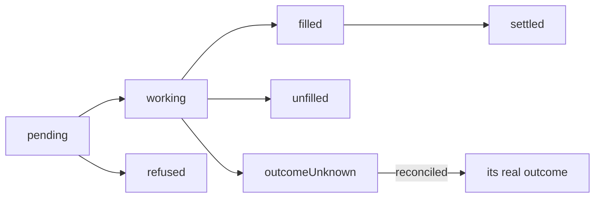

1. **Place** an order on a quote you hold with `POST /api/v1/orders`, with an `Idempotency-Key` you generate. It runs on the quote's terms.
2. **Follow** it at its `statusUrl`, or by the `order.updated` webhook, until `terminal` is `true`.
3. **Lost an answer?** Read it back by its quote with `GET /api/v1/orders/by-quote/{quoteId}`. Never order again.
4. **Cancel** it while it is still `pending`, before anything is sent.

Most orders take the top path. `outcomeUnknown` means the result is being reconciled; the trade may have filled. Every status, and what to do: [Order status](/trade/order-status). Full explanation: [Place an order](/trade/orders).
