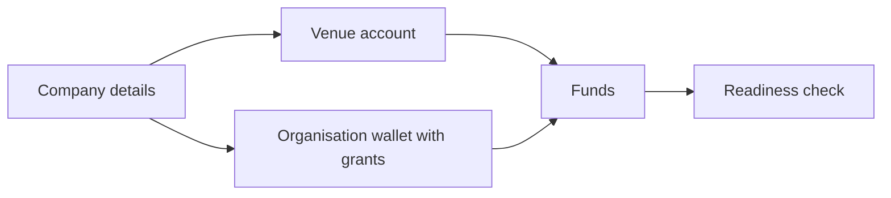

import MeOrganisationWallets from '/snippets/samples/me-organisation-wallets.mdx';

Quotes only need a key; an order also needs a workspace that may trade, an account or wallet to trade from and funds in it, set up once in the app.

## At a glance

| You need | Set it up | Check it |
| --- | --- | --- |
| [Company details](#complete-your-company-details) | **Company profile** in the app | `GET /api/v1/workspaces/{workspaceId}/capabilities` |
| [A venue account](#connect-a-venue-account) | **Counterparties** in the app | Its quotes carry `tradingSource.kind` `venueAccount` |
| [Funds](#fund-it) | Deposit to the account or wallet | [Balances](/trade/balances) |
| [Wallet grants](#give-a-key-organisation-wallets), for organisation wallets | The key's **Wallets** in the app | `GET /api/v1/me` |



## Complete your company details

A company, broker or liquidity provider workspace can request quotes, place orders and connect to counterparties once its legal name, country of incorporation, registration number and registered address are on file under **Company profile**. Until then, those requests answer `403 CAPABILITY_BLOCKED`.

<AccordionGroup>
  <Accordion title="Blockers and what to do">
    Each entry in `details.capabilityBlockers` names one thing to fix:

| Code | What to do |
| --- | --- |
| `BASE_PROFILE_INCOMPLETE` | Add the company details listed in `currentlyDue`. |
| `KYC_NOT_VERIFIED` | In a direct user's own workspace: complete the user's identity verification in the app. |
| A blocker you do not recognise | Follow its `message` and `unlockStep`. |

    A separate answer, `503 CAPABILITY_UNAVAILABLE` with `BASE_PROFILE_UNREADABLE`, means the company details could not be read just now: send the request again shortly.
  </Accordion>

  <Accordion title="Example refusal">
    ```json Refusal
    {
      "error": "CAPABILITY_BLOCKED",
      "message": "Add your company details (legal name, country of incorporation, registration number and registered address) in the TetraFi app under Company profile to start trading",
      "details": {
        "capabilityBlockers": [
          {
            "code": "BASE_PROFILE_INCOMPLETE",
            "unlockStep": "companyDetails",
            "currentlyDue": ["legalName", "jurisdiction", "registrationNumber", "registeredAddress"],
            "message": "Add your company details (…) in the TetraFi app under Company profile to start trading"
          }
        ]
      }
    }
    ```
  </Accordion>
</AccordionGroup>

## Connect a venue account

Someone who can manage your workspace's venues connects exchange and OTC venue accounts in the app:

<Steps>
  <Step title="Choose the provider">
    Open **Counterparties**, choose the venue's liquidity provider and select **Set up \<provider\> account**.
  </Step>

  <Step title="Enter the account">
    Work through **Integration mode**, **Account** and **Venues**, entering the credentials the venue asks for.
  </Step>

  <Step title="Verify">
    In **Verification**, TetraFi checks each venue you added. Select **Check again** to repeat a check, then **Review setup**.
  </Step>
</Steps>

Its quotes then appear for members and keys allowed to trade on venue accounts, with `tradingSource.kind` `venueAccount`. Without an account, a venue reads `unavailable` with `notConnected`.

## Fund it

A Basic order spends what the account or wallet already holds. A quote whose `next.kind` is `fund` has a paying account short by `readiness.amount`.

<Accordion title="Deposits and shortfalls">
  - `GET …/venue-accounts/{venueAccountId}/deposit-instructions` lists where an exchange account takes deposits; [Balances](/trade/balances) shows what each account holds.
  - An order on a `fund` quote is refused with `409 FUNDING_SHORTFALL`: fund the account, then get a new price.
</Accordion>

## Give a key organisation wallets

An API key trades from an organisation wallet only when the wallet is granted to it, and only with venue trading ([Authentication](/authentication#trade-on-your-venue-accounts)); venue accounts need no wallet grant. Granted wallets appear in the key's [`sourceOptions`](/trade/wallets-and-accounts#read-sourceoptions).

<AccordionGroup>
  <Accordion title="Grant or revoke a wallet">
    Create API key with venue trading grants your workspace's default organisation wallets that you hold a Trade right on. To change it, open **Settings**, **Open API keys** under **Personal API keys**, expand the key and choose **Wallets**: **Grant** adds a wallet, **Revoke** removes one.
  </Accordion>

  <Accordion title="Who can grant what">
    - The key's owner can grant the workspace's default organisation wallets they hold a Trade right on, and revoke any grant. Another wallet is refused with `API_KEY_ORGANISATION_WALLET_NOT_A_DEFAULT`, one without your Trade right with `API_KEY_ORGANISATION_WALLET_TRADE_RIGHT_REQUIRED`.
    - A workspace owner, or an admin who manages credentials, can grant any active organisation wallet of the workspace. This is the only way a service-account key gets wallets.
    - Every change needs a sign-in with a second factor (otherwise `MFA_REQUIRED`), in the app: a key cannot change its own grants.
    - At trade time the key's owner still needs trading rights on the wallet, and the key needs Read quotes and Submit orders. An admin-granted wallet its owner cannot trade is refused.
  </Accordion>

  <Accordion title="Before a wallet is granted">
    Until then, on-chain Basic venues read `unavailable` with `apiKeyOrganisationWalletScopeRequired` or `onchainWalletNotUsable`.
  </Accordion>
</AccordionGroup>

## Check readiness from your backend

`GET /api/v1/me` describes the key, including its `organisationWallets` trading authority. `venueTradeScope` and `venueTradeEnabled` must both be `true` for quotes from your venue accounts.

<MeOrganisationWallets />

```json Output on test networks expandable
{"venueTradeScope":true,"venueTradeEnabled":true,"requestSigningRequired":true,"grants":[],"blockedBy":"API_KEY_ORGANISATION_WALLET_SCOPE_REQUIRED"}
```

<AccordionGroup>
  <Accordion title="organisationWallets fields">
| Field | What it says |
| --- | --- |
| `venueTradeScope`, `venueTradeEnabled` | The key holds venue trading and it is switched on. Both must be `true` for quotes from your venue accounts. |
| `requestSigningRequired` | Every request with the key must be signed. |
| `grants` | The organisation wallets granted to the key, each with the `financialAccountId` that `source.tradingWallets` takes. |
| `blockedBy` | When present, the code an order from an organisation wallet would be refused with now, such as `API_KEY_ORGANISATION_WALLET_SCOPE_REQUIRED`. |

    `503 API_KEY_ORGANISATION_WALLET_AUTHORITY_UNAVAILABLE` means the grants could not be read, never an empty list: retry shortly.
  </Accordion>

  <Accordion title="Workspace capabilities">
    `GET /api/v1/workspaces/{workspaceId}/capabilities` (Read compliance permission) says whether each capability, such as `request_quotes` or `submit_order`, is `allowed`, with the same `blockers` when not. The quote and order routes enforce the same decision.
  </Accordion>
</AccordionGroup>

## Next

<CardGroup cols={2}>
  <Card title="Quickstart" icon="rocket" href="/quickstart">
    Place your first order, with a small amount.
  </Card>

  <Card title="Authentication" icon="key" href="/authentication">
    Permissions, venue trading and request signing.
  </Card>
</CardGroup>
