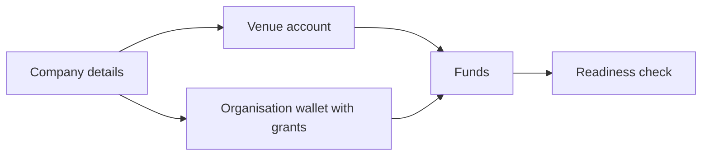

import MeOrganisationWallets from '/snippets/samples/me-organisation-wallets.mdx';

You set your workspace up **once**, in the app; after that your backend only quotes and orders. Quotes need company details on file; an order also needs a funded account or wallet:

| You need | Set it up in the app | Check it |
| --- | --- | --- |
| [Company details](#complete-your-company-details) | **Company profile** | [`GET …/capabilities`](#check-readiness-from-your-backend), or a quote's refusal |
| [A venue account](#connect-a-venue-account) | **Counterparties** | Quotes carry `tradingSource.kind` `venueAccount` |
| [Funds](#fund-it) | Deposit to the account or wallet | [Balances](/trade/balances) |
| [Wallet grants](#give-a-key-organisation-wallets) (organisation wallets only) | The key's **Wallets** | [`GET /api/v1/me`](/api-reference/auth/get-current-credential) |



## Complete your company details

Add your legal name, country of incorporation, registration number and registered address under **Company profile**. Until then, a company, broker or liquidity provider workspace gets `403 CAPABILITY_BLOCKED` on quotes, orders and connections.

<AccordionGroup>
  <Accordion title="Blockers and what to do">
    Each entry in `details.capabilityBlockers` names one thing to fix:

| Code | What to do |
| --- | --- |
| `BASE_PROFILE_INCOMPLETE` | Add the company details listed in `currentlyDue`. |
| `KYC_NOT_VERIFIED` | In a direct user's own workspace: complete the user's identity verification in the app. |
| A blocker you do not recognise | Follow its `message` and `unlockStep`. |

    A separate answer, `503 CAPABILITY_UNAVAILABLE` with `BASE_PROFILE_UNREADABLE`, means the company details could not be read just now: send the request again shortly.
  </Accordion>

  <Accordion title="Example refusal">
    ```json Refusal (shortened: docUrl, retryable and timestamp left out)
    {
      "error": "CAPABILITY_BLOCKED",
      "message": "Add your company details (legal name, country of incorporation, registration number and registered address) in the TetraFi app under Company profile to start trading",
      "details": {
        "capabilityBlockers": [
          {
            "code": "BASE_PROFILE_INCOMPLETE",
            "unlockStep": "companyDetails",
            "currentlyDue": ["legalName", "jurisdiction", "registrationNumber", "registeredAddress"],
            "message": "Add your company details (…) in the TetraFi app under Company profile to start trading"
          }
        ]
      }
    }
    ```
  </Accordion>
</AccordionGroup>

## Connect a venue account

You onboard with the liquidity provider off-platform; TetraFi adds no step or approval. Someone who manages your venues connects the account with the key you hold:

<Steps>
  <Step title="Open the liquidity provider">
    Find it in **Counterparties**.
  </Step>

  <Step title="Add your key">
    On the venue's row, enter the API key it issued you and anything it asks alongside.
  </Step>

  <Step title="Verify">
    TetraFi checks the key and reads the venue's whitelisted addresses into Treasury. Trading then turns on.
  </Step>
</Steps>

Quotes from it reach members and keys with [venue trading](/authentication#trade-on-your-venue-accounts). Without an account, the venue reads `unavailable` with `notConnected`.

Once connected, its pairs appear in [`GET /api/v1/pairs`](/api-reference/trading/list-pairs): list the pairs from the asset you sell, then quote one.

<Accordion title="Pairs another venue would add">
  `availability=connectable` lists the pairs that only a venue you have not connected, or one still being set up or paused, would trade, each with that venue in `connectableVenues`. A venue that lists its pairs only once you connect it appears in `unreachable` with `reason` `listedAfterConnection`.
</Accordion>

## Fund it

A Basic order spends what the account or wallet already holds. A quote that is short says `next.kind` `fund`.

<Accordion title="Shortfalls and deposits">
  The quote is short by `readiness.amount`; ordering it answers `409 FUNDING_SHORTFALL`. Fund the account, then get a new price.

  [`GET /api/v1/workspaces/{workspaceId}/venue-accounts/{venueAccountId}/deposit-instructions`](/api-reference/venue-accounts/get-deposit-instructions) lists where an exchange account takes deposits. The `venueAccountId` is the `accountId` of the account's entry in [`GET /api/v1/workspaces/{workspaceId}/venue-enablements`](/api-reference/venue-enablements/list-venue-accounts). [Balances](/trade/balances) shows what each account holds.
</Accordion>

## Give a key organisation wallets

A key trades from an organisation wallet only once the wallet is granted to it. Venue accounts need no grant. Granted wallets appear in the key's [`sourceOptions`](/trade/wallets-and-accounts#read-sourceoptions); until then, on-chain Basic venues read `unavailable` with `apiKeyOrganisationWalletScopeRequired` or `onchainWalletNotUsable`.

<AccordionGroup>
  <Accordion title="Grant or revoke a wallet">
    Create API key with venue trading grants your workspace's default organisation wallets that you hold a Trade right on. To change it, open **Settings**, **Open API keys** under **Personal API keys**, expand the key and choose **Wallets**: **Grant** adds a wallet, **Revoke** removes one.
  </Accordion>

  <Accordion title="Who can grant what">
    - The key's owner can grant the workspace's default organisation wallets they hold a Trade right on, and revoke any grant. Another wallet is refused with `API_KEY_ORGANISATION_WALLET_NOT_A_DEFAULT`, one without your Trade right with `API_KEY_ORGANISATION_WALLET_TRADE_RIGHT_REQUIRED`.
    - A workspace owner, or an admin who manages credentials, can grant any active organisation wallet of the workspace. This is the only way a service-account key gets wallets.
    - Every change needs a sign-in with a second factor (otherwise `MFA_REQUIRED`), in the app: a key cannot change its own grants.
    - At trade time the key's owner still needs trading rights on the wallet, and the key needs Read quotes and Submit orders. A wallet an admin granted to the key, which the key's owner cannot trade, is refused.
  </Accordion>

</AccordionGroup>

## Check readiness from your backend

`GET /api/v1/me` shows the key's `organisationWallets` authority. Quotes from your venue accounts need `venueTradeScope` and `venueTradeEnabled` both `true`.

<MeOrganisationWallets />

```json Example output
{"venueTradeScope":true,"venueTradeEnabled":true,"requestSigningRequired":true,"grants":[],"blockedBy":"API_KEY_ORGANISATION_WALLET_SCOPE_REQUIRED"}
```

<AccordionGroup>
  <Accordion title="organisationWallets fields">
| Field | What it says |
| --- | --- |
| `venueTradeScope`, `venueTradeEnabled` | The key holds venue trading, and it is switched on. |
| `requestSigningRequired` | Every request with the key must be signed. |
| `grants` | The organisation wallets granted to the key, each with the `financialAccountId` that `source.tradingWallets` takes, the wallet's `family` (`evm`, `solana`, `tron` or `bitcoin`) and its `networks`: each CAIP-2 `network` with `enabled`, and when it was last switched (`changedAt`, `changedBy`). `networksUnreadable` names why they could not be read, such as `WALLET_NETWORKS_UNAVAILABLE`; then `networks` is empty, which never means "no networks". |
| `blockedBy` | When present, the code an order from a wallet TetraFi signs for would be refused with now, such as `API_KEY_ORGANISATION_WALLET_SCOPE_REQUIRED`. |
| `clientSigned` | The External wallets the key trades from by signing each step itself (no grant needed): `wallets` (each `financialAccountId`, at most 100; `truncated` is `true` when there are more) and its own `blockedBy`, such as `VENUE_TRADE_SCOPE_REQUIRED`. |

    `503 API_KEY_ORGANISATION_WALLET_AUTHORITY_UNAVAILABLE` means the grants could not be read, never an empty list: retry shortly.
  </Accordion>

  <Accordion title="Workspace capabilities">
    `GET /api/v1/workspaces/{workspaceId}/capabilities` (Read compliance permission) says whether each capability, such as `request_quotes` or `submit_order`, is `allowed`, with the same `blockers` when not. The quote and order routes enforce the same decision.
  </Accordion>
</AccordionGroup>

Next: [place your first order](/quickstart).
