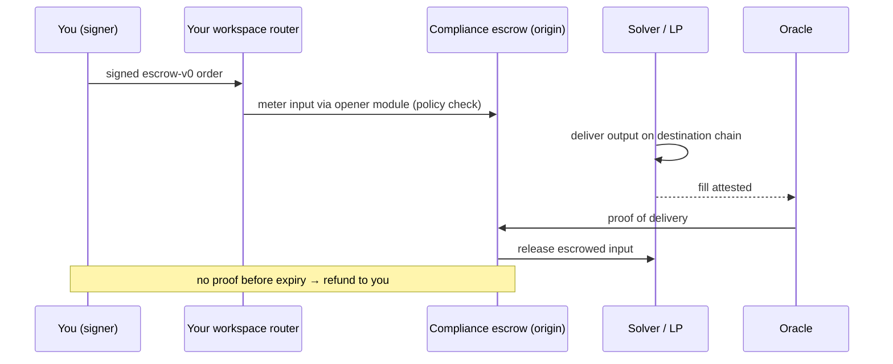

import ComingSoon from '/snippets/coming-soon.mdx';

<ComingSoon />

Advanced execution is not open yet: today every order is Basic, executed on your venue accounts or from organisation wallets granted to your key, without these contracts ([Basic execution](/overview#how-a-trade-works)). With Advanced, each workspace will get its **own on-chain router**, and trades will settle delivery-versus-payment through a compliance-gated escrow: the counterparty delivers, or you are refunded.

| Planned | How it is designed to work |
| --- | --- |
| Custody | TetraFi will hold no custody key and no upgrade key anywhere in the stack |
| Settlement | Funds release only against a proof of delivery |
| Refunds | No proof before expiry refunds your input, through a path no one can pause |

## The Contract Stack

Your router will feed shared venue modules, which open a compliance escrow; a settlement oracle proves delivery back to it.

<AccordionGroup>
  <Accordion title="Each contract's role">
|                        | Role                                                                            |
| ---------------------- | ------------------------------------------------------------------------------- |
| **Workspace router**   | One immutable contract per workspace. Pulls inputs transiently, meters them into modules, forwards fills to the recipient. |
| **Venue modules**      | Shared immutable modules: escrow opening, swaps, bridge legs, FX continuations. Capabilities are *added* to the allowlist, never swapped out. |
| **Compliance escrow**  | `ComplianceSettlerEscrow`. Locks inputs under the signed order, enforces the policy at deposit, releases on proof of delivery, refunds on expiry. Its output-side twin gates fills on the destination chain. |
| **Settlement oracle**  | Attests destination-chain delivery back to the origin escrow, so funds release only against proof. |
  </Accordion>

  <Accordion title="Addresses">
    Never send funds directly to a settlement address. Value will move only through a signed order's flow.

    Your router's address is deterministic, predicted before deployment, and yours permanently. Module and escrow addresses vary by chain and version. Never hardcode any of them: the addresses in quote responses will be authoritative.
  </Accordion>
</AccordionGroup>

## Settlement Lifecycle

An Advanced quote will carry its own EIP-712 `escrow-v0` payload. Your signature authorizes it, your router locks the input into escrow on those terms, and only a delivery proof moves the funds onward.

<Accordion title="Sequence and refunds">

If the expiry passes without a delivery proof, the escrow refunds your input through a path that is **permissionless and unpausable**. There is never a half-settled state.
</Accordion>

<AccordionGroup>
  <Accordion title="Funding locks">
The order will select the lock for the corridor and token.

| Lock type     | Description                                                          | Requires            |
| ------------- | -------------------------------------------------------------------- | ------------------- |
| Permit2       | The signature carries the pull authorization; no extra transaction   | One-time Permit2 approval |
| EIP-3009      | `transferWithAuthorization` for tokens that support it (e.g. USDC)   | No prior approval   |
| Resource lock | Pre-positioned balance drawn per order                               | Prior deposit       |
  </Accordion>

  <Accordion title="Signed payloads">
    Each quote names your next step in `next`. When that step is `sign`, `next.typedData` is the complete EIP-712 document - for `escrow-v0`, the `StandardOrder` typed data - and you sign exactly what it returns, then place the order. When an order needs more than one signature, the quote says how many in `signaturesRequired` and the later ones arrive on the order. Signing flows: [Orders](/trade/orders), [Quickstart](/quickstart).
  </Accordion>

  <Accordion title="Planned on the rails">
    - **Bonded firm quotes** - a proven no-show refunds you; the bond is slashed only on positive evidence
    - **A governed compliance plane** - a delayed main lane and an instant emergency lane
    - **Per-corridor settlement oracles**
    - **An add-only module catalogue** - a refund is bound to the version that opened the trade
    - **The same escrow model on Solana and Tron**
  </Accordion>

  <Accordion title="Netting and shared collateral">
    [Multilateral Netting](/netting) and the [Shared Collateral Network](/collateral) are also coming soon, in design. A settlement opted into clearing will post an **obligation**, and only the net residual later takes the escrow path above. A vault **draw** will fund a fill or settlement leg through the same opener and escrow, whose release repays the vault. Integration shapes: [netting](/netting-api/introduction), [shared collateral](/collateral-api/introduction).
  </Accordion>
</AccordionGroup>

Build on Basic today: [Quickstart](/quickstart) · [API reference](/api-reference/intros/orders)
