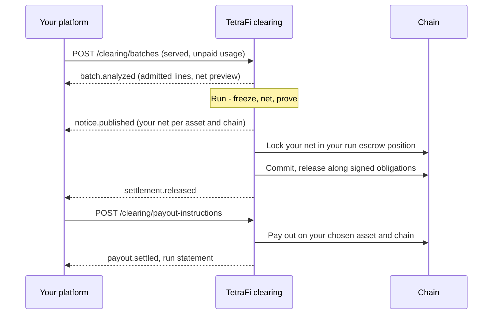

<Note>
  **Coming soon.** Agentic Netting opens to design partners first. Paths, field names, and schemas below are the planned shape; final versions publish at launch.
</Note>

Why it pays: [Agentic Netting](/netting/agentic-netting). Everything not on this page is the standard [Integration](/netting-api/integration).

## Batches From Your Stack

* **Your stack already holds the book** - who used what, against which signed authorization.
* **Export it as batches** to `POST /clearing/batches`, wrapping the native records - x402 payments and batch-settlement channels, payment-channel vouchers, and similar batched agent payments - without changing how they are signed.
* **Nothing moves out of your stack** - your facilitator, wallets, signers, and custody stay where they are.

Only one state nets:

| State | Nets? |
| --- | --- |
| Authorized, not yet used | No - a signature alone is not a debt |
| **Served, not yet paid** | **Yes - the only netting candidate** |
| Already paid | No - it reconciles, never nets twice |
| Owed onward, as a payout | No - a payout instruction pays it |

* **Cumulative vouchers count only their new delta** - a revision replaces the previous frontier, it is not a second debt.
* **Duplicates drop by the payment's own identity** - channel and frontier, or authorization nonce - not only by your request key.

## The Flow



## Analyze Before You Execute

Start with `mode: analyze`: send real batches, get back what would have netted, execute nothing. An illustrative batch request, with one of two items shown:

```json Batch (request)
{
  "mode": "analyze",
  "circuit": { "network": "eip155:8453", "asset": "USDC" },
  "items": [{
    "externalRef": "channel-A-B/frontier-7",
    "debtorRef": "member-A",
    "creditorRef": "member-B",
    "state": "accepted_unsettled",
    "amountAtomic": "100000000",
    "deadline": "2026-11-02T12:00:00Z",
    "nativeEvidence": { "digest": "sha256:..." }
  }]
}
```

For example, two opposing obligations of 100 and 80 USDC leave 20 USDC to fund after set-off. This is an explanation of the calculation, not a public API response shape. The [API overview](/overview) describes the current public API.

**From analysis to execution**, you need:

* each counterparty's **consent** to settle by set-off;
* **eligibility** for the signed-obligation lane;
* a **fence** so the original payment can't also be redeemed;
* **authority to fund** the residual;
* an agreed way to **prove a debt settled outside**.

## Payouts on Any Chain

* **Any asset, any chain** - a payout instruction sends the residual, or any funded receipt, to the asset and chain you choose over any [supported corridor](/supported-chains): `POST /clearing/payout-instructions`.
* **Agents stay inside their envelope** - when one of your agents calls it, every [envelope](/core-concepts/agents) check still applies: sponsor, expiry, kill switch, asset, chain, and destination limits.

**Key fields:** source receipts, destination asset and chain, minimum output, fee ceiling, deadline, refund address, callback.

## You Stay the Member

* **Your platform is the counterparty of record** - your agents and end users never become nodes on the graph.
* **Agents are delegates** acting inside sponsored envelopes, never parties to a debt.
* **Money moves only along existing obligations** - net positions always come with permitted transfer legs, and importing a payment signature never creates a new counterparty.

## No Facilitator Yet?

Run on TetraFi as your x402 facilitator: standard verify and settle for every payment, and netting for payments made under a deferred scheme your payers authorized.

<CardGroup cols={2}>
  <Card title="Integration" icon="plug" href="/netting-api/integration">
    The five touchpoints every member wires.
  </Card>

  <Card title="Register Interest" icon="sparkles" href="/support">
    Join the design partners integrating first.
  </Card>
</CardGroup>
