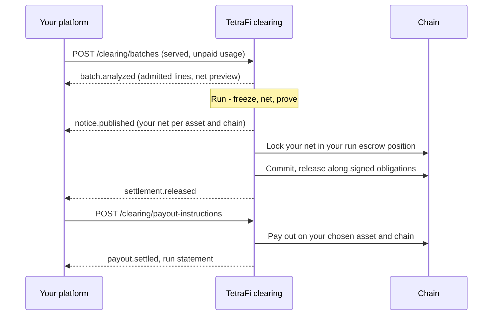

<Note>
  **Coming soon.** Agentic Netting opens to design partners first. Paths, field names, and schemas below are the planned shape; final versions publish at launch.
</Note>

Why it pays: [Agentic Netting](/netting/agentic-netting). Everything not on this page is the standard [Integration](/netting-api/integration).

## Batches From Your Stack

Your facilitator or channel store already holds the book: who used what, against which signed authorization. You export it as batches to `POST /clearing/batches`, wrapping the native records - x402 payments and batch-settlement channels, payment-channel vouchers, and similar batched agent payments - without changing how they are signed. Your facilitator, wallets, signers, and custody stay where they are.

Only one state nets:

| State | Nets? |
| --- | --- |
| Authorized, not yet used | No - a signature alone is not a debt |
| **Served, not yet paid** | **Yes - the only netting candidate** |
| Already paid | No - it reconciles, never nets twice |
| Owed onward, as a payout | No - a payout instruction pays it |

A cumulative voucher counts only its new delta: a revision replaces the previous frontier, it is not a second debt. Duplicates drop by the payment's own identity - channel and frontier, or authorization nonce - not only by your request key.

## The Flow



## Analyze Before You Execute

Start with `mode: analyze`: send real batches, get back what would have netted, execute nothing. Illustrative shapes, with one of two items shown:

<CodeGroup>
```json Batch (request)
{
  "mode": "analyze",
  "circuit": { "network": "eip155:8453", "asset": "USDC" },
  "items": [{
    "externalRef": "channel-A-B/frontier-7",
    "debtorRef": "member-A",
    "creditorRef": "member-B",
    "state": "accepted_unsettled",
    "amountAtomic": "100000000",
    "deadline": "2026-11-02T12:00:00Z",
    "nativeEvidence": { "digest": "sha256:..." }
  }]
}
```

```json Analysis (result)
{
  "status": "analyzed",
  "executable": false,
  "grossAtomic": "180000000",
  "dischargedBySetOffAtomic": "160000000",
  "positions": [
    { "memberRef": "member-A", "netDebitAtomic": "20000000" },
    { "memberRef": "member-B", "netCreditAtomic": "20000000" }
  ],
  "transferLegs": [
    { "debtorRef": "member-A", "creditorRef": "member-B", "amountAtomic": "20000000" }
  ],
  "requiredBeforeExecution": [
    "nettingConsent", "intakeEligibility", "grossRedemptionFence",
    "residualFundingAuthority", "agreedDischargeVerifier"
  ]
}
```
</CodeGroup>

Moving from analysis to execution adds what the result lists: each counterparty's consent to settle by set-off, eligibility for the signed-obligation lane, a fence so the original payment can't also be redeemed, authority to fund the residual, and an agreed way to prove a debt settled outside.

## Payouts on Any Chain

Agents earn on whichever chain the payer used. A payout instruction sends the residual, or any funded receipt, to the asset and chain you choose over any [supported corridor](/supported-chains): `POST /clearing/payout-instructions`.

**Key fields:** source receipts, destination asset and chain, minimum output, fee ceiling, deadline, refund address, callback.

When one of your agents calls it, every [envelope](/core-concepts/agents) check still applies: sponsor, expiry, kill switch, asset, chain, and destination limits.

## You Stay the Member

Your platform is the member and the counterparty of record; your agents and end users never become nodes on the graph. Agents are delegates acting inside sponsored envelopes, never parties to a debt. Net positions always come with permitted transfer legs - money moves only along obligations that already exist - and importing a payment signature never creates a new counterparty.

## No Facilitator Yet?

Run on TetraFi as your x402 facilitator: standard verify and settle for every payment, and netting for payments made under a deferred scheme your payers authorized.

<CardGroup cols={2}>
  <Card title="Integration" icon="plug" href="/netting-api/integration">
    The five touchpoints every member wires.
  </Card>

  <Card title="Register Interest" icon="sparkles" href="/support">
    Join the design partners integrating first.
  </Card>
</CardGroup>
