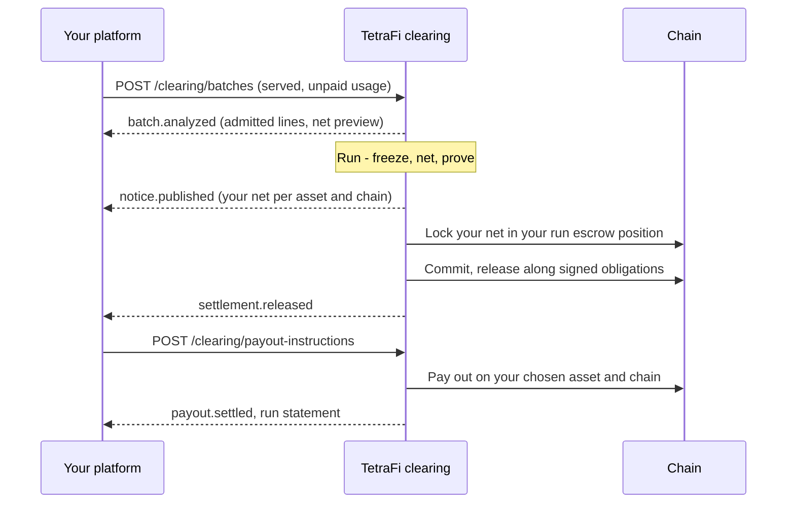

import ComingSoon from '/snippets/coming-soon.mdx';

<ComingSoon />

Your stack already holds the book: who used what, against which signed authorization. The agent platform integration is designed to take that book as batches, show you what would net before anything moves, and pay the residual out on the chain you choose. Everything not on this page is the standard [planned integration](/netting-api/integration); why it pays is on [Agentic Netting](/netting/agentic-netting). Paths, field names and schemas are the planned shape.

| You will add | Planned surface |
| --- | --- |
| Batches from your stack | `POST /clearing/batches` |
| A dry run first | `mode: analyze` |
| Payouts on any chain | `POST /clearing/payout-instructions` |

<AccordionGroup>
  <Accordion title="Batches from your stack">
    * **Export it as batches** to `POST /clearing/batches`, wrapping the native records - x402 payments and batch-settlement channels, payment-channel vouchers, and similar batched agent payments - without changing how they are signed.
    * **Nothing moves out of your stack** - your facilitator, wallets, signers, and custody stay where they are.

    Only one state nets:

| State | Nets? |
| --- | --- |
| Authorized, not yet used | No - a signature alone is not a debt |
| **Served, not yet paid** | **Yes - the only netting candidate** |
| Already paid | No - it reconciles, never nets twice |
| Owed onward, as a payout | No - a payout instruction pays it |

    * **Cumulative vouchers count only their new delta** - a revision replaces the previous frontier, it is not a second debt.
    * **Duplicates drop by the payment's own identity** - channel and frontier, or authorization nonce - not only by your request key.
  </Accordion>

  <Accordion title="The planned flow">

  </Accordion>

  <Accordion title="Analyze before you execute">
    You will start with `mode: analyze`: send real batches, get back what would have netted, execute nothing. The planned shape of a batch request, illustrative only, with one of two items shown:

```json Planned batch request (illustrative, not callable yet)
{
  "mode": "analyze",
  "circuit": { "network": "eip155:8453", "asset": "USDC" },
  "items": [{
    "externalRef": "channel-A-B/frontier-7",
    "debtorRef": "member-A",
    "creditorRef": "member-B",
    "state": "accepted_unsettled",
    "amountAtomic": "100000000",
    "deadline": "2026-11-02T12:00:00Z",
    "nativeEvidence": { "digest": "sha256:..." }
  }]
}
```

    For example, two opposing obligations of 100 and 80 USDC leave 20 USDC to fund after set-off. This is an explanation of the calculation, not a public API response shape. The [API overview](/overview) describes the current public API.

    **From analysis to execution**, you will need:

    * each counterparty's **consent** to settle by set-off;
    * **eligibility** for the signed-obligation lane;
    * a **fence** so the original payment can't also be redeemed;
    * **authority to fund** the residual;
    * an agreed way to **prove a debt settled outside**.
  </Accordion>

  <Accordion title="Payouts on any chain">
    * **Any asset, any chain** - a payout instruction sends the residual, or any funded receipt, to the asset and chain you choose over any [supported corridor](/supported-chains): `POST /clearing/payout-instructions`.
    * **Agents stay inside their envelope** - when one of your agents calls it, every [envelope](/core-concepts/agents) check still applies: sponsor, expiry, kill switch, asset, chain, and destination limits.

    **Key fields:** source receipts, destination asset and chain, minimum output, fee ceiling, deadline, refund address, callback.
  </Accordion>

  <Accordion title="You stay the member">
    * **Your platform is the counterparty of record** - your agents and end users never become nodes on the graph.
    * **Agents are delegates** acting inside sponsored envelopes, never parties to a debt.
    * **Money moves only along existing obligations** - net positions always come with permitted transfer legs, and importing a payment signature never creates a new counterparty.
  </Accordion>

  <Accordion title="No facilitator yet?">
    TetraFi is designed to act as your x402 facilitator: standard verify and settle for every payment, and netting for payments made under a deferred scheme your payers authorized.
  </Accordion>
</AccordionGroup>

Next: [Planned integration](/netting-api/integration) · [Register interest](/support) · Build today: [Quickstart](/quickstart) · [Platform status](/platform)
