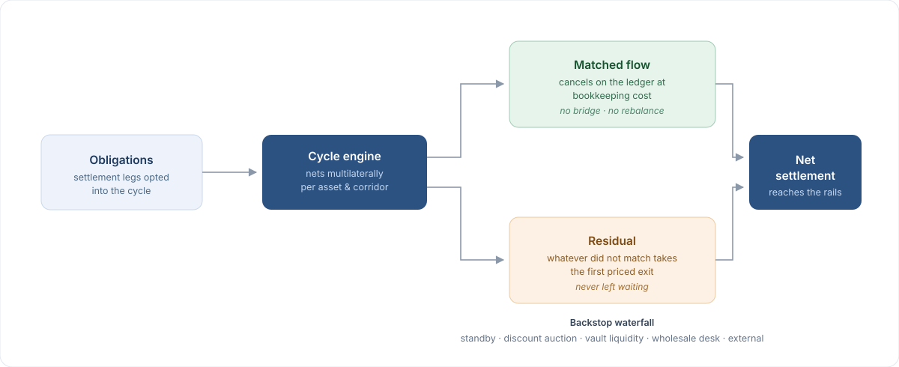

import ComingSoon from '/snippets/coming-soon.mdx';

<ComingSoon />

Multilateral Netting is designed so obligations collect on **one shared graph**, a run cancels what offsets, and only the net difference ever moves. Your wallet is touched once, for your net. This page describes the mechanism at the architecture level; cycle timing, discount schedules and fee splits are design decisions that publish at launch.

## Two ways to settle

A choice per settlement, whoever created the trade behind it:

|  | **Instant Settlement** | **Multilateral Netting** |
| --- | --- | --- |
| **The quote** | Firm, locked - today's price | Firm too, and tighter |
| **When funds move** | Now, in full | At a deadline you pick - only the net |
| **Your capital until then** | Spent | Yours, still working |
| **Across ten trades** | Ten settlements, ten tolls | One net amount moves - one toll |

<Accordion title="The full comparison">
|  | **Instant Settlement** | **Multilateral Netting** |
| --- | --- | --- |
| **The quote** | Firm, locked - today's price | Firm too, and tighter - less rebalancing, less capital, fewer transactions to price in |
| **When funds move** | Now, in full, exactly as quoted | At a deadline you pick - only the net difference moves |
| **Your capital until then** | Spent | Yours, still working - nothing pre-funded; only your net locks, and only in the lock window |
| **Debts cancel against** | Nothing - each leg settles alone | The whole network's opposing flow, not just this counterparty's |
| **What it costs** | The full settlement toll on that leg | One settlement on the net; the matched portion cancels at bookkeeping cost |
| **Across ten trades** | Ten settlements, ten tolls | Most cancel inside the run; one net amount moves - one toll |

* **Deadline tiers** - an hours-class tier or T+1 / T+2.
* **No lock-in** - need out early? A vault on the [Shared Collateral Network](/collateral) buys your position at its published discount.
* **Hold, don't move.** Your obligations net against the network's opposing flow - **opposite flows between chains and venues net instead of crossing** - so inventory stays where it sits.
</Accordion>

## The clearing run

Obligations collect by asset and <Tooltip tip="A direction of flow between two points - an asset moving from one chain or venue to another, e.g. USDC from Base to Arbitrum.">corridor</Tooltip>, gated by compliance policy and exposure caps. One signature records each debt; nothing leaves any wallet. Each run will take five steps:

<Steps>
  <Step title="Freeze" icon="snowflake">
    One snapshot everyone solves and can check.
  </Step>

  <Step title="Solve" icon="arrows-left-right">
    Loops cancel first; open chains clear with routed liquidity.
  </Step>

  <Step title="Prove" icon="badge-check">
    A validity proof, checked on-chain.
  </Step>

  <Step title="Notice" icon="bell">
    One number per asset and corridor. Silence accepts.
  </Step>

  <Step title="Lock and commit" icon="circle-check">
    Only your net locks; releases pay along obligations you signed.
  </Step>
</Steps>

<Frame caption="One run: obligations net multilaterally, the matched portion is extinguished on the record, and only the residual and the final net figure ever reach the rails.">
  
</Frame>

<AccordionGroup>
  <Accordion title="Each step in detail">
    * **Freeze** - **one snapshot** of open obligations, published liquidity, and one price per asset - everyone solves, and can check, the same input.
    * **Solve** - **loops cancel first**, with nothing moving; open chains then clear with a single unit of routed liquidity. Your consent and caps are constraints inside the maths, not filters after it.
    * **Prove** - the chain checks the proof, not the operator - a wrong answer cannot execute.
    * **Notice** - arithmetic over debts you already signed. Silence accepts; the same window is the objection window.
    * **Lock and commit** - **only your net locks**, in your own escrow position for the run. The commit runs over everything that locked and balances: set-offs and releases turn final together, and releases pay only along obligations you signed. A side that didn't lock drops out with whatever depended on it, is refunded, and carries to the next run - nothing is recomputed.
  </Accordion>

  <Accordion title="Untouched until the end">
    One obligation, birth to discharge - watch the wallet:

| Moment | Your wallet |
| --- | --- |
| **Accepted at T+0** | One signature - the debt, the lock authorization, its window. Nothing leaves. |
| **Runs pass** | Set-off only. A run your policy excludes it from carries it forward. Nothing moves. |
| **Notice** | Net positions publish; silence accepts. |
| **Lock** | The only moment your wallet is touched - and only for your net. |
| **Deadline** | Still unpaid after grace? The resolution ladder prices it out. |

    **Nothing is final before the cash it depends on is locked** - and a missing lock never unwinds anyone else.
  </Accordion>

  <Accordion title="Funding the net">
    * **At launch: your wallet.** Your net locks from it in the lock window.
    * **Later: ranked sources** - a yield position, an exchange balance, a bank rail last - each still locking only your net.
    * **Or settle outside, with proof** - both signatures, a custody balance change, or a proven receipt closes the obligation on the graph.
    * **A failed lock is loss-free** - that side drops out and is refunded, and the resolution ladder prices what remains. No margin calls, no cascade.
  </Accordion>

  <Accordion title="How a debt ends">
    Every obligation carries three numbers - **signed, set off, remaining** - and has **no edit path**: a correction is a signed offsetting entry, so the record itself can replace bilateral confirmations. Every ending is one you chose, proved, or priced:

| Ending | How |
| --- | --- |
| **Settled in a run** | Set off, released, or both - final at commit |
| **Settled outside** | Proven by evidence the pair agreed in advance |
| **Torn up** | Both parties sign - nobody cancels a debt alone |
| **Resolved at deadline** | The resolution ladder: standby funding, discount auction, vault liquidity, wholesale desk, external settlement at market cost |

    **A default hits the pair, never the pool** - you can only lose your own position with the defaulter, never a share of someone else's.
  </Accordion>

  <Accordion title="The netting premium">
    * **Cost scales with what settles, not what trades** - we plan on **40 to 55% of gross** netting out at the start, rising as the network densifies, and every spread priced against it tightens.
    * **Capital efficiency scales with it** - clearing the residual ties up a fraction of what gross settlement needs, and capital nobody has to hold is spread nobody has to pay.
  </Accordion>

  <Accordion title="The architecture">
    Trades keep settling on the per-chain rails they already use; **one clearing record on a coordination chain** sees only the legs participants opt in.

    <Frame caption="Per-chain rails plus one clearing record: the net figure can land on any domain the participant has configured.">
      
    </Frame>

    * **Obligation** - what is owed (asset, amount, corridor, counterparty), posted when a settlement opts into clearing.
    * **Net position** - what a run reduces your obligations to: one signed figure per asset and corridor.
    * **Settlement** - the only record that moves value: your net figure, sent to a domain you configured.

    **Flow of funds:** **instant** settlements move now, in full, through the normal escrow path. **Cleared** settlements post an obligation to the clearing record and wait there between runs. Matched flow cancels on the record; only residuals, and each participant's final net figure, reach the rails. Settlement is decoupled from routing: one settlement footprint across every chain you operate on.
  </Accordion>

  <Accordion title="Components">
    * **Clearing record** - each participant's obligations and net balances, by asset and corridor - on-chain, so the record outlives any operator.
    * **Clearing engine** - runs each run inside sealed hardware: nets obligations, prices the residual, emits net settlements - the only place the graph is ever readable.
    * **Verifier** - checks each run's validity proof on-chain before anything executes.
    * **Run escrow** - one position per payer per run, holding only that payer's locked net; it pays only along obligations the payer signed, or refunds the payer - no key of ours can send funds anywhere else.
    * **Backstop layer** - the priced exits for the residual: standby funding, discount auction, vault liquidity, wholesale desk conversion, external settlement.
    * **Compliance gates** - KYB, sanctions, and jurisdiction checks at membership and at every run entry - compliance can only exclude a pairing, never redirect money somewhere new.
    * **Spokes and messaging** - per-chain settlement endpoints where trades fill and net movements land, and the messaging layer that carries obligations in and net settlements out.
  </Accordion>
</AccordionGroup>

Next: [Where it applies](/netting/where-it-applies) · [Privacy and control](/netting/privacy-and-control) · [Planned integration](/netting-api/integration) · [Shared Collateral Network](/collateral) · Trade today: [Quickstart](/quickstart) · [Platform status](/platform)
