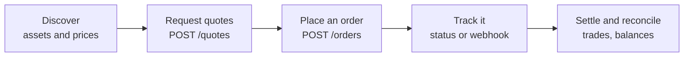

Your backend gets quotes from every venue at once, places orders and follows them to the end, as your team does in the TetraFi app.

## What you can do

<CardGroup cols={2}>
  <Card title="Get quotes" icon="magnifying-glass-dollar" href="/search/how-it-works">
    `POST /api/v1/quotes` 
    `GET /api/v1/prices`

    Every venue your workspace can use, ranked and net of fees.
  </Card>

  <Card title="Place orders" icon="arrow-right-arrow-left" href="/trade/orders">
    `POST /api/v1/orders` 
    `GET …/by-quote/{quoteId}`

    Order a held quote by its id, safely retried with an `Idempotency-Key`.
  </Card>

  <Card title="Track orders" icon="list-check" href="/trade/order-status">
    `GET /api/v1/orders/{orderId}` 
    `POST …/{orderId}/cancel`

    Follow each order until it is terminal.
  </Card>

  <Card title="Receive webhooks" icon="bell" href="/trade/webhooks">
    `POST …/webhooks`

    Signed order and trade updates pushed to your endpoint.
  </Card>

  <Card title="Trades and settlement" icon="scale-balanced" href="/trade/settlement-and-credit">
    `GET …/trades` 
    `GET …/settlement/plan`

    Your trade history and how each trade settles.
  </Card>

  <Card title="Balances and fees" icon="wallet" href="/trade/balances">
    `GET …/balances` 
    `GET …/fee-schedule`

    Balances, venue accounts, credit, deposits and your fees.
  </Card>

  <Card title="Authenticate" icon="key" href="/authentication">
    `X-API-Key` 
    `POST /api/v1/oauth/token`

    API keys, request signing and service accounts.
  </Card>

  <Card title="Every endpoint" icon="book-open" href="/reference/endpoints">
    All operations by task, with their scopes.
  </Card>
</CardGroup>

## How a trade works

Send one quote request: the asset you sell, the asset you buy and one exact amount. TetraFi asks every venue your workspace can use at once and returns comparable quotes, best first, net of fees.

| Step | Call | What happens |
| --- | --- | --- |
| Quote | `POST /api/v1/quotes` | Venues answer; each quote is held under its `id` until it expires. |
| Order | `POST /api/v1/orders` with `{"quoteId": "<id>"}` | Places the order on the held terms. You send the id, never a copy of the quote. |
| Follow | `GET` the order's `statusUrl`, or a [webhook](/trade/webhooks) | Read it until `terminal` is `true`. |
| Requote | `POST /api/v1/quotes` with `{"kind":"requote","requote":"<id>"}` | Asks the same venue again for fresh terms. |

Each quote's `next.kind` names your next step: `order`, `fund` (the paying account is short) or `requote`.

<AccordionGroup>
  <Accordion title="Which venues are asked">
    Venues include on-chain protocols and DEXs, bridges, solvers, and your connected exchange and OTC accounts. Each one considered is listed with its outcome, so a missing quote always has a reason.
  </Accordion>

  <Accordion title="Basic and Advanced execution">
    Every quote you can order today is Basic: TetraFi executes it for you from your exchange or OTC venue account, or an organisation wallet granted to your API key, inside the limits its owners approved. The order answers `"kind": "basicTrade"`.

    Advanced execution, where your own wallet signs and settles on-chain through TetraFi's settlement contracts, is not open yet. Advanced venues read `unavailable` with the reason `advancedModeDisabled` and are not asked, and an order on an Advanced quote answers `403 ADVANCED_MODE_DISABLED`. A quote's `legs[].venue.integrationMode` says which it is.
  </Accordion>

  <Accordion title="I want to…">
    | I want to… | Go to |
    | --- | --- |
    | Get a first quote in the sandbox | [Quickstart](/quickstart) |
    | Set up my workspace to order | [Before your first trade](/before-you-trade) |
    | Create a key and sign requests | [Authentication](/authentication) |
    | Give a backend its own identity | [Service accounts](/authentication#service-account-tokens) |
    | Request and compare quotes | [Request quotes](/search/how-it-works) |
    | Place an order | [Orders](/trade/orders) |
    | Follow an order to the end | [Order status](/trade/order-status), [Webhooks](/trade/webhooks) |
    | Retry without ordering twice | [Retries and recovery](/trade/orders#retries-and-recovery) |
    | Understand a refusal | [Errors](/trade/errors) |
    | Go to production | [Go-live checklist](/recipes/go-live-checklist) |
  </Accordion>
</AccordionGroup>

## Environments

| Environment | Base URL | Use it for |
| --- | --- | --- |
| Sandbox | `https://api-dev.tetrafi.io` | Testing on test networks, with testnet assets and your sandbox and testnet venue accounts. Makers are not simulated. |
| Production | `https://api.tetrafi.io` | Real assets and venue accounts. Opens at launch. |

Keys, workspaces and venue accounts belong to one environment: create sandbox keys in the sandbox app at `https://dev.tetrafi.io`. Samples read the base URL from `TETRAFI_BASE_URL`, so they run in either.

## Next

<CardGroup cols={2}>
  <Card title="Quickstart" icon="rocket" href="/quickstart">
    Create a key, get quotes and place a small sandbox order.
  </Card>

  <Card title="Before your first trade" icon="list-check" href="/before-you-trade">
    Company details, a venue account, funds and wallet grants.
  </Card>
</CardGroup>
