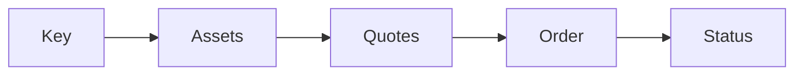

import QuickstartClient from '/snippets/samples/quickstart-client.mdx'
import QuickstartAssets from '/snippets/samples/quickstart-assets.mdx'
import QuickstartQuote from '/snippets/samples/quickstart-quote.mdx'
import QuickstartOrder from '/snippets/samples/quickstart-order.mdx'
import QuickstartStatus from '/snippets/samples/quickstart-status.mdx'
import TestSafelyMinimums from '/snippets/samples/test-safely-minimums.mdx'

Get quotes on 10 USDC to USDT from every venue your workspace can use, and order the best one.

## At a glance

| Call (permission) | Result |
| --- | --- |
| `GET /api/v1/assets` (Read quotes) | The assets you can trade. |
| `POST /api/v1/quotes` (Read quotes and Submit orders) | A quote per venue, and every venue's outcome in `sources`. |
| `POST /api/v1/orders` (Submit orders) | An order and its `statusUrl`. |
| `GET` the `statusUrl` (Read orders) | The order, until `terminal` is `true`. |



To quote, your workspace needs its company details on file; to order, also a venue account or wallet with funds ([Before your first trade](/before-you-trade)).

<Accordion title="Tools and code samples">
  The cURL, Node.js and Python tabs show the API calls of one full script per language ([below](#run-the-full-script)): run it whole, since it also signs requests, checks inputs and saves the order record. cURL needs `bash`, `curl`, `jq`, `openssl` and `bc` (for exact decimal arithmetic); the Node.js (18 or later) and Python (3.8 or later) scripts need no third-party packages. The tab for the TypeScript SDK (not published yet; see [SDK and samples](/sdk)) quotes USDC for ETH and waits for the order to end.
</Accordion>

<Steps>
  <Step title="Get a key">
    At `https://app.tetrafi.io`, create a personal API key with Read quotes, Submit orders, Read orders and Venue trading. Store its API Key and Request-signing secret separately: both are shown once.

    <Accordion title="Where to click">
      Sign in with a second factor, in a role that can request quotes and place orders ([who can turn on venue trading](/authentication#trade-on-your-venue-accounts)).

      1. Open **Settings**, find **Personal API keys** under **Your account**, then select **Open API keys** and **Create key**.
      2. Enter a **Name**, and under **Permissions** tick **Read quotes**, **Submit orders** and **Read orders**.
      3. Switch **Venue trading** on and select **Create key**. It lets TetraFi trade on your venue accounts with this key, and turns on request signing.
      4. Copy **API Key** and **Request-signing secret** to your secret manager, separately: both are shown once.

      [Authentication](/authentication) explains each permission.
    </Accordion>
  </Step>

  <Step title="Set your environment">
    ```bash
    export TETRAFI_BASE_URL=https://api.tetrafi.io
    export TETRAFI_API_KEY=...                           # from your secret manager
    export TETRAFI_SIGNING_SECRET=...                    # the key's signing secret
    export TETRAFI_WORKSPACE_ID=...                      # the TypeScript SDK example needs it
    ```

    <Accordion title="The request helper and the workspace id">
      cURL needs no workspace id: the key implies it. The SDK does: find it under workspace settings, **General**, **Workspace ID**.

      The code below sends each request with your key, pins the API version with `TetraFi-Version` ([Versioning](/reference/conventions#versioning)) and [signs it](/authentication#sign-requests). It stops on a transport error or non-2xx status, printing the body. Requests time out after 60 seconds.

      <QuickstartClient />
    </Accordion>
  </Step>

  <Step title="List the assets you can trade">
    `GET /api/v1/assets` pages through the assets your workspace can trade: follow `nextCursor` until both sides of your pair are listed.

    <QuickstartAssets />

    ```json Response (shortened) expandable
    {
      "items": [
        {
          "asset": "USDC",
          "assetSymbol": "USDC",
          "name": "USD Coin",
          "kind": "stablecoin",
          "variants": [
            { "kind": "native", "name": "USDC", "deployments": [{ "network": "eip155:8453", "decimals": 6 }] }
          ]
        }
      ]
    }
    ```
  </Step>

  <Step title="Request quotes and pick the best">
    `POST /api/v1/quotes` asks every venue your workspace can use for one pair and `sellAmount`, the exact amount you sell ([Request quotes](/search/how-it-works)). Take the first quote whose `next.kind` is `order`; if none is, read `sources` ([below](#if-something-goes-wrong)). On your first real trade, set `TETRAFI_VENUES` to the venue you connected and check the quote's venue, amounts and expiry.

    <QuickstartQuote />

    ```json Response (shortened) expandable
    {
      "quoteRequestId": "rq_01M5…",
      "venueAsked": true,
      "quotes": [
        {
          "id": "q_01M5…",
          "legs": [{ "venue": { "id": "binance-orderbook", "integrationMode": "basic" } }],
          "quality": "executable",
          "firm": false,
          "sell": { "asset": "USDC", "network": null, "amount": "10" },
          "buy": { "asset": "USDT", "network": null, "amount": "10.0134" },
          "minOut": "9.9833",
          "minReceiveRequired": true,
          "next": { "kind": "order" },
          "expiresAt": "2026-10-27T00:43:10.213Z"
        }
      ],
      "sources": [
        { "venue": { "id": "binance-orderbook" }, "status": "answered" },
        { "venue": { "id": "across" }, "status": "unsupported", "reason": "pairNotServed" }
      ]
    }
    ```
  </Step>

  <Step title="Place the order">
    `POST /api/v1/orders` with the quote id and an `Idempotency-Key` you generate places the order on the held terms. Before sending, save `{quoteId, idempotencyKey, exactBody}` to `./tetrafi-order-<quoteId>.json`, readable only by you, and keep it ([Retries and recovery](/trade/orders#retries-and-recovery)).

    <Warning>
    An order cannot be undone; in production it trades real assets. The cURL step orders only with `TETRAFI_PLACE_ORDER=1`: start with the [smallest amount the venue takes](#find-the-smallest-amount-a-venue-takes).
    </Warning>

    <Accordion title="When the quote needs minReceive">
      When `minReceiveRequired` is `true`, also send [`minReceive`](/trade/orders#minimum-receive): the quoted `buy.amount` less your slippage (`TETRAFI_SLIPPAGE_BPS`, default 50 basis points), rounded down to the asset's decimals.
    </Accordion>

    <QuickstartOrder />

    ```json Response (shortened) expandable
    {
      "kind": "basicTrade",
      "orderId": "acb8…",
      "quoteId": "q_01M5…",
      "status": "working",
      "terminal": false,
      "statusUrl": "/api/v1/orders/acb8…",
      "operation": { "connectionId": "1586…", "operationId": "acb8…" }
    }
    ```
  </Step>

  <Step title="Read the status">
    Read the order at its `statusUrl` until `terminal` is `true` (each script reads once); `outcomeUnknown` is not a failure ([Order status](/trade/order-status)). The app shows the trade under **Trades**.

    <QuickstartStatus />

    ```json Output expandable
    {"kind":"basicTrade","status":"filled","terminal":true,"next":null,"idempotencyKey":"bef0…"}
    ```
  </Step>
</Steps>

## Find the smallest amount a venue takes

Quotes cost nothing. Sell the smallest amount a venue answers in your first order.

<Accordion title="Probe 1, 5, 10 and 25 USDC">
  Quote 1, 5, 10 and 25 USDC, one request every 3 seconds, and note the smallest amount each venue answers. Nothing is ordered.

  <TestSafelyMinimums />

  ```json Example output (shortened)
  {"venue":"binance-orderbook","smallest":"5"}
  {"venue":"bebop","smallest":null,"triedUpTo":"25","status":"unavailable","reason":"apiKeyOrganisationWalletScopeRequired"}
  {"venue":"keyrock-rfq","smallest":null,"triedUpTo":"25","status":"unsupported","reason":"pairNotServed"}
  ```

  A venue that needs more reads a reason such as `sizeNotEligible` or `amountBelowMinimum`. Use that minimum as the amount you sell in your first order.
</Accordion>

## If something goes wrong

<Accordion title="No quote can be ordered">
    Read each venue's `status` and `reason` in `sources`:

| `status` and `reason` | What to do |
| --- | --- |
| `restricted`, `venueTradeScopeRequired` | Use a key with [venue trading](/authentication#trade-on-your-venue-accounts). |
| `unavailable`, `notConnected` | [Connect a venue account](/before-you-trade#connect-a-venue-account), or ignore that venue. |
| `unavailable`, `apiKeyOrganisationWalletScopeRequired` or `onchainWalletNotUsable` | [Grant the key organisation wallets](/before-you-trade#give-a-key-organisation-wallets). |
| `unavailable`, `advancedModeDisabled` | Nothing: the venue is Advanced, which is not open yet. |
| `unsupported`, `pairNotServed` | Nothing, or try another pair. |
| A quote whose `next.kind` is `fund` | The account holds less than you sell, by `readiness.amount`: fund it. |

    [Error codes](/reference/error-codes#source-reasons) lists every reason.
</Accordion>

A timeout, `5xx`, `409 IDEMPOTENCY_*` or unreadable order answer does not prove the order failed: [recover it](/trade/orders#retries-and-recovery) and never place a fresh order.

## Run the full script

Each script lists assets, gets quotes and, with `TETRAFI_PLACE_ORDER=1`, orders the best one.

<CardGroup cols={3}>
  <Card title="cURL" icon="terminal" href="https://github.com/TetraFi/docs/blob/main/samples/http/quickstart.sh">Bash.</Card>
  <Card title="Node.js" icon="node-js" href="https://github.com/TetraFi/docs/blob/main/samples/node/quickstart.mjs">Node.js 18+.</Card>
  <Card title="Python" icon="python" href="https://github.com/TetraFi/docs/blob/main/samples/python/quickstart.py">Python 3.8+.</Card>
</CardGroup>

<Accordion title="Run it with other values">
  Every script reads these optional variables:

| Variable | Default | Sets |
| --- | --- | --- |
| `TETRAFI_SELL`, `TETRAFI_BUY` | `USDC`, `USDT` | The pair. |
| `TETRAFI_AMOUNT` | `10` | The amount you sell. |
| `TETRAFI_VENUES` | every venue | Comma-separated venue ids to ask, from `sources[].venue.id`. |
| `TETRAFI_SLIPPAGE_BPS` | `50` | How far below the quoted amount you accept when the quote needs `minReceive`. |
| `TETRAFI_PLACE_ORDER` | not set | `1` places the order. |

</Accordion>

## Next

<CardGroup cols={2}>
  <Card title="Go-live checklist" icon="flag-checkered" href="/recipes/go-live-checklist">
    What to have in place before production.
  </Card>

  <Card title="Retries and recovery" icon="rotate" href="/trade/orders#retries-and-recovery">
    Retry an order safely and find out whether it was placed.
  </Card>
</CardGroup>
