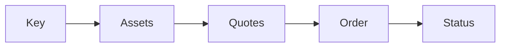

import QuickstartClient from '/snippets/samples/quickstart-client.mdx'
import QuickstartAssets from '/snippets/samples/quickstart-assets.mdx'
import QuickstartQuote from '/snippets/samples/quickstart-quote.mdx'
import QuickstartOrder from '/snippets/samples/quickstart-order.mdx'
import QuickstartStatus from '/snippets/samples/quickstart-status.mdx'
import TestSafelyMinimums from '/snippets/samples/test-safely-minimums.mdx'

Get quotes on 10 USDC to USDT from every venue your workspace can use, and order the best one, in the [sandbox](/overview#environments) with testnet assets.

## At a glance

| Call | Permission | Result |
| --- | --- | --- |
| `GET /api/v1/assets` | Read quotes | The assets you can trade. |
| `POST /api/v1/quotes` | Read quotes and Submit orders | A quote per venue, and every venue's outcome in `sources`. |
| `POST /api/v1/orders` | Submit orders | An order and its `statusUrl`. |
| `GET` the `statusUrl` | Read orders | The order, until `terminal` is `true`. |



You need `bash`, `curl`, `jq`, `openssl` and `bc` (for exact decimal arithmetic). To order (not to quote), you also need company details, a venue account and funds ([Before your first trade](/before-you-trade)).

<Accordion title="About the code samples">
  The cURL steps show the API calls of [one Bash script](https://github.com/TetraFi/docs/blob/main/samples/http/quickstart.sh); run it whole, since it also signs requests, checks inputs and keeps your order record. The TypeScript SDK tab (SDK coming soon to npm) quotes USDC for ETH and waits for the order to end.
</Accordion>

<Steps>
  <Step title="Get a key">
    In the app (the sandbox app is `https://dev.tetrafi.io`), create a personal API key with Read quotes, Submit orders and Read orders, and Venue trading on. Store its API Key and Request-signing secret separately: both are shown once.

    <Accordion title="Where to click">
      Sign in with a second factor as a workspace owner or admin who manages credentials.

      1. Open **Settings**, find **Personal API keys** under **Your account**, then select **Open API keys** and **Create key**.
      2. Enter a **Name**, and under **Permissions** tick **Read quotes**, **Submit orders** and **Read orders**.
      3. Switch **Venue trading** on and select **Create key**. It lets TetraFi trade on your venue accounts with this key, and turns on request signing.
      4. Copy **API Key** and **Request-signing secret** to your secret manager, separately: both are shown once.

      [Authentication](/authentication) explains each permission.
    </Accordion>
  </Step>

  <Step title="Set your environment">
    ```bash
    export TETRAFI_BASE_URL=https://api-dev.tetrafi.io   # the sandbox
    export TETRAFI_API_KEY=...                           # from your secret manager
    export TETRAFI_SIGNING_SECRET=...                    # the key's signing secret
    export TETRAFI_WORKSPACE_ID=...                      # the TypeScript SDK example needs it
    ```

    <Accordion title="The request helper and the workspace id">
      cURL needs no workspace id: the key implies it. The SDK does: find it under workspace settings, **General**, **Workspace ID**.

      The code below sends each request with your key and [signs it](/authentication#sign-requests). It stops on a transport error or non-2xx status, printing the body. Requests time out after 60 seconds.

      <QuickstartClient />
    </Accordion>
  </Step>

  <Step title="List the assets you can trade">
    `GET /api/v1/assets` returns every asset your workspace can trade, with its variants and chains. Check that both sides of your pair are listed.

    <QuickstartAssets />

    ```json Response (shortened) expandable
    {
      "items": [
        {
          "assetId": "USDC",
          "symbol": "USDC",
          "name": "USD Coin",
          "kind": "stablecoin",
          "variants": [
            { "kind": "native", "name": "USDC", "deployments": [{ "chain": "eip155:8453", "decimals": 6 }] }
          ]
        }
      ]
    }
    ```
  </Step>

  <Step title="Request quotes and pick the best">
    `POST /api/v1/quotes` asks every venue at once for what you sell, what you buy and `sellAmount`, the exact amount you sell ([Request quotes](/search/how-it-works)). Take the first quote whose `next.kind` is `order`; if none is, read `sources` ([below](#if-something-goes-wrong)).

    <QuickstartQuote />

    ```json Response (shortened) expandable
    {
      "quoteRequestId": "rq_01M5…",
      "venueAsked": true,
      "quotes": [
        {
          "id": "q_01M5…",
          "legs": [{ "venue": { "id": "binance-orderbook", "integrationMode": "basic" } }],
          "quality": "executable",
          "firm": false,
          "sell": { "asset": "USDC", "chain": null, "amount": "10" },
          "buy": { "asset": "USDT", "chain": null, "amount": "10.0134" },
          "minOut": "9.9833",
          "next": { "kind": "order" },
          "expiresAt": "2026-10-27T00:43:10.213Z"
        }
      ],
      "sources": [
        { "venue": { "id": "binance-orderbook" }, "status": "answered" },
        { "venue": { "id": "across" }, "status": "unsupported", "reason": "pairNotServed" }
      ]
    }
    ```
  </Step>

  <Step title="Place the order">
    `POST /api/v1/orders` with the quote id places the order on the held terms. Send an `Idempotency-Key` you generate and keep: a retry with the same key and body returns the first answer, never a second order.

    <Warning>
    An order cannot be undone, and in production it trades real assets. The cURL step orders only with `TETRAFI_PLACE_ORDER=1`: start with the [smallest amount the venue takes](#find-the-smallest-amount-a-venue-takes).
    </Warning>

    <Accordion title="minReceive and the order record">
      - When `minReceiveRequired` is `true`, send `minReceive`: the quoted `buy.amount` less your slippage tolerance (50 basis points in the example), rounded down to the asset's decimals, calculated on decimal strings.
      - Before sending, save `{quoteId, idempotencyKey, exactBody}` to `./tetrafi-order-<quoteId>.json`, readable only by you. Keep it after success.
    </Accordion>

    <QuickstartOrder />

    ```json Response (shortened) expandable
    {
      "kind": "basicTrade",
      "orderId": "acb8…",
      "quoteId": "q_01M5…",
      "status": "working",
      "terminal": false,
      "statusUrl": "/api/v1/orders/acb8…",
      "operation": { "connectionId": "1586…", "operationId": "acb8…" }
    }
    ```
  </Step>

  <Step title="Read the status">
    Read the order at its `statusUrl` every 10 to 15 seconds until `terminal` is `true` (the cURL step reads once). `outcomeUnknown` is not a failure: keep reading ([Order status](/trade/order-status)). The trade also appears in the app under **Trades**.

    <QuickstartStatus />

    ```json Output expandable
    {"kind":"basicTrade","id":"f507…","status":"filled","idempotencyKey":"bef0…"}
    ```
  </Step>
</Steps>

## Find the smallest amount a venue takes

Quotes cost nothing; only an order moves assets. Before your first production order, find the smallest amount each venue answers, and sell that amount first.

<Accordion title="Probe 1, 5, 10 and 25 USDC">
  Quote 1, 5, 10 and 25 USDC, one request every 3 seconds, and note the smallest amount each venue answers. Nothing is ordered.

  <TestSafelyMinimums />

  ```json Output on test networks, 2026-10-30 (shortened)
  {"venue":"binance-orderbook","smallest":"5"}
  {"venue":"bebop","smallest":null,"triedUpTo":"25","status":"unavailable","reason":"apiKeyOrganisationWalletScopeRequired"}
  {"venue":"keyrock-rfq","smallest":null,"triedUpTo":"25","status":"unsupported","reason":"pairNotServed"}
  ```

  A venue that needs more reads a reason such as `sizeNotEligible` or `amountBelowMinimum`. Use that minimum as the amount you sell in your first order, and revoke test keys when done.
</Accordion>

## If something goes wrong

<AccordionGroup>
  <Accordion title="No quote can be ordered">
    Read each venue's `status` and `reason` in `sources`:

| `status` and `reason` | What to do |
| --- | --- |
| `restricted`, `venueTradeScopeRequired` | Use a key with venue trading. |
| `unavailable`, `notConnected` | [Connect a venue account](/before-you-trade#connect-a-venue-account), or ignore that venue. |
| `unavailable`, `apiKeyOrganisationWalletScopeRequired` or `onchainWalletNotUsable` | [Grant the key organisation wallets](/before-you-trade#give-a-key-organisation-wallets). |
| `unavailable`, `advancedModeDisabled` | Nothing: the venue is Advanced, which is not open yet. |
| `unsupported`, `pairNotServed` | Nothing, or try another pair. |
| A quote whose `next.kind` is `fund` | The account holds less than you sell, by `readiness.amount`: fund it. |

    [Error codes](/reference/error-codes#source-reasons) lists every reason.
  </Accordion>

  <Accordion title="The order answer is unclear">
    A timeout, `5xx`, `409 IDEMPOTENCY_*` or unreadable answer does not prove the order failed. Resend the saved body with the same `Idempotency-Key`, then read the order by its quote even if that replay fails. Never place a fresh order for this trade ([Retries and recovery](/trade/retries-and-recovery)).
  </Accordion>
</AccordionGroup>

<Card title="Run the full script" icon="terminal" href="https://github.com/TetraFi/docs/blob/main/samples/http/quickstart.sh">
  Lists assets, gets quotes and, with `TETRAFI_PLACE_ORDER=1`, orders the best one.
</Card>

<Accordion title="Run it with other values">
  The script reads these optional variables:

| Variable | Default | Sets |
| --- | --- | --- |
| `TETRAFI_SELL`, `TETRAFI_BUY` | `USDC`, `USDT` | The pair. |
| `TETRAFI_AMOUNT` | `10` | The amount you sell. |
| `TETRAFI_VENUES` | every venue | Comma-separated venue ids to ask, from `sources[].venue.id`. |
| `TETRAFI_SLIPPAGE_BPS` | `50` | How far below the quoted amount you accept when the quote needs `minReceive`. |
| `TETRAFI_PLACE_ORDER` | not set | `1` places the order. |

</Accordion>

## Next

<CardGroup cols={2}>
  <Card title="Before your first trade" icon="list-check" href="/before-you-trade">
    Company details, a venue account, funds and wallet grants.
  </Card>

  <Card title="Go-live checklist" icon="flag-checkered" href="/recipes/go-live-checklist">
    What to have in place before production.
  </Card>
</CardGroup>
