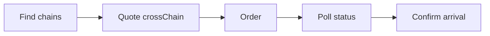

import CrossChainChains from '/snippets/samples/recipe-cross-chain-chains.mdx';
import CrossChainQuote from '/snippets/samples/recipe-cross-chain-quote.mdx';
import CrossChainOrder from '/snippets/samples/recipe-cross-chain-order.mdx';
import CrossChainStatus from '/snippets/samples/recipe-cross-chain-status.mdx';
import CrossChainArrival from '/snippets/samples/recipe-cross-chain-arrival.mdx';

Move USDC to the same USDC on another chain; TetraFi executes it from one of your organisation wallets, so no wallet signature is needed.

## At a glance

| | |
| --- | --- |
| You trade | USDC on one chain for USDC on another. |
| Endpoints | `GET /api/v1/assets`, `POST /api/v1/quotes`, `POST /api/v1/orders`, then the order's `statusUrl`. |
| Result | A settled Basic trade, with what you paid and received under `operation`. |



## Before you begin

- `bash`, `curl`, `jq` and `openssl`.
- An API key with Read quotes, Submit orders and Read orders ([Authentication](/authentication)), plus [venue trading](/authentication#trade-on-your-venue-accounts): a move from an organisation wallet is a Basic trade.
- An organisation wallet [granted to the key](/before-you-trade#give-a-key-organisation-wallets), holding USDC and gas on the chain you sell from.

<AccordionGroup>
  <Accordion title="Why venue trading, gas and signed requests">
    A move from an organisation wallet is a Basic trade, so the key needs venue trading. Sign every request: see [Sign requests](/authentication#sign-requests). The wallet sends the transactions itself, so it needs gas as well as USDC on the chain you sell from.
  </Accordion>
  <Accordion title="Environment variables">
    Export your environment, as in the [Quickstart](/quickstart):

    ```bash
    export TETRAFI_BASE_URL=https://api.tetrafi.io
    export TETRAFI_API_KEY=...            # from your secret manager
    export TETRAFI_SIGNING_SECRET=...     # the key's signing secret
    export TETRAFI_FROM_CHAIN=...         # the CAIP-2 chain you sell on, from step 1
    export TETRAFI_TO_CHAIN=...           # the CAIP-2 chain you buy on, from step 1
    ```
  </Accordion>
</AccordionGroup>

<Warning>
This recipe places a real order that moves funds out of your organisation wallet.
</Warning>

<Steps>
  <Step title="Find the chains USDC is on">
    `GET /api/v1/assets` lists every deployment of each asset. You can move USDC between the chains of its `native` variant; check both of yours are listed.

    <CrossChainChains />

    ```json Output on test networks (shortened) expandable
    {"asset":"USDC","chains":["eip155:11155111","eip155:11155420","eip155:84532","solana:EtWTRABZ…"]}
    ```

    <Accordion title="Test and production networks">
      Outputs here come from test networks: Ethereum Sepolia (`eip155:11155111`), Optimism Sepolia (`eip155:11155420`), Base Sepolia (`eip155:84532`) and Solana devnet. Production lists main networks, such as Base (`eip155:8453`).
    </Accordion>
  </Step>

  <Step title="Quote the move">
    `POST /api/v1/quotes` with USDC on both sides, each pinned to its chain, and `filters.locations: ["crossChain"]` ([Chains and routes](/search/filters-and-sort#chains-and-routes)). Pick a quote whose `next` is `order`.

    <CrossChainQuote />

    ```json Output on test networks (shortened) expandable
    {"venue":"across","status":"answered","reason":null}
    {"venue":"cctp","status":"unavailable","reason":"amountBelowMinimum"}
    {"quoteId":"q_01M5XS49…","venue":"across","next":"order","sell":"1 on eip155:84532","buy":"0.999501 on eip155:11155111","eta":"PT166S","tradesFrom":{"kind":"wallet","financialAccountId":"4d4670ab-…","network":"eip155:84532"},"fundingModel":"prefunded"}
    ```

    <Accordion title="Reading the quote, and wallets with pinned destinations">
      `tradingSource` names the wallet it trades from (`financialAccountId`, `network`), `fundingModel` how it is funded ([Wallets and accounts](/trade/wallets-and-accounts)), and `eta` the expected delivery time.

      Relay picks a deposit address per order, so a wallet whose signing policy pins where it may send funds cannot use it. Use Circle CCTP from those wallets.
    </Accordion>
  </Step>

  <Step title="Place the order">
    `POST /api/v1/orders` with the quote id and an `Idempotency-Key` you generate and keep. When the quote's `minReceiveRequired` is `true`, also send `minReceive`.

    <CrossChainOrder />

    ```json Output (shortened) expandable
    {"kind":"basicTrade","quoteId":"q_01M5XS49…","operation":{"connectionId":"…","operationId":"f1103a3a-…"}}
    ```

    <Accordion title="Retries, minReceive and the operation ids">
      A retry with the same key and body returns the first answer, never a second move ([Idempotency](/trade/retries-and-recovery)).

      Bridges usually quote indicatively. `minReceive` is the least you accept, such as the quoted amount less 50 basis points ([Orders](/trade/orders#venues-that-execute-within-your-limit)). Without it, the order is refused with `400 MIN_RECEIVE_REQUIRED` and nothing is sent.

      A Basic trade's `operation` holds the `connectionId` and `operationId` you read its status with.
    </Accordion>
  </Step>

  <Step title="Follow it until it ends">
    The order answers `"kind": "basicTrade"` once accepted. Read its `statusUrl` every 10 seconds until `terminal` is `true`, or after `retryAfter` when `next` says `wait` ([Order status](/trade/order-status)).

    <CrossChainStatus />

    ```json Output (shortened) expandable
    {"kind":"basicTrade","status":"working","terminal":false,"next":null}
    {"kind":"basicTrade","status":"settled","terminal":true,"next":null}
    ```

    <Accordion title="Working, outcomeUnknown and timing">
      `working` and `outcomeUnknown` are not failures: keep reading, and never order it again. On test networks, Base Sepolia to Ethereum Sepolia finished about two and a half minutes after the order.
    </Accordion>
  </Step>

  <Step title="Confirm it arrived">
    The venue trade's own detail is under `operation`. To confirm arrival independently, check the receiving wallet's balance in the app.

    <CrossChainArrival />

    ```json Output (shortened) expandable
    {
      "executionStatus": "filled",
      "bounds": {
        "sell": { "asset": "USDC", "amount": "1" },
        "buy": { "asset": "USDC", "amount": "0.994503" }
      },
      "dispatch": { "inputSpent": "1", "outputReceived": "0.999501" }
    }
    ```

    <Accordion title="Fields under operation">

| Field | Meaning |
| --- | --- |
| `executionStatus` | The trade's state. |
| `settlementStatus` | Any later money movement. |
| `dispatch.inputSpent`, `dispatch.outputReceived` | What you paid and received, when reported. Missing or `null` is unknown, not zero. |
| `dispatch.venueOrderId` | The venue's native order id, when present. |
| `bounds.sell.amount`, `bounds.buy.amount` | Your accepted limits, not settled amounts: the most it spends, fees charged in it included, and the least it delivers. |

      The public response does not document delivery transaction hashes or your organisation wallet's transaction steps.
    </Accordion>
  </Step>
</Steps>

## If no quote can be ordered

A venue that cannot quote says why in `sources`.

<AccordionGroup>
  <Accordion title="What each reason means and what to do">

| What you see | What it means | What to do |
| --- | --- | --- |
| `unavailable` with `apiKeyOrganisationWalletScopeRequired` or `onchainWalletNotUsable` | No organisation wallet granted to the key suits this venue. | [Grant the key organisation wallets](/before-you-trade#give-a-key-organisation-wallets). |
| `unavailable` with `amountBelowMinimum` | Below the venue's minimum. `fix.amount` is the least, and `detail` says it in words. | Request at least `fix.amount`. |
| `next` is `preflight`, `sign` or `transact` | The move pays from your own wallet on-chain (Advanced), not open yet. | Use a quote whose `next` is `order`. |
| `restricted` with `venueTradeScopeRequired` | The key cannot trade on venue accounts. | Set up [venue trading](/authentication#trade-on-your-venue-accounts). |

  </Accordion>
  <Accordion title="A bridge minimum blocks the quote">
    The minimum follows the bridge's fees, so it moves. Quote again with `fix.amount`:

    ```json Output on test networks (shortened)
    {"venue":{"id":"cctp"},"status":"unavailable","reason":"amountBelowMinimum","asked":true,"fix":{"kind":"changeAmount","amount":"5.943624"},"detail":"Request at least 5.943624 USDC to get a price."}
    ```
  </Accordion>
</AccordionGroup>

## If you are rate limited

<AccordionGroup>
  <Accordion title="429 QUOTE_RATE_LIMITED on a search">
    Wait `details.retryAfter`, then quote again ([Rate limits](/reference/rate-limits)).
  </Accordion>
</AccordionGroup>

<Card title="Run the full script" icon="terminal" href="https://github.com/TetraFi/docs/blob/main/samples/http/recipe-cross-chain.sh">
  Runs every step above end to end; it places the order only with `TETRAFI_PLACE_ORDER=1`.
</Card>

## Next

<CardGroup cols={2}>
  <Card title="Wallets and accounts" icon="wallet" href="/trade/wallets-and-accounts">
    Choose which organisation wallet trades or receives with source and deliverTo.
  </Card>
  <Card title="Order status" icon="list-check" href="/trade/order-status">
    Every status a trade can read, and how often to poll.
  </Card>
</CardGroup>
