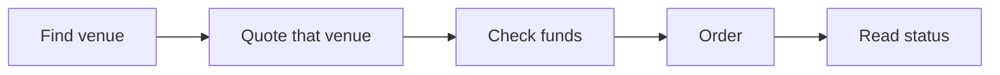

import ExchangeVenue from '/snippets/samples/recipe-exchange-venue.mdx';
import ExchangeQuote from '/snippets/samples/recipe-exchange-quote.mdx';
import ExchangeFunds from '/snippets/samples/recipe-exchange-funds.mdx';
import ExchangeOrder from '/snippets/samples/recipe-exchange-order.mdx';
import ExchangeRecover from '/snippets/samples/recipe-exchange-recover.mdx';
import ExchangeStatus from '/snippets/samples/recipe-exchange-status.mdx';

Swap 5 USDC for USDT on an exchange account your workspace has connected; TetraFi trades with that account's own balance, so no wallet signs anything.

## At a glance

| | |
| --- | --- |
| You trade | 5 USDC for USDT on your connected exchange account. |
| Endpoints | `POST /api/v1/quotes`, `POST /api/v1/orders`, `GET /api/v1/orders/by-quote/{quoteId}`, then the order's `statusUrl`. |
| Result | A filled Basic trade, with what the account spent and received under `operation`. |



## Before you begin

- `bash`, `curl`, `jq` and `openssl`.
- A connected exchange account that holds the asset you sell ([Connect a venue account](/before-you-trade#connect-a-venue-account)).
- An API key with Read quotes, Submit orders, Read orders and [venue trading](/authentication#trade-on-your-venue-accounts), and its signing secret ([Sign requests](/authentication#sign-requests)).

<AccordionGroup>
  <Accordion title="Without venue trading">
    The venue reads `restricted` with `venueTradeScopeRequired` in `sources`. Sign every request: see [Sign requests](/authentication#sign-requests).
  </Accordion>
  <Accordion title="Environment variables">
    Export your environment as in the [Quickstart](/quickstart), plus:

    ```bash
    export TETRAFI_WORKSPACE_ID=...    # the workspace the key belongs to (see Authentication)
    export TETRAFI_VENUE=...           # optional: the venue id of your exchange account; if unset, step 1 finds it
    ```
  </Accordion>
</AccordionGroup>

<Warning>
This recipe places a real order on your exchange account and spends its balance.
</Warning>

<Steps>
  <Step title="Find your account's venue">
    Search with `filters.locations: ["offChain"]`: only your connected venue accounts answer. Take the venue id of the best Basic quote, such as `binance-orderbook`.

    <ExchangeVenue />

    ```json Output (shortened) expandable
    {"venue":"okx-rfq","status":"unavailable","reason":"notConnected"}
    {"venue":"binance-orderbook","status":"answered","reason":null}
    ```

    <Accordion title="notConnected">
      `notConnected` means your workspace has no account at that venue.
    </Accordion>
  </Step>

  <Step title="Search that venue only">
    Set `filters.venues.include` to that venue id; every other venue reads `filteredOut` in `sources` and is not asked.

    <ExchangeQuote />

    ```json Output (shortened) expandable
    {"quoteId":"q_01M5XSRC…","venue":"binance-orderbook","mode":"basic","firm":false,"sell":"5","buy":"5.00675","minOut":"4.99172","next":"order","expiresAt":"2026-10-27T04:26:42.527Z"}
    ```

    <Accordion title="tradingSource and fundingModel">
      The quote's `tradingSource` has `kind` `venueAccount`, and `fundingModel` says whether the account must already hold the funds (`prefunded`) or takes them in (`payIn`).
    </Accordion>
  </Step>

  <Step title="Check the account holds enough">
    `readiness` says whether the account holds enough: `funded` means `next` is `order`.

    <ExchangeFunds />

    ```json Output expandable
    {"readiness":{"kind":"funded"}}
    ```

    <Accordion title="Readiness values and balances">

| `readiness.kind` | What it means |
| --- | --- |
| `funded` | The account holds enough. `next` is `order`. |
| `shortfall` | `amount` is what is missing and `next` is `fund`. Fund the account, then get a new price. |

      To see all it holds, read [its balances](/trade/balances#one-exchange-account).
    </Accordion>
  </Step>

  <Step title="Place the order">
    `POST /api/v1/orders` with the quote id and an `Idempotency-Key` you generate and store before you send it. A Basic quote takes no signature.

    <ExchangeOrder />

    ```json Output (shortened) expandable
    {"kind":"basicTrade","quoteId":"q_01M5XSRC…","operation":{"connectionId":"15862432-…","operationId":"0b23326f-…"}}
    ```

    <Accordion title="When to send minReceive">
      When the quote reads `minReceiveRequired: true`, send `minReceive`, the least you accept, such as the quoted amount less 50 basis points ([Orders](/trade/orders#venues-that-execute-within-your-limit)). Otherwise, as on this order-book quote, it is optional.
    </Accordion>
  </Step>

  <Step title="Recover the order by its quote">
    If the order response never reaches you, read it with `GET /api/v1/orders/by-quote/{quoteId}`, which places nothing. Never order again with a new key: that is a second order.

    <ExchangeRecover />

    ```json Output (shortened) expandable
    {"state":"ordered","orderId":"0b23326f-…","statusUrl":"/api/v1/orders/0b23326f-…"}
    ```

    <Accordion title="What each state means">

| `state` | What to do |
| --- | --- |
| `ordered` | Read its status at `statusUrl`. Do not order again. |
| `notOrdered` | Nothing was placed. If `expired` is `false`, you can order it. |
| `unknown` | Wait and read again. Do not order again. |

      See [Recover an order](/trade/orders#recover-an-order-by-its-quote).
    </Accordion>
  </Step>

  <Step title="Read the status">
    Read `statusUrl` every 10 seconds until `terminal` is `true`, or after `next.retryAfter` when `next` says `wait` ([Order status](/trade/order-status)).

    <ExchangeStatus />

    ```json Output expandable
    {"status":"settled","terminal":true,"next":null}
    {"executionStatus":"filled","settlementStatus":null,"bounds":{"sell":{"asset":"USDC","amount":"5"},"buy":{"asset":"USDT","amount":"4.99172"}},"dispatch":{"inputSpent":"5","outputReceived":"5.00675","venueOrderId":"229377"}}
    ```

    <Accordion title="outcomeUnknown and the fields under operation">
      `outcomeUnknown` is not a failure: the trade may have filled, so keep reading. The venue's own detail is under `operation`:

| Field | Meaning |
| --- | --- |
| `dispatch.inputSpent`, `dispatch.outputReceived` | What the trade took from and added to the account, when reported. Missing or `null` is unknown, never zero. |
| `bounds.sell.amount`, `bounds.buy.amount` | Your accepted limits (most spent, least delivered), not fill amounts. |
| `dispatch.venueOrderId` | The venue's native order id, when present. |
| `settlementStatus` | Any later money movement. |

      To confirm the balance independently, open the account under **Treasury** in the app.
    </Accordion>
  </Step>
</Steps>

## If something goes wrong

<AccordionGroup>
  <Accordion title="429 QUOTE_RATE_LIMITED on a search">
    Wait `details.retryAfter`, then search again ([Rate limits](/reference/rate-limits)).
  </Accordion>
  <Accordion title="The order is refused">
    A refused order names its code, such as `409 FUNDING_SHORTFALL`, and nothing was traded ([Orders](/trade/orders#refusals)).
  </Accordion>
</AccordionGroup>

<Card title="Run the full script" icon="terminal" href="https://github.com/TetraFi/docs/blob/main/samples/http/recipe-exchange-order.sh">
  Runs every step above end to end; it places the order only with `TETRAFI_PLACE_ORDER=1`.
</Card>

## Next

<CardGroup cols={2}>
  <Card title="Orders" icon="list-check" href="/trade/orders">
    Venue quotes that execute within your limit, and every refusal.
  </Card>
  <Card title="Retries and recovery" icon="rotate" href="/trade/orders#retries-and-recovery">
    Retry an order safely and find out whether it was placed.
  </Card>
</CardGroup>
