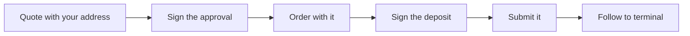

<Info>
**Rolling out.** This flow is not live yet. The shapes on this page are the contract we are building to; field names can still change before it opens. Today, a key trades on-chain from organisation wallets granted to it, which TetraFi signs for ([Move stablecoins across chains](/recipes/cross-chain-stablecoins)).
</Info>

Move 100 USDC from Base to Ethereum through a bridge, from a wallet you sign for yourself: the first trade on a token takes two steps, an approval and then the deposit.

## At a glance

| | |
| --- | --- |
| You trade | 100 USDC on Base (`eip155:8453`) for USDC on Ethereum (`eip155:1`). |
| Endpoints | `POST /api/v1/quotes`, `POST /api/v1/orders`, `POST /api/v1/orders/{orderId}/steps/{stepId}`, `GET /api/v1/orders/{orderId}`. |
| You sign | Step 1, the token approval; step 2, the bridge deposit. Each is one EVM transaction. |
| Result | A finished order, with both transaction hashes under `operation.steps`. |



## Before you begin

- An API key with Read quotes, Submit orders, Read orders and [venue trading](/authentication#trade-on-your-venue-accounts), signing every request ([Sign requests](/authentication#sign-requests)). It needs no organisation-wallet grant.
- An EVM wallet whose private key you hold, with USDC and some ETH for gas on Base. It does not have to be registered in TetraFi first.
- [Foundry](https://getfoundry.sh)'s `cast`, or Node.js with [viem](https://viem.sh), and an RPC endpoint for Base to read fees.

<AccordionGroup>
  <Accordion title="Why you pay the gas">
    You sign and pay for each transaction yourself; TetraFi never holds a key or a signing grant for the wallet. It checks each signed transaction against the step it prepared before relaying it.
  </Accordion>
  <Accordion title="Keep the private key out of code">
    The snippets read the key from `SIGNER_PRIVATE_KEY`. Load it from your secret manager, or use a hardware or remote signer that signs the same transaction.
  </Accordion>
</AccordionGroup>

<Warning>
This recipe moves funds out of your wallet once it is live.
</Warning>

<Steps>
  <Step title="Quote with your address">
    `POST /api/v1/quotes` with your wallet's address as the value for Base in `source.tradingWallets`, and only cross-chain quotes kept. Pick a quote whose `next.kind` is `order` and whose `signing.mode` is `you`.

    ```json Request
    {"kind":"pair","sell":{"asset":"USDC","network":"eip155:8453"},"buy":{"asset":"USDC","network":"eip155:1"},"sellAmount":"100",
     "filters":{"locations":["crossChain"]},
     "source":{"tradingWallets":{"eip155:8453":"0xAbc…"}}}
    ```

    ```json Output shape of the quote you pick (shortened) expandable
    {
      "id": "q_01M5…",
      "next": {"kind": "order"},
      "minReceiveRequired": true,
      "signing": {
        "mode": "you",
        "address": "0xAbc…",
        "firstStep": {
          "stepId": "stp_01A…",
          "sequence": 1,
          "purpose": "approval",
          "type": "transaction",
          "network": "eip155:8453",
          "from": "0xAbc…",
          "signBy": "2026-11-18T12:00:45Z",
          "transaction": {"chainId": 8453, "to": "0x…", "data": "0x095ea7b3…", "value": "0", "nonce": 17, "gasLimit": "65000"}
        }
      }
    }
    ```

    <Accordion title="When step 1 is the deposit itself">
      If the bridge already has your USDC allowance, `firstStep` has `purpose` `trade` and the trade takes one step: skip step 4 below.
    </Accordion>
  </Step>

  <Step title="Sign the approval">
    Sign `firstStep.transaction` exactly as given, with its `nonce`. The fee is yours to choose and `gasLimit` is a suggestion. Check first that `type` is `transaction` and `from` is your address.

    <Tabs>
      <Tab title="cast">
        ```bash
        # step holds firstStep (or a later next.step) as JSON
        tx=$(jq -c '.transaction' <<<"$step")
        raw=$(cast mktx "$(jq -r .to <<<"$tx")" "$(jq -r .data <<<"$tx")" \
          --chain "$(jq -r .chainId <<<"$tx")" \
          --nonce "$(jq -r .nonce <<<"$tx")" \
          --value "$(jq -r .value <<<"$tx")" \
          --gas-limit "$(jq -r .gasLimit <<<"$tx")" \
          --rpc-url "$BASE_RPC_URL" \
          --private-key "$SIGNER_PRIVATE_KEY")
        ```

        `cast mktx` signs without broadcasting and prints the raw transaction. It reads current fees from `--rpc-url`; pass `--gas-price` and `--priority-gas-price` to set them yourself.
      </Tab>
      <Tab title="viem">
        ```ts
        import { createPublicClient, http, type Address, type Hex } from 'viem';
        import { privateKeyToAccount } from 'viem/accounts';
        import { base } from 'viem/chains';

        type TransactionStep = {
          stepId: string;
          type: string;
          from: Address;
          transaction: { chainId: number; to: Address; data: Hex; value: string; nonce: number; gasLimit: string };
        };

        const account = privateKeyToAccount(process.env.SIGNER_PRIVATE_KEY as Hex);
        const client = createPublicClient({ chain: base, transport: http(process.env.BASE_RPC_URL) });

        export async function signStep(step: TransactionStep): Promise<Hex> {
          if (step.type !== 'transaction') throw new Error(`Unknown step type ${step.type}: do not sign it`);
          if (step.from.toLowerCase() !== account.address.toLowerCase()) throw new Error('Step is for another wallet');
          const tx = step.transaction;
          const fees = await client.estimateFeesPerGas(); // fees are your choice
          return account.signTransaction({
            chainId: tx.chainId,
            to: tx.to,
            data: tx.data,
            value: BigInt(tx.value),
            nonce: tx.nonce, // pinned: sign with it
            gas: BigInt(tx.gasLimit), // a suggestion
            maxFeePerGas: fees.maxFeePerGas,
            maxPriorityFeePerGas: fees.maxPriorityFeePerGas,
          });
        }
        ```
      </Tab>
    </Tabs>
  </Step>

  <Step title="Order with it">
    `POST /api/v1/orders` with an `Idempotency-Key` you store before sending. Send `minReceive`, the least you accept, because the quote reads `minReceiveRequired: true`. TetraFi checks the signed approval against the step it issued and against the chain, then relays it.

    ```json Request
    {"quoteId":"q_01M5…","minReceive":"99.45","firstStep":{"stepId":"stp_01A…","kind":"signedTransaction","raw":"0x02f8…"}}
    ```

    ```json Output shape while the approval confirms, then when the deposit is ready (shortened) expandable
    {"orderId":"9410e38e-…","status":"working","terminal":false,"next":{"kind":"wait","retryAfter":"PT5S"}}
    {"orderId":"9410e38e-…","status":"working","terminal":false,
     "next":{"kind":"sign","step":{"stepId":"stp_01B…","sequence":2,"purpose":"trade","type":"transaction","network":"eip155:8453","from":"0xAbc…","signBy":"2026-11-18T12:02:10Z",
       "transaction":{"chainId":8453,"to":"0x…","data":"0x…","value":"0","nonce":18,"gasLimit":"180000"}}}}
    ```
  </Step>

  <Step title="Sign and submit the deposit">
    When `next.kind` is `sign`, sign `next.step` the same way, then send it to `POST /api/v1/orders/{orderId}/steps/{stepId}` with a new `Idempotency-Key`. The answer is the order again.

    ```json Request
    {"kind":"signedTransaction","raw":"0x02f9…"}
    ```
  </Step>

  <Step title="Follow it until it ends">
    Read `GET /api/v1/orders/{orderId}` after each `retryAfter`, or wait for the `order.updated` [webhook](/trade/webhooks), which fires whenever `next` changes. Stop when `terminal` is `true` ([Order status](/trade/order-status)).

    ```json Output shape when it ends (shortened) expandable
    {"orderId":"9410e38e-…","status":"settled","terminal":true,
     "operation":{"steps":[
       {"stepId":"stp_01A…","purpose":"approval","status":"mined","txHash":"0x5e1…"},
       {"stepId":"stp_01B…","purpose":"trade","status":"mined","txHash":"0x9c4…"}]}}
    ```
  </Step>
</Steps>

## If it does not go to plan

<AccordionGroup>
  <Accordion title="The order opens with a fresh step 1">
    Your nonce, allowance or balance changed between the quote and the order, so nothing was relayed. Sign `next.step` and submit it on the step endpoint.
  </Accordion>
  <Accordion title="You did not sign in time">
    A later step not signed by its `signBy` ends the order `unfilled` with `outcomeCode: not_sent`. A mined approval stays; nothing else moved. To trade, quote again.
  </Accordion>
  <Accordion title="You would rather broadcast it yourself">
    Broadcast the signed transaction, then submit `{"kind":"transactionHash","txHash":"0x…"}`. TetraFi reads it from the chain and applies the same checks. `SIGNING_TRANSACTION_NOT_FOUND` (409) means the chain does not show it yet: retry with backoff.
  </Accordion>
  <Accordion title="You decide not to go on">
    Submit `{"kind":"declined"}` on the step endpoint: the order ends `unfilled` and the deposit is never sent. An approval already mined stays.
  </Accordion>
  <Accordion title="A refusal">
    Nothing was relayed: `SIGNING_STEP_MISMATCH` (422, `details.field` names what differs), `SIGNING_STEP_EXPIRED` (410), `SIGNING_STEP_NOT_OPEN` (409) or `SIGNING_WALLET_REFUSED` (403). The full list is on [Sign with your own wallet](/trade/sign-with-your-own-wallet).
  </Accordion>
</AccordionGroup>

## Next

<CardGroup cols={2}>
  <Card title="Sign with your own wallet" icon="signature" href="/trade/sign-with-your-own-wallet">Every step type, submission kind and outcome.</Card>
  <Card title="How a trade runs" icon="route" href="/trade/how-a-trade-runs">The other ways a trade is funded and signed.</Card>
</CardGroup>
