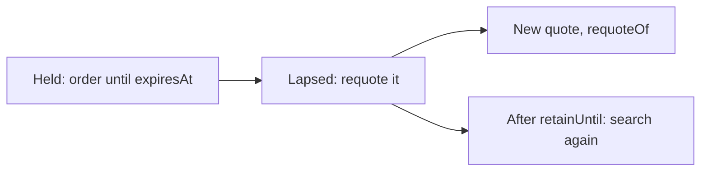

import RequoteAgain from '/snippets/samples/requote-again.mdx';
import RequoteProtection from '/snippets/samples/requote-protection.mdx';
import RequoteExpired from '/snippets/samples/requote-expired.mdx';

Each quote states what its venue commits to in `quality`, and until when in `expiresAt`: read both before you order.

## Firm, executable and indicative

| `quality` | What it guarantees | Can you order it? |
| --- | --- | --- |
| `firm` | The venue delivers exactly `buy.amount` until `expiresAt`. | When `next.kind` is `order`, until `expiresAt`. |
| `executable` | The venue trades until `expiresAt`. Delivery may move, but never below `minOut`. | When `next.kind` is `order`, until `expiresAt`. |
| `indicative` | Nothing: it is the venue's current price, not a commitment. | Only when `next.kind` is `order`, with `minReceive`. |

<AccordionGroup>
  <Accordion title="How to recognise each, and what firmness does not cover">

| `quality` | How to recognise it | Notes |
| --- | --- | --- |
| `firm` | `firm: true` and `expiresAt` set. `minOut` and `staleAfter` are `null`. | A `fund` quote is refused with `409 FUNDING_SHORTFALL`. |
| `executable` | `firm: false`, `expiresAt` set and `minOut` set by your [price protection](/search/how-it-works#filters-and-sort). `staleAfter` is `null`. | Order-book and AMM quotes are executable. A `fund` quote is refused with `409 FUNDING_SHORTFALL`. |
| `indicative` | `firm: false`, `expiresAt` `null` and `staleAfter` set. `minOut` is `null`. | Order it with `minReceive`: see Order an indicative quote below. |

- `firm` and `expiresAt` repeat `quality` in two fields. Treat a `quality` you do not recognise as `indicative`.
- `lastLook` is always `false`: no venue re-checks an accepted price before it fills. An order inside a firm quote's window trades at that price or is refused unsent.
- Firmness does not waive funding, wallet, permission or pre-trade checks. It does not mean the order will be accepted or settle immediately.
- A [price](/search/prices) is never firm: only a quote can be.

</Accordion>
  <Accordion title="Order an indicative quote" id="order-an-indicative-quote">

| Its `next.kind` | What to do |
| --- | --- |
| `order` | Order it with `minReceive`, the least you accept. The venue is asked for its price when you order, and the trade happens only if it delivers at least that ([Orders](/trade/orders#venues-that-execute-within-your-limit)). |
| `requote` | [Requote it](#requote-a-quote) to get an executable price first. |

  </Accordion>
</AccordionGroup>

## Lifetime and requotes



- Order before `expiresAt`, read from the quote, never a timer started on your side.
- Until `retainUntil`, ordering a lapsed quote answers `410 QUOTE_EXPIRED` with `next.kind: "requote"`: requote the same id.
- After it, a requote or an order answers `410 REQUOTE_WINDOW_CLOSED` with `next.kind: "search"`: search again.

## Ask for firm prices

Send `firmness: "firm"` to ask every eligible desk for a firm price up front, or `filters.firmOnly: true` to keep only firm quotes.

<Accordion title="The two firmness fields">

Two independent request fields control firmness:

| Field | Value | Effect |
| --- | --- | --- |
| `firmness` | `auto` (default), `firm` or `indicative` | How desks are asked. `auto` keeps automatic pricing, `firm` asks every eligible desk for a firm price up front, and `indicative` never asks for one. |
| `filters.firmOnly` | `true`, or `false` (default) | Keeps only `firm` quotes in `quotes`, after venues answer. |

How `filters.firmOnly` behaves:

- It drops executable estimates and indicative quotes after the venues answer. The same venues are asked, and the search counts against the [quote limit](/reference/rate-limits) as usual.
- A venue that gave only estimates still reads `answered` in `sources`, with no quote in `quotes`.
- Send it when you are about to trade and compare only committed amounts. Leave it out when you compare prices: an order book or a pool may give the best one, protected by `minOut`.
- `filters.executableOnly` is refused with `400 INVALID_REQUEST`.

</Accordion>

## Quote times

Use the returned `expiresAt`: each venue type sets its own window, and network time or an older observation can leave less.

<AccordionGroup>
  <Accordion title="Every quote time">

| Field | Set on | Meaning |
| --- | --- | --- |
| `expiresAt` | `firm` and `executable` quotes | The last time the quote can be ordered. It is not a settlement deadline. |
| `staleAfter` | `indicative` quotes | When the price is old. |
| `observedAt` | `indicative` quotes | When the venue's price or book was read. |
| `retainUntil` | Every held quote | The last time it can be requoted: 10 minutes after it lapsed (`expiresAt`, or `staleAfter` for an indicative quote). |
| `firmAskAvailableAt` | Desk quotes, when known | Your workspace has reached the desk's firm-quote limit until then. |

When `next.kind` is `requote`, `next.needs` lists what the new quote needs from you, such as a trading wallet to name; an empty list means requote it as it is.

  </Accordion>
  <Accordion title="Window by venue type">

| Venue type | Window |
| --- | --- |
| Exchange or OTC desk (RFQ) | The venue's own quote terms. For example, Keyrock declares 3 seconds and Binance RFQ 30 seconds. |
| Order book | At most 5 seconds from pricing, and never past the book's freshness or the request deadline. |
| AMM or DEX | The route's returned deadline. A Basic Uniswap quote is held for at most 60 seconds. |
| Solver | The solver's returned validity. |
| Bridge | Native CCTP quotes have a 60-second window. Basic Across and Relay quotes are capped at 60 seconds, or their provider's expiry if earlier. |
| Indicative | No orderable expiry: refresh after `staleAfter`, or requote. |

  </Accordion>
</AccordionGroup>

## Requote a quote

Send a quote's id to ask its venue for a new price and get one new quote from that venue. Requote to change how it executes, to get an executable or firm price, or to refresh it after it expires.

<Steps>
  <Step title="Send the quote id">
    `POST /api/v1/quotes` with `kind: "requote"`, `requote` set to the quote id, and only the fields you change.

    <RequoteAgain />
  </Step>
  <Step title="Order the new id">
    The new quote's `requoteOf` names the original.

```json Response (shortened) expandable
{
  "quotes": [
    {
      "id": "q_01M5XJXN…",
      "requoteOf": "q_01M5XJXM…",
      "firm": false,
      "buy": { "asset": "USDT", "amount": "5.00685" },
      "minOut": "4.99182",
      "expiresAt": "2026-10-27T02:27:15.792Z",
      "next": { "kind": "order" }
    }
  ]
}
```
  </Step>
</Steps>

<AccordionGroup>
  <Accordion title="Why requote">

- Change how it executes: another trading wallet or venue account (`source`), destination (`deliverTo`), corridor (`corridor`) or price protection (`priceProtectionBps`).
- Get an executable price for an indicative quote, or a desk's firm price when its quote reads `next.kind: "requote"`.
- Refresh a quote that expired.

</Accordion>
  <Accordion title="Requote fields">

| Field | Required | Value |
| --- | --- | --- |
| `kind` | Yes | `"requote"`. |
| `requote` | Yes | The quote id (`q_…`). |
| `source` | No | A different trading wallet per chain (`source.tradingWallets`), venue account (`source.venueAccountId`) or funding account (`source.fundingAccountId`), each a `financialAccountId` from the answer's `sourceOptions`. |
| `deliverTo` | No | Where the output goes ([Where the output goes](/trade/wallets-and-accounts#where-the-output-goes)). With an API key, a venue account's output stays on the account. |
| `corridor` | No | `{"from": "<chain>", "to": "<chain>"}`: another chain pair the original listed in `corridors`. |
| `priceProtectionBps` | No | 0 to 1000, for the new quote's `minOut`. |

A field you leave out keeps the original's. The pair, amount, side and filters cannot change: sending them is `400 REQUOTE_FIELDS_CONFLICT`. For a different pair or amount, search again.

  </Accordion>
  <Accordion title="How a requote behaves">

- You get one new quote whose `requoteOf` names the original. Order the new id.
- The answer is JSON, never a stream.
- The original stays orderable until its own `expiresAt`. Each quote can still be ordered once.
- Only that venue is asked (for a route, every venue on that same route). If it declines, you get a named refusal; TetraFi never substitutes another venue.
- A requote counts against the [quote limit](/reference/rate-limits).

</Accordion>
  <Accordion title="Example: a different price protection">

Here a requote at 50 basis points lowers `minOut` from `4.99182` to `4.98181` on the same quoted amount:

<RequoteProtection />

  </Accordion>
</AccordionGroup>

## Refresh an expired quote

An expired quote is refused with `410 QUOTE_EXPIRED` and nothing is sent. Requote the same id.

<Accordion title="Example">

<RequoteExpired />

```json Output
{"error":"QUOTE_EXPIRED","next":{"kind":"requote","needs":[]}}
{"quoteId":"q_01M5XJNK…","requoteOf":"q_01M5XJNB…","buy":"5.0068","expiresAt":"2026-10-27T02:22:49.076Z"}
```

</Accordion>

## Refusals

<Accordion title="Requote refusals">

| Code | Status | Why | What to do |
| --- | --- | --- | --- |
| `REQUOTE_FIELDS_CONFLICT` | 400 | A field that cannot go with `requote`, such as `sellAmount` or `filters`. | Send only the requote fields, or search again. |
| `CORRIDOR_NOT_OFFERED` | 400 | The original was not offered on that corridor. | Use one from its `corridors`. |
| `WALLET_NOT_ON_CHAIN` | 400 | The trading wallet you named is not on that chain. | Name a wallet listed for that chain. |
| `SOURCE_NOT_OWNED` | 403 | A wallet or account you named is not one you can use. | Name one from `sourceOptions`. |
| `ACCOUNT_NOT_AVAILABLE` | 403 | That venue account is not the one this quote was priced on. | Leave out `source.venueAccountId`. |
| `VENUE_NOT_AVAILABLE_TO_CREDENTIAL` | 403 | This credential cannot ask this venue for a firm quote. | Use a key with Read quotes and Submit orders. |
| `QUOTE_NOT_FOUND` | 404 | No quote with this id is available to you, including another key's quote. | Requote only quotes your key requested. |
| `PERSONAL_TARGET_NOT_ALLOWED` | 409 | An API key named a personal wallet. | Name an organisation wallet. |
| `REQUOTE_REFUSED` | 409 | The venue declined; `details.reason` carries a token, such as `productNotQuoted`. | Show `message`. The original still holds until it expires. |
| `REQUOTE_NEEDS_WALLET` | 409 | The venue quotes only once you choose a wallet. | Requote with `source.tradingWallets`. |
| `REQUOTE_WINDOW_CLOSED` | 410 | Past `retainUntil`. | Search again. |
| `QUOTE_RATE_LIMITED`, `VENUE_FIRM_QUOTE_LIMITED`, `BUDGET_EXHAUSTED` | 429 | The quote limit, the venue's firm-quote limit or the venue's quote budget is used up. | Wait `Retry-After` seconds; `firmAskAvailableAt` says when a desk reopens, where known. |
| `QUOTE_STORE_UNAVAILABLE` | 503 | Held quotes cannot be read just now. | Send the same requote again after a second. |
| `REQUOTE_TIMED_OUT` | 504 | The venue did not answer in time. | Try again, or order the original while it holds. |

</Accordion>

<Card title="Run the full script" icon="terminal" href="https://github.com/TetraFi/docs/blob/main/samples/http/orders.sh">
  Requotes a quote at another price protection and refreshes a quote that expired.
</Card>

## Next

<CardGroup cols={2}>
  <Card title="Place an order" icon="cart-shopping" href="/trade/orders">
    Order a quote you hold by its id.
  </Card>
  <Card title="Request quotes" icon="magnifying-glass" href="/search/how-it-works">
    Search again for a different pair or amount.
  </Card>
</CardGroup>
