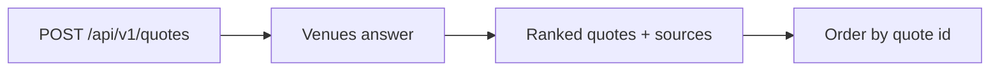

import SearchSellExact from '/snippets/samples/search-sell-exact.mdx';
import SearchBuyExact from '/snippets/samples/search-buy-exact.mdx';
import SearchStream from '/snippets/samples/search-stream.mdx';
import SearchSingleChain from '/snippets/samples/search-single-chain.mdx';
import SearchCrossChain from '/snippets/samples/search-cross-chain.mdx';
import SearchOffChain from '/snippets/samples/search-off-chain.mdx';
import SearchModalities from '/snippets/samples/search-modalities.mdx';
import SearchVenueInclude from '/snippets/samples/search-venue-include.mdx';
import SearchVenueExclude from '/snippets/samples/search-venue-exclude.mdx';
import SearchNativeOnly from '/snippets/samples/search-native-only.mdx';
import SearchFirmOnly from '/snippets/samples/search-firm-only.mdx';
import SearchSortEta from '/snippets/samples/search-sort-eta.mdx';
import SearchPriceProtection from '/snippets/samples/search-price-protection.mdx';

Ask every venue at once with one request, then order the quote you want by its id.

## At a glance

| Endpoint | You need | Result |
| --- | --- | --- |
| `GET /api/v1/assets` | Read quotes | The assets, variants and chains you can trade. |
| `POST /api/v1/quotes` | An API key, plus venue trading for your venue accounts ([Before your first trade](/before-you-trade)) | `quotes`, best first, each held under its `id`, and `sources`, every venue considered with its outcome. |
| `GET /api/v1/quotes/requests/{quoteRequestId}` | Read quotes | A recorded search. |



## Request and read quotes

<Steps>
  <Step title="Take values from discovery">
    Read asset ids and chains from `GET /api/v1/assets` ([Use values from discovery](#use-values-from-discovery)).
  </Step>
  <Step title="Send the request">
    Send `kind: "pair"`, `sell.asset`, `buy.asset` and exactly one of `sellAmount` or `buyAmount`, as a decimal string such as `"10"`.

    <AccordionGroup>
      <Accordion title="Every request field">

| Field | Required | Value |
| --- | --- | --- |
| `kind` | Yes | `"pair"`. Missing: `400 QUOTE_REQUEST_KIND_REQUIRED`; unknown or not a string: `400 QUOTE_REQUEST_KIND_INVALID`. `"requote"` [refreshes a held quote](/search/firmness-and-lifetime#requote-a-quote). |
| `sell.asset`, `buy.asset` | Yes | An asset id from [`GET /api/v1/assets`](#use-values-from-discovery), such as `USDC`. Assets carry no chain. |
| `sell.chain`, `buy.chain` | No | A CAIP-2 chain id, such as `eip155:8453`, to [pin that side](#filters-and-sort). |
| `sellAmount` or `buyAmount` | Exactly one | A positive decimal string in asset units, such as `"10"`, never base units. Both or neither: `400 INVALID_REQUEST`. |
| `filters`, `sort`, `priceProtectionBps` | No | Narrow, order and protect the search ([Filters and sort](#filters-and-sort)). `sort` defaults to `netReceived`; `priceProtectionBps` is 0 to 1000, 30 when omitted. |
| `firmness` | No | `auto` (default), `firm` or `indicative` ([Ask for firm prices](/search/firmness-and-lifetime#ask-for-firm-prices)). |
| `timeout` | No | How long venues are collected, as an ISO 8601 duration: `PT6S` by default, from 100 milliseconds up to `PT10S`. |
| `source`, `deliverTo`, `preferredWallets` | No | Which wallet or account trades and where the output goes; your defaults when omitted ([Wallets and accounts](/trade/wallets-and-accounts)). |
| `onBehalfOf` | No | For a broker: the direct user you quote for. |
| `integrationAppId` | No | The integration app whose partner fee terms apply ([Monetize](/monetize)). |

      </Accordion>
    </AccordionGroup>
  </Step>
  <Step title="Read the quotes">
    `quotes` lists the quotes best first. Order one whose `next.kind` is `order` by its `id` before `expiresAt`.

```json POST /api/v1/quotes response expandable
{
  "quoteRequestId": "rq_...",
  "venueAsked": true,
  "referenceMid": { "sellUsd": "0.99965", "buyUsd": "2323.71", "buyPerSell": "0.00043019" },
  "quotes": [
    {
      "id": "q_...",
      "location": { "kind": "offChain" },
      "quality": "executable",
      "firm": false,
      "lastLook": false,
      "sell": { "asset": "USDC", "chain": null, "variant": { "kind": "native", "name": "USDC" }, "amount": "99.99994" },
      "buy": { "asset": "ETH", "chain": null, "variant": { "kind": "native", "name": "ETH" }, "amount": "0.043" },
      "minOut": "0.042",
      "expiresAt": "2026-10-27T00:33:18.432Z",
      "next": { "kind": "order" }
    }
  ],
  "sources": [
    { "status": "answered", "venue": { "id": "...", "modality": "orderBook" }, "asked": true, "detail": null },
    { "status": "unsupported", "venue": { "id": "...", "modality": "bridge" }, "asked": false, "reason": "pairNotServed", "detail": null }
  ]
}
```

    <AccordionGroup>
      <Accordion title="The quote fields to read first">

Each quote also carries `legs`, `fees`, `netReceived`, `eta` and more.

| Field | Meaning |
| --- | --- |
| `next.kind` | `order`: order it now. `fund`: the paying account is short. `requote`: ask the venue again. `preflight`, `sign` and `transact` appear only on Advanced quotes. |
| `quality`, `firm`, `expiresAt` | What the price commits to ([Firmness and requotes](/search/firmness-and-lifetime)). |
| `buy.amount` | What lands at `deliverTo` after every fee the quote includes. |
| `netReceived` | Also subtracts fees you pay separately, for fair comparison. `{"kind": "unavailable", "reason": ...}` when a fee could not be read, never 0. |
| `location.kind` | `singleChain`, `crossChain`, `offChain`, or `mixed` for a route whose legs differ. |
| `venueAsked` | `false` when every quote came from cached prices and no venue was contacted. |

`GET /api/v1/quotes/requests/{quoteRequestId}` reads a recorded search. Its `request` is the recorded echo (`QuoteRequestEcho`), not a valid new request: build a fresh body instead.

      </Accordion>
    </AccordionGroup>
  </Step>
  <Step title="Order it">
    [Place an order](/trade/orders) with the quote's `id`.
  </Step>
</Steps>

## Sell exact or buy exact

A venue may price slightly less than you sent, rounded to its trading precision: selling `"100"` can come back as `sell.amount` `"99.99994"`. The quote states the amount it used.

<Tabs>
  <Tab title="Sell exact">
    Send `sellAmount`, in units of `sell.asset`. Each quote states `buy.amount`, and `quotes` lists the most `netReceived` first.

    <SearchSellExact />
  </Tab>
  <Tab title="Buy exact">
    Send `buyAmount`, in units of `buy.asset`. Each quote states `sell.amount`, and `quotes` lists the least `sell.amount` first. Fewer venues quote a fixed buy amount.

    <SearchBuyExact />

    <Accordion title="Venues that quote only the amount you sell">

On-chain protocols, bridges and some exchanges quote only the amount you sell, so a buy-exact search usually returns fewer quotes:

- those venues read `unsupported` with the reason `buyAmountUnsupported`;
- a venue account can show the same limit as a `filteredOut` row, with the token in `detail`;
- an on-chain venue that cannot deliver an exact amount uses the reason `exactOutputDeliveryUnsupported`.

When no venue can quote a fixed buy amount, size a `sellAmount` from a [price](/search/prices) instead.

    </Accordion>
  </Tab>
</Tabs>

## JSON or a stream

<Tabs>
  <Tab title="JSON">
    By default you get one JSON reply when collection ends.
  </Tab>
  <Tab title="Stream">
    Send `Accept: text/event-stream` to get server-sent events as venues answer.

    <Accordion title="Stream events and example">

| Event | Carries |
| --- | --- |
| `quote` | One quote. |
| `source` | One venue's outcome. |
| `complete` | The whole quote set, as in the JSON reply. |
| `error` | The error body; the stream ends. |

Event ids increase, and keepalive comments arrive between events.

<SearchStream />

The stream reports the search only. Follow an order through its status or [webhooks](/trade/webhooks).

    </Accordion>
  </Tab>
</Tabs>

## Filters and sort

Narrow or reorder a search with `filters`, `sort` and `priceProtectionBps`. A filter you leave out keeps everything.

<AccordionGroup>
  <Accordion title="Every filter: effect and example" id="every-filter">

| Field | Effect | Example |
| --- | --- | --- |
| `sell.chain`, `buy.chain` | That side trades on that CAIP-2 chain. | `"sell": {"asset": "USDC", "chain": "eip155:8453"}` |
| `filters.locations` | Keeps only quotes that execute there: any of `singleChain`, `crossChain`, `offChain`. | `"locations": ["singleChain"]` |
| `filters.modalities` | Keeps only venues of those types: any of `amm`, `solver`, `bridge`, `rfq`, `orderBook`, `fiat`. | `"modalities": ["rfq", "orderBook"]` |
| `filters.venues` | Asks only the venues you name (`include`), or every venue except them (`exclude`). An empty `include` keeps every venue. | `"venues": {"exclude": ["binance-orderbook"]}` |
| `filters.variants` | `nativeOnly` keeps only the native form of that side's asset; each side is `any` by default. | `"variants": {"buy": "nativeOnly"}` |
| `filters.firmOnly` | `true` keeps only firm quotes; `false` by default. | `"firmOnly": true` |
| `sort` | The order of `quotes`: `netReceived` (default) or `eta`. | `"sort": "eta"` |
| `priceProtectionBps` | How far a non-firm executable quote may deliver below its quote: 0 to 1000, 30 when omitted. | `"priceProtectionBps": 100` |

- A venue must pass every filter you send to be asked.
- A venue that does not is listed in `sources` with `status: "filteredOut"` and `asked: false`.
- When nothing is left, `quotes` is empty and `sources` shows why.

</Accordion>
  <Accordion title="Chains and routes" id="chains-and-routes">

An asset such as `USDC` carries no chain. Left open, a side can trade on any chain the asset is deployed on, or on your venue accounts. Take chain ids from the deployments in [`GET /api/v1/assets`](#use-values-from-discovery).

| `location.kind` | Meaning | Its sides |
| --- | --- | --- |
| `singleChain` | Swapped on one chain. | `sell.chain` and `buy.chain` are the same. |
| `crossChain` | Moved between chains by a bridge or a solver. | `sell.chain` and `buy.chain` differ. |
| `offChain` | Traded on one of your venue accounts. | `chain` is `null` on a side held on the account. |
| `mixed` | Legs that execute in different places. Each leg has its own location. | Not a filter value: sending it is `400 INVALID_REQUEST`. |

Single-chain: pin both sides to the same chain and keep `singleChain`.

<SearchSingleChain />

Cross-chain: pin the two sides to different chains. To move one asset between chains, put the same asset on both sides and pin at least one. A cross-chain quote's `eta` is the expected delivery time, such as `PT10S`.

<SearchCrossChain />

Off-chain: keep `offChain` and pin no chain. Only your venue accounts answer.

<SearchOffChain />

  </Accordion>
  <Accordion title="Venue types and venues" id="venue-types-and-venues">

Every venue has one type, in `venue.modality` on each source and quote leg. Treat a type you do not recognise as "other".

| `modality` | Venue |
| --- | --- |
| `amm` | An on-chain pool. |
| `solver` | Fills your order on-chain. |
| `bridge` | Moves an asset between chains. |
| `rfq` | A desk that quotes on request, through your venue account. |
| `orderBook` | An exchange book, through your venue account. |
| `fiat` | Between bank money and digital assets. |

<SearchModalities />

`filters.venues` matches `venue.id`, the route that executes, such as `binance-orderbook`. It does not match `venue.venueId`, the named venue (`binance`), which can have several routes. Take ids from `sources[].venue.id` or a [price](/search/prices) row's `venue.id`.

```json
{ "status": "answered", "venue": { "id": "binance-orderbook", "venueId": "binance", "modality": "orderBook" }, "asked": true }
```

Include:

<SearchVenueInclude />

Exclude:

<SearchVenueExclude />

To ask a desk that quotes only on request for a firm price, name it in `filters.venues.include`. When a broad search did not ask it, its source says so in `detail`.

  </Accordion>
  <Accordion title="Native only" id="native-only">

`GET /api/v1/assets` lists each asset's variants with a `kind`: `native` (the asset itself), `bridged` (such as `USDC.e`), `wrapped` (such as `WETH`), `omnichain` or `test`. Treat a kind you do not recognise as not native. Each quote states its variants in `sell.variant` and `buy.variant`.

`nativeOnly` acts on each venue's routes, not on whole venues:

- a venue whose only route uses another variant is not asked, and reads `unavailable` with the reason `onchainAssetVariantFiltered`;
- with `buy: "nativeOnly"` on a search for ETH, a pool that pays out WETH drops out, while venue accounts holding native ETH still quote.

<SearchNativeOnly />

  </Accordion>
  <Accordion title="Firm only" id="firm-only">

`filters.firmOnly: true` keeps only quotes with `quality: "firm"`, after the same venues answer ([Ask for firm prices](/search/firmness-and-lifetime#ask-for-firm-prices)).

<SearchFirmOnly />

  </Accordion>
  <Accordion title="Sort" id="sort">

| `sort` | Amount you send | Order of `quotes` |
| --- | --- | --- |
| `netReceived` | `sellAmount` | Most `netReceived` first. |
| `netReceived` | `buyAmount` | Least `sell.amount` first. |
| `eta` | Either | Shortest `eta` first. |

A quote whose value cannot be read goes last: an `unavailable` `netReceived`, or no `eta` (venue account quotes may carry none). Ties go first to quotes whose every fee is known, then by venue id.

<SearchSortEta />

  </Accordion>
  <Accordion title="Price protection" id="price-protection">

A non-firm executable quote may deliver a little less than it quotes. `priceProtectionBps` sets the most it may fall, in basis points (100 is 1%), and the quote states the result:

| Quote | Field | Value |
| --- | --- | --- |
| `executable` | `minOut` | The least you receive: the quoted amount less the protection, rounded down to the buy amount's precision. |
| Buy exact, from a venue account | `maxPay` | The most you sell: once the venue has firmly priced it, its amount raised by the protection and rounded up; until then, `sell.amount`. |
| `firm` or `indicative` | `minOut` | `null`. |

<SearchPriceProtection />

For example, 100 basis points on a quote to buy `0.4322` ETH gives a `minOut` of `0.4278`:

```json Output
{ "venue": "...", "buy": "0.4322", "minOut": "0.4278" }
```

A [requote](/search/firmness-and-lifetime#requote-a-quote) can send its own `priceProtectionBps`, or keep the original's. An order on a Basic quote takes no `priceProtectionBps` (`400 INVALID_REQUEST`): set your floor with `minReceive` instead ([Orders](/trade/orders#minimum-receive)).

  </Accordion>
</AccordionGroup>

## Sources: why a venue did or did not quote

Every venue considered appears once in `sources`, with a `status`, a `reason` token your code can match and a `detail` sentence you can show a person.

<AccordionGroup>
  <Accordion title="Every status and example reason">

| `status` | What happened | Example `reason` |
| --- | --- | --- |
| `answered` | The venue quoted. Its quotes are in `quotes`. | - |
| `filteredOut` | Your filters excluded it. It was not asked. | - |
| `unsupported` | It does not serve this request. | `pairNotServed` (this pair), `buyAmountUnsupported` (a buy-exact amount) |
| `unavailable` | It could not quote now. | `notConnected` (no account at that venue); `apiKeyOrganisationWalletScopeRequired` or `onchainWalletNotUsable` (no organisation wallet granted to the key); `advancedModeDisabled` |
| `restricted` | A permission keeps it from you. | `venueTradeScopeRequired` |
| `needsWallet` | It quotes only for a wallet you have not named ([When a quote needs a wallet](/trade/wallets-and-accounts#when-a-quote-needs-a-wallet)). | - |
| `walletRefused` | The wallet it would use cannot trade there; `wallet` names it. | - |
| `timedOut` | It did not answer before the collection deadline. | - |
| `refused` | The venue declined. | - |

- Treat a status or reason you do not recognise as a source you cannot use, and show its `detail`.
- `fix`, when present, names the next step.
- `creditRefusal` carries a credit owner's exact refusal. An absent or `null` `creditRefusal` means no credit detail, not proof that credit is available.
- [Error codes](/reference/error-codes#source-reasons) lists every reason.

</Accordion>
  <Accordion title="A key without venue trading">

A key without venue trading still gets `200`, but no quotes from your venue accounts: they read `restricted` with `venueTradeScopeRequired`. Check `GET /api/v1/me` first ([Authentication](/authentication#check-what-a-key-can-do)).

  </Accordion>
</AccordionGroup>

## Size limits and minimums

Limits depend on the venue, pair, account and execution stage: read them from the quote answer for the amount you intend to trade. A quote reserves no capacity.

<AccordionGroup>
  <Accordion title="Where limits appear">

| Where | What it tells you |
| --- | --- |
| `quotes[].sizeLimits`, `sources[].sizeLimits` | The venue's observed bounds: `read.status` `observed` with `minimum`, `maximum`, `bands` and `observedAt`, or `unavailable` with a `code`. `fixedAmount` names the request amount they bound. |
| `minimum`, `maximum` | A decimal `amount` with a `unit`: `kind: "asset"` names its asset, `kind: "usd"` is USD notional. A missing bound is neither zero nor unlimited. |
| `bands` | Each mechanism's own range. An amount between the outer minimum and maximum may still fit no band. |
| `quotes[].legs[].execution.stage` | A venue account leg's stage. `pilot` carries `maxPerTradeUsd` and `maxPerDayUsd`, USD caps; the daily cap is per UTC day across all workspaces on that venue. `live` has no TetraFi caps, and `disabled` does not execute. |

  </Accordion>
  <Accordion title="When the amount does not fit">

The venue stays in `sources` with a reason:

| Reason | What to do |
| --- | --- |
| `belowVenueMinimum`, `amountBelowMinimum` | Raise the amount. `detail` names the venue's minimum when it is verified. |
| `amountAboveMaximum`, `pilotTradeCapExceeded` | Lower the amount. |
| `pilotMinimumAboveTradeCap` | The venue's minimum is above its Pilot cap, so no amount fits: choose another venue. |

Order admission checks the caps again: `PILOT_TRADE_CAP_EXCEEDED` means nothing was sent.

  </Accordion>
  <Accordion title="Rate limit" id="rate-limit">

Each key may send one live quote request every 3 seconds ([Rate limits](/reference/rate-limits)). To watch a market, read [prices](/search/prices) instead.

  </Accordion>
</AccordionGroup>

## Use values from discovery

Never hardcode asset ids, chains or venue lists: take them from `GET /api/v1/assets` and `sources[].venue.id`.

<Accordion title="The assets response and how to use it">

`GET /api/v1/assets` returns what your workspace can trade, and needs the Read quotes permission:

```json
{
  "eligibility": { "complete": true },
  "items": [
    {
      "assetId": "USDC",
      "symbol": "USDC",
      "kind": "stablecoin",
      "variants": [
        {
          "name": "USDC",
          "kind": "native",
          "deployments": [{ "chain": "eip155:8453", "decimals": 6 }],
          "offChainVenues": ["..."]
        }
      ]
    }
  ]
}
```

- Send `assetId` as `sell.asset` and `buy.asset`, and a deployment's `chain` to pin a side.
- `offChainVenues` lists the venue accounts that hold that variant.
- When `eligibility.complete` is `false`, `reason` says which part of the list could not be read.
- Take venue ids from `sources[].venue.id`.

</Accordion>

## Refusals

A refused request answers the standard [error body](/trade/errors#read-a-refusal). [Error codes](/reference/error-codes) lists every code.

<AccordionGroup>
  <Accordion title="Request refusals">

| Code | Why | What to do |
| --- | --- | --- |
| `INVALID_REQUEST` | A field is unknown, missing or of the wrong type; `message` names it. | Fix that field. |
| `UNKNOWN_ASSET`, `UNKNOWN_CHAIN`, `UNKNOWN_VENUE` | The value is not in the catalogue. | Use values from `GET /api/v1/assets` and `sources[].venue.id`. |
| `INVALID_AMOUNT` | The amount is not a positive decimal string. | Send it as a string, such as `"10"`. |
| `API_KEY_ORGANISATION_WALLET_NOT_ALLOWLISTED` | An API key's `deliverTo` names an address outside the workspace's organisation wallets. | Deliver to an organisation wallet the key may use ([Where the output goes](/trade/wallets-and-accounts#where-the-output-goes)). |
| `QUOTE_RATE_LIMITED` | More than one live quote request in 3 seconds. | Wait `Retry-After` seconds. |

  </Accordion>
  <Accordion title="Chain, venue and filter refusals">

| Code | Why | What to do |
| --- | --- | --- |
| `SAME_ASSET_NEEDS_CHAIN` | The same asset on both sides with nothing to tell them apart: no chain pinned, or the same chain with `nativeOnly` on both sides. | Pin a chain on at least one side, or two different chains. |
| `CHAIN_PIN_NEEDS_ON_CHAIN` | A side is pinned to a chain, but `filters.locations` allows only `offChain`. | Remove the pin, or allow `singleChain` or `crossChain`. |
| `ASSET_NOT_ON_CHAIN` | The pinned chain has no deployment of that asset; `details.value` is the chain. | Pin a chain the asset is deployed on. |
| `UNKNOWN_CHAIN`, `UNKNOWN_VENUE` | A chain or venue id TetraFi does not know; `details.value` names it. | Use values from `GET /api/v1/assets` and `sources[].venue.id`. |
| `INVALID_REQUEST` | A filter value is not one listed above, `filters.locations` includes `mixed`, `firmOnly` is not a boolean, `sort` is unknown, or `priceProtectionBps` is outside 0 to 1000. `message` names the field. | Fix that field. |

  </Accordion>
</AccordionGroup>

<CardGroup cols={2}>
  <Card title="Run the basics script" icon="terminal" href="https://github.com/TetraFi/docs/blob/main/samples/http/search-basics.sh">
    Searches sell-exact and buy-exact, streams a search and reads prices, without placing an order.
  </Card>
  <Card title="Run the filters script" icon="terminal" href="https://github.com/TetraFi/docs/blob/main/samples/http/search-filters.sh">
    Runs one quote request per filter, sort and price protection setting, without placing an order.
  </Card>
</CardGroup>

## Next

<CardGroup cols={2}>
  <Card title="Firmness and requotes" icon="clock" href="/search/firmness-and-lifetime">
    What a quote commits to, until when, and how to refresh it.
  </Card>
  <Card title="Place an order" icon="cart-shopping" href="/trade/orders">
    Order a quote you hold by its id.
  </Card>
</CardGroup>
