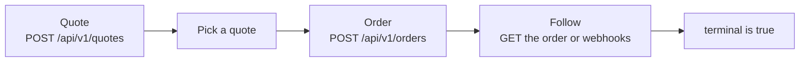

Every trade uses one flow: quote, order, follow. What differs is where the money comes from, who signs and when it settles, and each quote states all three, so you never choose them.

## At a glance

| You want to know | Read it on the quote |
| --- | --- |
| Where it trades from | `tradingSource`: an exchange or OTC account, or a wallet |
| How it is funded | `fundingModel`: `prefunded`, `credit` or `payIn` |
| How and when it settles | `settlement.method` and `settlement.timing` |
| Who signs, on an on-chain venue | `signing.mode`, rolling out: `tetrafi` or `you`. Today TetraFi signs. |
| What to do next | `next.kind`: `order` when it can be ordered |

<Steps>
  <Step title="Quote">
    `POST /api/v1/quotes` with what you sell, what you buy and one amount. Naming a wallet or account in `source` is optional: without it, each venue quotes from your defaults ([Choose wallets and accounts](/trade/wallets-and-accounts)).
  </Step>
  <Step title="Pick a quote">
    Read how it runs from the fields above. The quote fixes its source; to change it, [requote](/search/firmness-and-lifetime#requote-a-quote).
  </Step>
  <Step title="Order">
    `POST /api/v1/orders` with `quoteId`, an `Idempotency-Key`, and whatever that quote asks for (below).
  </Step>
  <Step title="Follow">
    Read `GET /api/v1/orders/{orderId}`, or receive [webhooks](/trade/webhooks), until `terminal` is `true` ([Order status](/trade/order-status)).
  </Step>
</Steps>

## The five ways a trade runs

| Way | The quote says | Before you order | At the order | When it settles | Status |
| --- | --- | --- | --- | --- | --- |
| [Exchange account](/recipes/exchange-account-order) | `prefunded`, `venueLedger` | Deposit into the account | `quoteId` | At once, inside the venue | Live |
| [OTC or credit account](/trade/settlement-and-credit#trade-on-a-credit-account) | `credit`, a `settlement.window` | Credit on the account | `quoteId`, `settlementWindowId` | In the window, netted | Live |
| [Pay-in venue](#pay-in-after-the-order) | `payIn` and its terms | Nothing | `quoteId` | When your payment is credited | Rolling out |
| [On-chain venue, TetraFi signs](/recipes/cross-chain-stablecoins) | `prefunded`, `dvp` or `fop` | Owners approve a signing grant | `quoteId` | On-chain, as its transactions confirm | Live |
| [On-chain venue, you sign](/trade/sign-with-your-own-wallet) | `signing.firstStep` | Nothing to register | `quoteId`, `firstStep` | On-chain, as its transactions confirm | Rolling out |

<AccordionGroup>
  <Accordion title="Exchange account, prefunded">
    Deposit first: `GET /api/v1/workspaces/{workspaceId}/venue-accounts/{venueAccountId}/deposit-instructions` says where. The trade spends the account's balance at the venue and settles on the venue's own ledger (`venueLedger`, `immediate`). A quote whose `next.kind` is `fund` has an account short by `readiness.amount` ([Before your first trade](/before-you-trade#fund-it)).
  </Accordion>
  <Accordion title="OTC or credit account">
    The trade goes on the account's credit and is netted with your other trades in a settlement window. The quote carries `creditPortion`, `creditCheck` and `settlement.window`; your order consents to that window with `settlementWindowId`. A trade that spends only what the account already holds settles at once instead. Settlement actions (agreeing a statement, paying) are taken by members in the TetraFi app: a key only reads them ([Credit and settlement](/trade/settlement-and-credit)).
  </Accordion>
  <Accordion title="On-chain venue, TetraFi signs">
    The trade runs from an organisation wallet on Turnkey or Privy. Its owners approve, once per venue, a signing grant with per-trade and per-day caps that the provider itself enforces, and the wallet is granted to your key ([Give a key organisation wallets](/before-you-trade#give-a-key-organisation-wallets)). TetraFi then signs each trade inside those caps, with no approval per trade. The wallet holds the funds and pays the gas.
  </Accordion>
  <Accordion title="On-chain venue, you sign">
    Name your wallet's address in `source.tradingWallets`. Each on-chain quote carries `signing.firstStep`; you sign it and send it with the order, and sign any later step on `POST /api/v1/orders/{orderId}/steps/{stepId}`. You pay your own gas ([Sign with your own wallet](/trade/sign-with-your-own-wallet), [the recipe](/recipes/own-wallet-trade)).
  </Accordion>
  <Accordion title="Settlement method and timing">

| `settlement.method` | Meaning |
| --- | --- |
| `venueLedger` | Both sides move on the venue's own books. |
| `dvp` | Delivery versus payment: what you pay and what you receive move together, as in one swap transaction. |
| `fop` | Free of payment: one side moves first; `firstLeg` says whose. `taker` is you, as with a bridge deposit or a payment you send in. |

    `settlement.timing` is `immediate`, `byDeadline` (a pay-in, by its deadline) or `delayed` (in a settlement window, or whenever either side asks). Both lists can grow: treat a value you do not know as other.
  </Accordion>
  <Accordion title="Basic and Advanced">
    Every quote you can order today is Basic: direct execution at the venue, through its own API (exchanges, OTC desks, fiat providers) or its own smart contracts (Uniswap, Across, Relay, Circle CCTP and others). On-chain does not mean Advanced. Advanced settles through TetraFi's own router and escrow and is not open yet.
  </Accordion>
  <Accordion title="What a key cannot trade from">
    A personal wallet, a custody account, or, until signing with your own wallet opens, an external wallet it signs itself. With no usable wallet, on-chain venues read `needsWallet` in `sources` ([When a quote needs a wallet](/trade/wallets-and-accounts#when-a-quote-needs-a-wallet)).
  </Accordion>
  <Accordion title="If the order's answer never reaches you">
    `GET /api/v1/orders/by-quote/{quoteId}` finds the order without placing one. Never order again with a new key ([Retries and recovery](/trade/orders#retries-and-recovery)).
  </Accordion>
  <Accordion title="Planned, not available yet">
    People approving one trade elsewhere (`signing.mode` `owners` or `custodian`, with an order `next.kind` of `approve` and an `approvalUrl`), Solana and Tron steps, more venues for your own wallet, and custody wallets that TetraFi signs for ([Sign with your own wallet](/trade/sign-with-your-own-wallet), under What comes next). Keep following the order on any value you do not know.
  </Accordion>
</AccordionGroup>

## Pay in after the order

On a `payIn` quote you order first, then send the money over the venue's own rail, such as a bank transfer. The venue delivers once your payment is credited; the quote's `payIn` states the deadline and what happens to late money.

<AccordionGroup>
  <Accordion title="The payIn terms">

| Field | Meaning |
| --- | --- |
| `payBy` | The deadline: `seconds`, counted from the quote, and `clock`. `funds_arrived`: the money must be credited at the venue by then. `payment_started`: the payment must be started by then. `null`: the venue states no deadline, and the trade settles when the money arrives. |
| `settlementGrace` | `no_grace`, or `within` with `seconds`: how long after the deadline a payment started in time may still be credited. It applies with the `payment_started` clock. |
| `afterPayBy` | What the venue does with money credited after the deadline, in `action`: `returned`; `re_priced`, where it may execute at its current price instead of the quoted one until `untilSeconds` after the quote; `held`; or `handled_by_support`. `source` cites where the venue states the rule. |

    With a deadline, `settlement.timing` is `byDeadline`. Every value list can grow: treat an unknown one as other.
  </Accordion>
  <Accordion title="Follow the payment">
    The trade's leg, in `legs[].tradeLeg` of `GET /api/v1/workspaces/{workspaceId}/trades/{tradeId}`, carries `fundingDeadlineAt` (the trade's own deadline, never later than the quote's terms), `status` (`awaiting_funds`, then `funds_received`, or `expired_unfunded` or `late_funds`), and `fundsReceivedAt` with `creditedAmount` once the venue credits it.
  </Accordion>
</AccordionGroup>

## Next

<CardGroup cols={2}>
  <Card title="Choose wallets and accounts" icon="wallet" href="/trade/wallets-and-accounts">Name the source a quote trades from.</Card>
  <Card title="Place an order" icon="cart-shopping" href="/trade/orders">Order a quote and retry safely.</Card>
</CardGroup>
