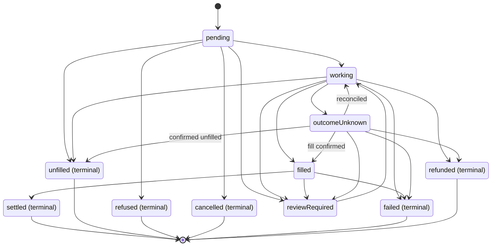

Both order kinds use the same public `status` values. The diagram shows common paths, not a required sequence: states can be skipped, and a review or uncertain outcome can interrupt progress. Always use the response's `terminal` flag to decide when to stop.

`outcomeUnknown` is not terminal and does not mean failure: the trade may have filled. `reviewRequired` is also not final; follow the response's `next` action. `refused` is final and means a pre-trade check stopped the order before anything was sent.

A final `failed` outcome does not by itself prove that nothing traded; read the recorded fills and settlement detail. [Order status](/trade/order-status#statuses) explains each value, and [Recover an uncertain order](/trade/recovering-an-order) gives the safe recovery sequence.

New status values may be added. Treat one you do not recognise as "other" and keep following `terminal`, rather than failing your parser or assuming success.
