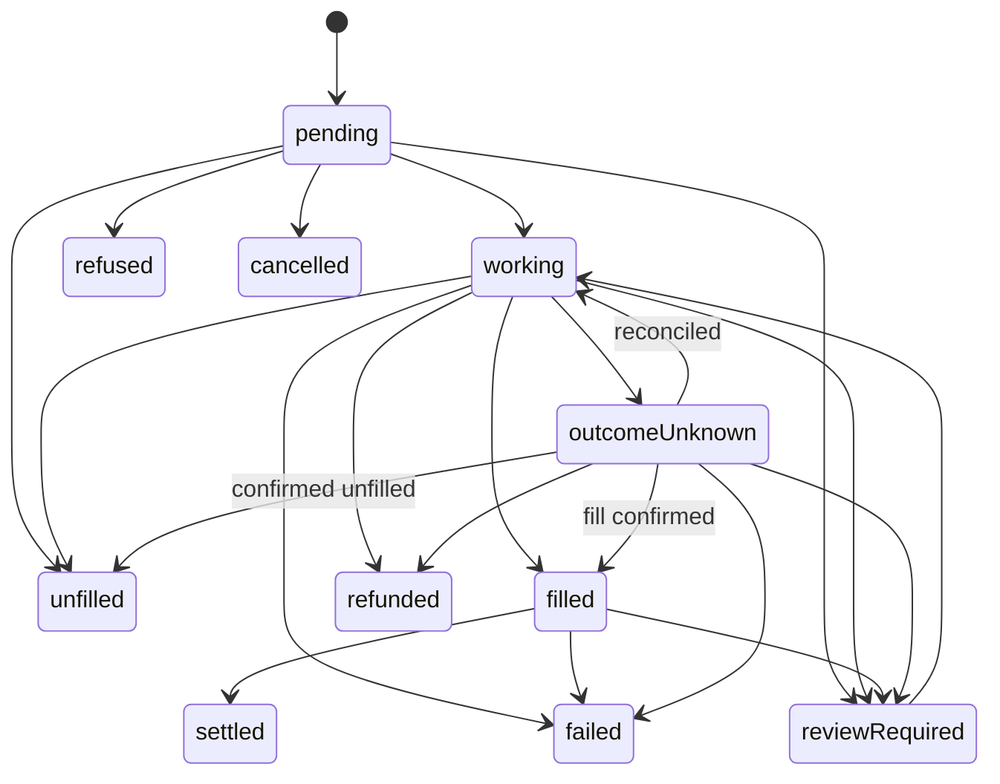

import OrderStatus from '/snippets/samples/order-status.mdx';
import OrdersList from '/snippets/samples/orders-list.mdx';
import OrderExecution from '/snippets/samples/order-execution.mdx';

Read an order at the `statusUrl` its answer gave every 10 to 15 seconds until `terminal` is `true`, or let [webhooks](/trade/webhooks) tell you when to read it.

## At a glance

| Endpoint | Permission | Result |
| --- | --- | --- |
| `GET /api/v1/orders/{orderId}` | Read orders | One order, in the same envelope as the order answer, for every kind of order. |
| `GET /api/v1/orders` | Read orders | Your workspace's orders, newest first, in the same envelope. |

- Any member or key of the workspace with that permission can read the order.
- An order that does not exist, or belongs to another workspace, answers `404 ORDER_NOT_FOUND`.
- If you lost the order answer, [recover it by its quote](/trade/orders#recover-an-order-by-its-quote).

<OrderStatus />

```json Output on test networks
{"kind":"basicTrade","status":"settled","terminal":true,"next":null}
```

## The envelope

Stop on `terminal`, never on a particular `status`; `next` says what to do meanwhile.

<Accordion title="Envelope fields">

| Field | Meaning |
| --- | --- |
| `orderId` | The order's id. |
| `kind` | `basicTrade` today. New kinds may be added: for a kind you do not recognise, keep following `status` and `terminal`, and never resubmit it. |
| `status` | Where the order is (below). |
| `terminal` | `true` when the order can no longer change. Stop on this, never on a particular `status`. |
| `next` | Present only while there is something to do meanwhile (below). |
| `statusUrl` | Where to read the order again. |
| `quoteId` | The quote it was placed from, when known. |
| `operation` | The venue trade's own detail, on a `basicTrade` order only. |

The TypeScript SDK marks a kind it does not know with `unknownKind: true` and keeps `kind`, `orderId`, `status`, `terminal` and `statusUrl`. It is an SDK marker, not a wire field.

</Accordion>

## Statuses



The diagram shows common paths, not a required sequence. An order can skip statuses: treat a status you do not recognise as "other" and keep following `terminal`.

- Not final: `pending`, `working`, `filled`, `reviewRequired`, `outcomeUnknown`.
- Final: `settled`, `unfilled`, `cancelled`, `failed`, `refunded` and `refused`.

<Warning>
`outcomeUnknown` is not a failure. Never place a new order for it: keep reading its status.
</Warning>

<AccordionGroup>
  <Accordion title="What each status means">

| `status` | What it means | Final? | What to do |
| --- | --- | --- | --- |
| `pending` | Accepted; nothing sent to a venue yet. | No | Keep reading. |
| `working` | Sent to the venue and executing, including an on-chain trade waiting to confirm. | No | Keep reading. |
| `filled` | Executed; settlement or delivery is still to complete. | No | Keep reading until it is final. |
| `reviewRequired` | A person must review it, such as for a compliance hold. | No | Keep reading. |
| `outcomeUnknown` | TetraFi lost track of the outcome and is reconciling it. The trade may have filled. | No | Keep reading. Never place a new order for it. |
| `settled` | Executed and settled, or there was nothing to settle. | Yes | Nothing. |
| `unfilled` | Not filled, or never sent, for example because the wallet refused to sign (`operation.dispatch.notSentCause`). Nothing traded. | Yes | To trade, order a new quote. |
| `refused` | A pre-trade check refused it before anything was sent; `operation.complianceRefusal` says why. | Yes | Clear the cause, then request a new quote. |
| `cancelled` | Cancelled before it was sent. | Yes | To trade, order a new quote. |
| `failed` | Failed; nothing more will happen. A `failed` order does not by itself prove nothing traded. | Yes | Read the fills and settlement detail, and `settlement.failureReason`. |
| `refunded` | Your funds were returned. | Yes | Read `settlement.failureReason`. |

For a `failed` or `refunded` order, the trade history's `settlement.failureReason` says why in words ([Read one trade](/trade/trade-history#read-one-trade)).

  </Accordion>
  <Accordion title="While it is not final: next.kind">

| `next.kind` | What to do |
| --- | --- |
| `wait` | Read it again after `retryAfter`, an ISO 8601 duration such as `PT15S`. |
| `contact` | Contact support with `reference`: a person has to look at the order. |

Without `next`, poll every 10 to 15 seconds.

  </Accordion>
</AccordionGroup>

## What the order did

A `basicTrade` order also records what it actually did, never the quote carried forward: its `fills`, `fees` and the amounts that landed.

<AccordionGroup>
  <Accordion title="Execution fields">

| Field | Meaning |
| --- | --- |
| `fills` | Each confirmed fill in execution order: `fillId` (stable: deduplicate repeated reads by it), `amount` delivered, `sellAmount`, `price`, `at`, `venue`, and `txHash` with `network` for an on-chain fill. Empty until a fill is confirmed; a field not recorded is `null`. |
| `quotedBuyAmount` | What the executed quote said would land. `null` when not known. |
| `settledBuyAmount` | What actually landed. `null` until measured. |
| `fees` | Each fee charged: `kind`, `amount`, `asset`, `chain` for an on-chain charge, and `includedInPrice` (`true`: the venue took it inside its price, so it is not charged on top). |
| `unrecordedFees` | Fee kinds the order incurred whose amount is not recorded. Show these as "not recorded", never 0. |
| `settlesBy` | The latest time the order settles or can no longer execute under its recorded terms (below). |

A fee's `kind` is `trading`, `relayer`, `forwarding`, `transfer`, `network` (gas the order's wallet paid) or `platform` (the TetraFi fee). Show a kind you do not recognise generically.

  </Accordion>
  <Accordion title="Example: read what an order did">
    <OrderExecution />

    ```json Output on test networks
    {"orderId":"9410e38e-…","kind":"basicTrade","quotedBuyAmount":"0.499751","settledBuyAmount":"0.499751","fills":[{"amount":"0.499751","at":"2026-11-02T01:37:12Z","network":"eip155:11155111"}],"fees":[{"kind":"relayer","amount":"0.000249","asset":"USDC","includedInPrice":false},{"kind":"network","amount":"0.000000332622","asset":"ETH","includedInPrice":false},{"kind":"network","amount":"0.000000438318","asset":"ETH","includedInPrice":false},{"kind":"platform","amount":"0.000049","asset":"USDC","includedInPrice":false}],"unrecordedFees":[],"settlesBy":null}
    ```
  </Accordion>
</AccordionGroup>

## When it settles

A quote's `expiresAt` is its ordering deadline, and its `eta` an expected delivery time; neither says the order settled. `settlesBy` on the order is the recorded deadline.

<Accordion title="How to read settlesBy">
  - For an on-chain Basic swap, it is the last wallet step's send-by time.
  - It is `null` when no deadline is recorded, as for an exchange account trade or a same-chain DEX swap whose call carries none.
  - A `null` is not immediate settlement, and a passed `settlesBy` is not proof of failure: keep reading until `terminal` is `true`.

  Trades on venues that settle on a schedule have their obligations and windows in [Settlement and credit](/trade/settlement-and-credit).
</Accordion>

## List your orders

`GET /api/v1/orders` lists your workspace's orders, newest first, up to 20 a page; in the app, the same orders appear under Trades.

<AccordionGroup>
  <Accordion title="Filters and paging">

| Query parameter | What it filters |
| --- | --- |
| `status` | One status from the list above. |
| `kind` | `basicTrade` or `advancedTrade`. |
| `sellAsset`, `buyAsset` | The asset sold or bought, such as `USDC`. |
| `from`, `to` | Created at or after, and at or before, an RFC 3339 time. |
| `limit`, `cursor` | Up to 20 orders a page (the default); the previous page's `nextCursor`. |

- A filtered page can hold fewer than `limit` orders, even none, with `scanLimitReached: true` and a `nextCursor` while more remain. Keep following `nextCursor` until it is `null`.
- A cursor belongs to the key and its filters; any other answers `400 INVALID_CURSOR` ([Conventions](/reference/conventions)).

</Accordion>
  <Accordion title="Example: list the last 30 days">
    <OrdersList />

    ```json Output on test networks (shortened)
    orders: 100 across 5 pages
    {"orderId":"b7670e34-…","kind":"basicTrade","status":"unfilled","terminal":true}
    {"orderId":"dad901ac-…","kind":"basicTrade","status":"settled","terminal":true}
    ```
  </Accordion>
</AccordionGroup>

<Card title="Run the full script" icon="terminal" href="https://github.com/TetraFi/docs/blob/main/samples/http/orders-list.sh">
  Lists your orders with filters, pages through them and reads what one order did.
</Card>

## Next

<CardGroup cols={2}>
  <Card title="Webhooks" icon="bell" href="/trade/webhooks">
    Get told when an order changes instead of polling.
  </Card>
  <Card title="Trade history" icon="clock-rotate-left" href="/trade/trade-history">
    Read one trade's settlement and failure reason.
  </Card>
</CardGroup>
