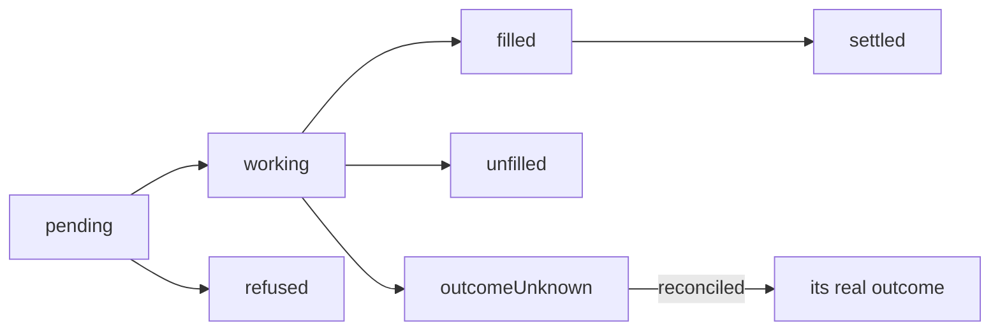

import OrderStatus from '/snippets/samples/order-status.mdx';
import OrdersList from '/snippets/samples/orders-list.mdx';
import OrderExecution from '/snippets/samples/order-execution.mdx';

Read an order at its `statusUrl` every 10 to 15 seconds, or after `next.retryAfter`, until `terminal` is `true`. [Webhooks](/trade/webhooks) can tell you when to read it.

## At a glance

Both need Read orders. One order, and each item in the list's `items` page, comes in the same envelope as the order answer, for every kind of order.

| Endpoint | Result |
| --- | --- |
| [`GET /api/v1/orders/{orderId}`](/api-reference/orders/get-order) | One order. |
| [`GET /api/v1/orders`](/api-reference/orders/list-orders) | Your workspace's orders, newest first. |

Any member or key of the workspace with Read orders can read an order; one that does not exist, or belongs to another workspace, answers `404 ORDER_NOT_FOUND`. Lost the order answer? [Recover it by its quote](/trade/orders#recover-an-order-by-its-quote).

<OrderStatus />

```json Example output
{"kind":"basicTrade","status":"settled","terminal":true,"next":null}
```

## The envelope

Stop on `terminal`, never on a particular `status`; `next` says what to do meanwhile.

<Accordion title="Envelope fields">

<ResponseField name="orderId" type="string">The order's id.</ResponseField>
<ResponseField name="kind" type="string">`basicTrade` today: one venue trade. New kinds may be added, such as routes over several venues (coming); every kind carries `orderId`, `kind`, `status`, `terminal` and `statusUrl`, and `next` while there is something to do. For a kind you do not recognise, keep following `status` and `terminal`, and never resubmit it ([Designed to grow](/reference/conventions#designed-to-grow)).</ResponseField>
<ResponseField name="status" type="string">Where the order is (below).</ResponseField>
<ResponseField name="terminal" type="boolean">`true` when the order can no longer change. Stop on this, never on a particular `status`.</ResponseField>
<ResponseField name="next" type="object">Present only while there is something to do meanwhile (below).</ResponseField>
<ResponseField name="statusUrl" type="string">Where to read the order again.</ResponseField>
<ResponseField name="quoteId" type="string">The quote it was placed from, when known.</ResponseField>
<ResponseField name="operation" type="object">The venue trade's own detail, on a `basicTrade` order only.</ResponseField>

The TypeScript SDK marks a kind it does not know with `unknownKind: true` and keeps `kind`, `orderId`, `status`, `terminal` and `statusUrl`. It is an SDK marker, not a wire field.

</Accordion>

## Statuses



The top row is an order that fills and settles; an order can skip statuses, and `terminal` always decides. Treat a value you do not know as other ([Conventions](/reference/conventions#values)); keep following `terminal`.

| Not final | Final |
| --- | --- |
| `pending`, `working`, `filled`, `reviewRequired`, `outcomeUnknown` | `settled`, `unfilled`, `cancelled`, `failed`, `refunded`, `refused`, and `filled` when `terminal` is `true` |

<Accordion title="Every other transition">

| From | Can also go to |
| --- | --- |
| `pending` | `cancelled`, `unfilled`, `reviewRequired` |
| `working` | `failed`, `refunded`, `reviewRequired` |
| `filled` | `failed`, `reviewRequired` |
| `reviewRequired` | `working` |
| `outcomeUnknown` | Once reconciled: `working`, `filled`, `unfilled`, `failed`, `refunded` or `reviewRequired` |

</Accordion>

<Warning>
`outcomeUnknown` is not a failure. Never place a new order for it: keep reading its status.
</Warning>

<AccordionGroup>
  <Accordion title="What each status means">

| `status` | What it means, and what to do |
| --- | --- |
| `pending` | Not final. Accepted; nothing sent to a venue yet. Keep reading. |
| `working` | Not final. Sent to the venue and executing, including an on-chain trade waiting to confirm. Keep reading. |
| `filled` | Executed. Usually not final: settlement or delivery is still to complete, so keep reading. A fill on credit stays here, with `settlementStatus` `awaitingWindow`, until its settlement window settles; a fill paid from a venue balance settles at once and goes straight to `settled`. A trade on a credit venue with no recorded settlement terms ends here, with `terminal` `true`. |
| `reviewRequired` | Not final. A person must review it, such as for a compliance hold. Keep reading. |
| `outcomeUnknown` | Not final. TetraFi lost track of the outcome and is reconciling it. The trade may have filled. Keep reading. Never order again. |
| `settled` | Final. Executed and settled, or there was nothing to settle. Nothing to do. |
| `unfilled` | Final. Not filled, or never sent, for example because the wallet refused to sign. Nothing traded. To trade, order a new quote. |
| `refused` | Final. A pre-trade check refused it before anything was sent. Clear the cause, then request a new quote. |
| `cancelled` | Final. Cancelled before it was sent. To trade, order a new quote. |
| `failed` | Final. Failed; nothing more will happen. A `failed` order does not by itself prove nothing traded. Read the fills, the settlement detail and its failure reason (below). |
| `refunded` | Final. Your funds were returned. Read its failure reason (below). |

An `unfilled` order that was never sent names the cause in `operation.dispatch.notSentCause`; for a `refused` one, `operation.complianceRefusal` says why.

For a `failed` or `refunded` order, the trade history's `settlement.failureReason` says why in words ([Read one trade](/trade/trade-history#read-one-trade)).

  </Accordion>
  <Accordion title="While it is not final: next.kind">

| `next.kind` | What to do |
| --- | --- |
| `wait` | `next.kind: "wait"`: read it again after `retryAfter`, an ISO 8601 duration such as `PT15S`. |
| `contact` | `next.kind: "contact"`: contact support with `reference`; a person has to look at the order. |
| `sign` | Rolling out, for your own wallet: sign `next.step`, which names its `stepId`, `legId` and `signer` ([Sign with your own wallet](/trade/sign-with-your-own-wallet#submit-a-step)). |

Without `next`, poll every 10 to 15 seconds.

  </Accordion>
</AccordionGroup>

## What the order did

A `basicTrade` order records what it actually did, not the quote: its `fills`, `fees` and the amounts that landed.

<AccordionGroup>
  <Accordion title="Execution fields">

<ResponseField name="fills" type="object[]">Each confirmed fill in execution order: `fillId` (stable: deduplicate repeated reads by it), `legId` (the quote leg it fills), `amount` delivered, `sellAmount`, `price`, `at`, `venue`, `network`, and `txHash` for an on-chain fill. Empty until a fill is confirmed; a field not recorded is `null`.</ResponseField>
<ResponseField name="quotedBuyAmount" type="string">What the executed quote said would land. `null` when not known.</ResponseField>
<ResponseField name="settledBuyAmount" type="string">What actually landed. `null` until measured.</ResponseField>
<ResponseField name="fees" type="object[]">Each fee charged: `kind`, `amount`, `asset`, `network` (CAIP-2) for an on-chain charge, and `includedInPrice` (`true`: the venue took it inside its price, so it is not charged on top).</ResponseField>
<ResponseField name="unrecordedFees" type="string[]">Fee kinds the order incurred whose amount is not recorded. Show these as "not recorded", never 0.</ResponseField>
<ResponseField name="settlesBy" type="string">The latest time the order settles or can no longer execute under its recorded terms (below).</ResponseField>

The order's own `venueId` and `venueName` summarise a single-venue order; each fill names its own `venue`, so read the fills when an order runs over several venues (coming).

A fee's `kind` is `trading`, `relayer`, `forwarding`, `transfer`, `network` (gas the order's wallet paid) or `platform` (the TetraFi fee). Show a kind you do not recognise generically.

  </Accordion>
  <Accordion title="Example: read what an order did">
    <OrderExecution />

    ```json Example output
    {"orderId":"9410e38e-…","kind":"basicTrade","quotedBuyAmount":"0.499751","settledBuyAmount":"0.499751","fills":[{"amount":"0.499751","at":"2026-11-02T01:37:12Z","network":"eip155:11155111"}],"fees":[{"kind":"relayer","amount":"0.000249","asset":"USDC","includedInPrice":false},{"kind":"network","amount":"0.000000332622","asset":"ETH","includedInPrice":false},{"kind":"network","amount":"0.000000438318","asset":"ETH","includedInPrice":false},{"kind":"platform","amount":"0.000049","asset":"USDC","includedInPrice":false}],"unrecordedFees":[],"settlesBy":null}
    ```
  </Accordion>
</AccordionGroup>

## When it settles

A quote's `expiresAt` is its ordering deadline and `eta` an expected delivery time; neither says the order settled. The order's `settlesBy` is the recorded deadline.

<Accordion title="How to read settlesBy">
  - For an on-chain Basic swap, it is the last wallet step's send-by time.
  - It is `null` when no deadline is recorded, as for an exchange account trade or a same-chain DEX swap whose call carries none.
  - A `null` is not immediate settlement, and a passed `settlesBy` is not proof of failure: keep reading until `terminal` is `true`.

  Trades on venues that settle on a schedule have their obligations and windows in [Settlement and credit](/trade/settlement-and-credit).
</Accordion>

## List your orders

`GET /api/v1/orders` lists your workspace's orders, newest first, up to 20 a page; the app shows them under **Trades**.

<AccordionGroup>
  <Accordion title="Filters and paging">

<ParamField query="status" type="string">One status from the list above.</ParamField>
<ParamField query="kind" type="string">`basicTrade` or `advancedTrade`.</ParamField>
<ParamField query="sell, buy" type="string">The asset sold or bought, such as `USDC`, as the quote request names them.</ParamField>
<ParamField query="from, to" type="string">Created at or after, and at or before, an RFC 3339 time.</ParamField>
<ParamField query="limit, cursor" type="integer, string">Up to 20 orders a page (the default); the previous page's `nextCursor`.</ParamField>

- A filtered page can hold fewer than `limit` orders, even none, with a `nextCursor` while more remain. Keep following `nextCursor` until it is `null`.
- A cursor belongs to the key and its filters; any other answers `400 CURSOR_INVALID` ([Conventions](/reference/conventions)).

</Accordion>
  <Accordion title="Example: list the last 30 days">
    <OrdersList />

    ```json Example output (shortened)
    orders: 100 across 5 pages
    {"orderId":"b7670e34-…","kind":"basicTrade","status":"unfilled","terminal":true}
    {"orderId":"dad901ac-…","kind":"basicTrade","status":"settled","terminal":true}
    ```
  </Accordion>
</AccordionGroup>

<Card title="Run the full script" icon="terminal" href="https://github.com/TetraFi/docs/blob/main/samples/http/orders-list.sh">
  Lists and pages your orders, and reads what one did.
</Card>

## Next

<CardGroup cols={2}>
  <Card title="Webhooks" icon="bell" href="/trade/webhooks">
    Get told when an order changes instead of polling.
  </Card>
  <Card title="Trade history" icon="clock-rotate-left" href="/trade/trade-history">
    Read one trade's settlement and failure reason.
  </Card>
</CardGroup>
