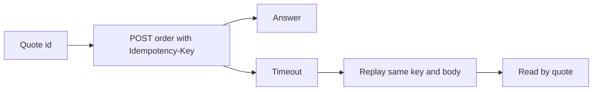

import OrderPlace from '/snippets/samples/order-place.mdx';
import OrderCancel from '/snippets/samples/order-cancel.mdx';
import OrderIdempotentReplay from '/snippets/samples/order-idempotent-replay.mdx';
import OrderIdempotencyConflict from '/snippets/samples/order-idempotency-conflict.mdx';
import OrderRecoverByQuote from '/snippets/samples/order-recover-by-quote.mdx';

Order a quote you hold by naming its id: ordering it is the accept, with no separate accept call, and TetraFi executes it through your venue account or an organisation wallet granted to your key.

## At a glance

| Endpoint | Permission | Result |
| --- | --- | --- |
| `POST /api/v1/orders` | Submit orders, with venue trading and request signing ([Authentication](/authentication#trade-on-your-venue-accounts)) | The recorded order. |
| `GET /api/v1/orders/by-quote/{quoteId}` | Read orders | What a quote produced. |
| `POST /api/v1/orders/{orderId}/cancel` | Submit orders | The order, `cancelled`. |



You need a quote whose `next.kind` is `order`, and an account or wallet that holds what you sell ([Before your first trade](/before-you-trade)).

<Accordion title="Which quotes you can order">
  Today you can order Basic quotes (`legs[].venue.integrationMode` `basic`): TetraFi executes them from your venue account, or from an organisation wallet granted to your key inside the limits its owners approved.
</Accordion>

## Place an order

<Steps>
  <Step title="Choose an Idempotency-Key">
    An API key must send one with every order. Generate a new random value and save it with the exact body before you send.

    <Warning>
    Retry only with the same key and body. A new key on a retry can place a second order.
    </Warning>
  </Step>
  <Step title="Send the order">
    `POST /api/v1/orders` with the `Idempotency-Key` header. TetraFi kept the quote's terms, so send only what you alone can supply.

    | Field | Required | Value |
    | --- | --- | --- |
    | `quoteId` | Yes | The quote id (`q_…`). |
    | `minReceive` | When the quote's `minReceiveRequired` is `true` | The least you accept to receive, in units of the asset you buy, such as `"4.99"`. |

    Each quote can be ordered once.

    <Accordion title="Fields a Basic quote refuses">
      Leave out `signature` and `priceProtectionBps`: a Basic quote refuses them.
    </Accordion>

    <OrderPlace />

    ```json Response (shortened) expandable
    {
      "kind": "basicTrade",
      "orderId": "acb84378-…",
      "quoteId": "q_01M5XJXR…",
      "status": "working",
      "terminal": false,
      "statusUrl": "/api/v1/orders/acb84378-…",
      "operation": {
        "connectionId": "15862432-…",
        "operationId": "acb84378-…"
      }
    }
    ```
  </Step>
  <Step title="Follow it to the end">
    The answer comes when the order is recorded, not when it completes: a `2xx` only means the order exists. Follow it at `statusUrl` until `terminal` is `true`, or with [webhooks](/trade/webhooks) ([Order status](/trade/order-status)).

    <Accordion title="On-chain orders that answer working before signing">
      A Basic order on an on-chain venue answers `working` before its wallet signs. If the wallet then refuses to sign, nothing is sent and the order ends `unfilled`, with the cause in `operation.dispatch.notSentCause`.
    </Accordion>
  </Step>
</Steps>

## Minimum receive

Send `minReceive` when the quote reads `minReceiveRequired: true`; otherwise it is your own optional floor.

### Venues that execute within your limit

<AccordionGroup>
  <Accordion title="Which venues need minReceive">
    Some venues are asked for their price only when you order:

    - desks whose firm prices last too few seconds to confirm;
    - on-chain venues, such as bridges, that TetraFi trades for you from an organisation wallet.

    Their quotes are often indicative with `next.kind: "order"`, and read `minReceiveRequired: true`. Read the flag rather than working it out from `quality`.
  </Accordion>
  <Accordion title="minReceive or priceProtectionBps">
    `priceProtectionBps` belongs on the quote request, where it sets `minOut` ([Price protection](/search/how-it-works#filters-and-sort)); `minReceive` belongs on the order.
  </Accordion>
  <Accordion title="What happens when minReceive is not met">

| Quote | `minReceive` | If it is not met |
| --- | --- | --- |
| `minReceiveRequired: true` | Required. The trade happens only if the venue delivers at least that. | Missing: `400 MIN_RECEIVE_REQUIRED`, and nothing is sent. |
| Any other Basic quote | Optional: your own floor. | The venue's held firm price already delivers less: `409 VENUE_QUOTE_OUTSIDE_BOUNDS`. |

  </Accordion>
</AccordionGroup>

## Retries and recovery

A timeout, dropped connection, `5xx` or `status: "outcomeUnknown"` does not prove an order failed: the trade may have filled. Resolve it by reading, never by ordering again.

<AccordionGroup>
  <Accordion title="Send a key with every order">
    Every `POST /api/v1/orders` with an API key needs an `Idempotency-Key` header, or it is refused with `400 IDEMPOTENCY_KEY_REQUIRED`.

    - Generate a new random value per order, such as 32 hexadecimal characters: exactly one value, 1 to 255 bytes, with no surrounding spaces (otherwise `400 IDEMPOTENCY_KEY_INVALID`).
    - Store the key and the exact body with your record of the order before you send it, so a retry after a crash can reuse both.
    - Keys are scoped to your workspace and the endpoint. Cancelling an order takes its own key the same way.
  </Accordion>
  <Accordion title="Replay: same key, same body">
    The same body with the same key returns the first answer, with the header `Idempotent-Replayed: true`, and places nothing else.

    - The body is compared by content, so whitespace and key order do not matter.
    - A replay of a placed order returns that order even after the quote expired.

    <OrderIdempotentReplay />

    ```json Output
    {"replayedSameOrder":true}
    ```

    On a signed key, a replay still signs again with a fresh `X-Timestamp` and `X-Nonce`: the idempotency key, not the signature, is what makes the retry safe ([Sign requests](/authentication#sign-requests)).
  </Accordion>
  <Accordion title="When to retry">

| Answer | What it means | What to do |
| --- | --- | --- |
| No answer (timeout, dropped connection) | The order may or may not have been placed. | Send the same body with the same key. |
| `409 ORDER_IN_PROGRESS` | An order with this key is still being placed. | Wait `Retry-After`, then read the order. |
| `503 IDEMPOTENCY_UNAVAILABLE`, `QUOTE_STORE_UNAVAILABLE` | The key or the held quote could not be read just now. | Send the same body and key after a second. |
| `403 IDEMPOTENCY_AUTHORITY_REQUIRED` | A replay, but the key no longer holds the permission the first order needed. | Restore the permission, then replay. |
| `409 QUOTE_ALREADY_ORDERED` | Another order, sent with a different key, already used this quote. It is not a failure. | Recover by quote. |
| `409 IDEMPOTENCY_CONFLICT` | The key was used for a different body. | Fix your code, then recover by quote. |

  </Accordion>
</AccordionGroup>

### Conflict: same key, different body

Reusing a key with a different body is refused with `409 IDEMPOTENCY_CONFLICT`, and nothing is placed.

<Accordion title="Example: a changed body on a reused key">
  A conflict means your code reused a key by mistake. Use a new key for a new order, but only after you have [recovered by quote](#recover-an-order-by-its-quote). Here the same quote with a `minReceive` added counts as a different body:

  <OrderIdempotencyConflict />

  ```json Output
  {"reusedKeyWithNewBody":"IDEMPOTENCY_CONFLICT"}
  ```
</Accordion>

### Recover an order by its quote

Read `GET /api/v1/orders/by-quote/{quoteId}` whenever you lost the answer, the key or both.

<AccordionGroup>
  <Accordion title="States and what to do">

It says what a quote produced, never places anything, and works after the quote expired.

| `state` | What it means | What to do |
| --- | --- | --- |
| `ordered` | An order exists. | Follow its `statusUrl` until `terminal` ([Order status](/trade/order-status)). Do not order again. |
| `notOrdered` | No order was placed with this quote. | If `expired` is `false`, order it with the saved body and key. If `true`, requote or search again. |
| `unknown` | TetraFi cannot yet prove either way. | Wait and read again. Do not order. |

An unknown quote id, or one from another workspace, answers `404 QUOTE_NOT_FOUND`. A failed read answers `503 QUOTE_ORDER_UNAVAILABLE`: retry the read, never the order.

  </Accordion>
  <Accordion title="Example: recover by quote">
    <OrderRecoverByQuote />

    ```json
    {"state":"ordered","orderId":"acb84378-…","statusUrl":"/api/v1/orders/acb84378-…"}
    {"state":"notOrdered","expired":false}
    ```
  </Accordion>
</AccordionGroup>

### The recovery sequence

<Steps>
  <Step title="Replay">
    Send the saved body with the saved key.
  </Step>
  <Step title="Read by quote">
    Read `GET /api/v1/orders/by-quote/{quoteId}`, even if the replay failed.
  </Step>
  <Step title="Follow">
    Follow the order it names until `terminal` is `true`.

    <Accordion title="On the way to terminal">
      Keep following through `outcomeUnknown`, `next.kind: "wait"` (read again after `retryAfter`) or `next.kind: "contact"` (contact support with `reference`).
    </Accordion>
  </Step>
</Steps>

<Warning>
Never retry with a new key, change the body, or treat `unknown` or a failed read as "not ordered". Only `notOrdered`, or a final status that did not fill, makes it safe to order again, on a new quote.
</Warning>

## Cancel an order

`POST /api/v1/orders/{orderId}/cancel`, with an `Idempotency-Key` and Submit orders, cancels an order not yet sent to a venue, or a pay-in still waiting for your funds.

<AccordionGroup>
  <Accordion title="When a cancel is refused">
    It answers the order with `status` `cancelled`; cancelling again changes nothing.

    - A Basic venue trade is sent as soon as it is placed, so in practice you can cancel only while it waits for a pay-in.
    - After it is sent, its funding or delivery moved, or it ended, the cancel is refused with `409 ORDER_NOT_CANCELLABLE` and the status in `details.status`.
    - TetraFi never cancels at the venue and never refunds.
  </Accordion>
  <Accordion title="Example: cancel an order">
    <OrderCancel />

    ```json Output on test networks
    {"error":"ORDER_NOT_CANCELLABLE","status":"unfilled"}
    ```
  </Accordion>
</AccordionGroup>

## Refusals

A refused order answers the standard [error body](/trade/errors#read-a-refusal).

<Accordion title="Order refusal codes">

Unless the table says otherwise, nothing was sent. [Error codes](/reference/error-codes) lists every code.

| Code | Status | Why | What to do |
| --- | --- | --- | --- |
| `INVALID_REQUEST` | 400 | A field is unknown or malformed, or `priceProtectionBps` was sent on a Basic quote. | Fix the field `message` names. |
| `SIGNATURE_NOT_ACCEPTED` | 400 | A `signature` was sent on a quote that takes none. | Leave it out. |
| `MIN_RECEIVE_REQUIRED`, `MIN_RECEIVE_INVALID` | 400 | `minReceive` is missing on a quote that needs it, or is not a positive amount. | Send it as a positive decimal string. |
| `ADVANCED_MODE_DISABLED` | 403 | The quote is Advanced, which is not open yet. | Order a Basic quote. |
| `QUOTE_NOT_FOUND` | 404 | No quote with this id is available to you. | Check the id. |
| `QUOTE_NOT_EXECUTABLE`, `QUOTE_NOT_HELD` | 409 | The quote is a price for comparison, or is no longer held. `next` is `requote`. | [Requote it](/search/firmness-and-lifetime#requote-a-quote). |
| `VENUE_QUOTE_SEND_WINDOW_CLOSED` | 409 | The venue's firm price reached its send deadline before the order could be sent, so it was not sent. | Request a new quote and order it. |
| `QUOTE_RECONFIRMATION_REQUIRED` | 409 | The venue's firm price could no longer be accepted when the order reached it, so it was not sent. | Request a new quote and order it. |
| `QUOTE_ALREADY_ORDERED` | 409 | Another order already used this quote. | Find it by its quote ([Recover an order by its quote](#recover-an-order-by-its-quote)). |
| `VENUE_QUOTE_OUTSIDE_BOUNDS` | 409 | The venue's held firm price is below your `minReceive`. | Lower `minReceive` or get a new price. |
| `FUNDING_SHORTFALL` | 409 | The venue account holds less than the trade needs. `next` is `fund`. | Fund the account, then get a new price. |
| `PILOT_TRADE_CAP_EXCEEDED` | 409 | Above the venue's Pilot per-trade cap. | Get a price for a smaller amount. |
| `IDEMPOTENCY_*`, `ORDER_IN_PROGRESS` | 400, 409, 503 | The `Idempotency-Key` is missing, malformed, reused, or its order is still being placed. | [Retries and recovery](#retries-and-recovery). |
| `QUOTE_EXPIRED` | 410 | Past `expiresAt`. `next` is `requote`. | [Requote it](/search/firmness-and-lifetime#refresh-an-expired-quote). |
| `REQUOTE_WINDOW_CLOSED` | 410 | Past `retainUntil`. `next` is `search`. | Search again. |
| `QUOTE_STORE_UNAVAILABLE`, `VENUE_TEMPORARILY_REFUSED` | 503 | Held quotes cannot be read just now, or the venue briefly refused. | Send the same request with the same key shortly. |

</Accordion>

<Card title="Run the full script" icon="terminal" href="https://github.com/TetraFi/docs/blob/main/samples/http/orders.sh">
  Places one order with an Idempotency-Key, replays it, reuses the key on a changed body, recovers the order by quote and reads its status.
</Card>

## Next

<CardGroup cols={2}>
  <Card title="Order status" icon="list-check" href="/trade/order-status">
    Follow the order until it is final.
  </Card>
  <Card title="Errors" icon="triangle-exclamation" href="/trade/errors">
    Read a refusal and decide whether to retry.
  </Card>
</CardGroup>
