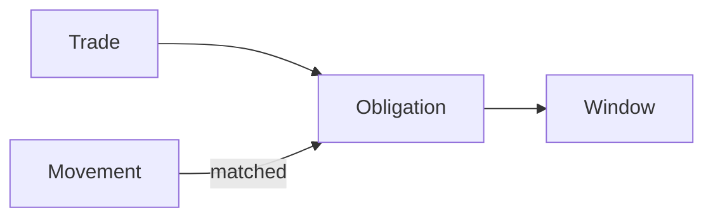

import TradesList from '/snippets/samples/trades-list.mdx';
import TradeDetail from '/snippets/samples/trade-detail.mdx';
import CreditMonitor from '/snippets/samples/credit-monitor.mdx';
import CreditLedger from '/snippets/samples/credit-ledger.mdx';
import SettlementPlan from '/snippets/samples/settlement-plan.mdx';
import SettlementWindows from '/snippets/samples/settlement-windows.mdx';
import SettlementObligations from '/snippets/samples/settlement-obligations.mdx';
import SettlementMovements from '/snippets/samples/settlement-movements.mdx';
import TradeSettlement from '/snippets/samples/trade-settlement.mdx';
import CreditQuoteFunding from '/snippets/samples/credit-quote-funding.mdx';
import CreditQuoteRefusal from '/snippets/samples/credit-quote-refusal.mdx';
import CreditOrderWindow from '/snippets/samples/credit-order-window.mdx';
import CreditOrderRefusals from '/snippets/samples/credit-order-refusals.mdx';
import CreditTradeReadback from '/snippets/samples/credit-trade-readback.mdx';

Read every trade your workspace placed or made on an exchange account, and the credit and settlement behind each venue account. On a credit account you trade first and settle later: what you owe is netted over a settlement window, then paid.

<Note>
  **What an API key can do.** A key quotes, orders, and reads balances, credit and settlement. It never takes a settlement action. Agreeing a statement, disputing it, marking a payment sent and paying are done by signed-in members in the TetraFi app. A key that tries one gets `403 JWT_REQUIRED`.
</Note>

## At a glance

Paths are under `/api/v1/workspaces/{workspaceId}`.

| Endpoint | Permission | Result |
| --- | --- | --- |
| `GET …/trades` | Read trades | Orders and exchange-account trades, newest first. |
| `GET …/trades/{tradeId}` | Read trades | One trade, with how it ended. |
| `GET …/trades/{tradeId}/settlement` and `…/settlement/obligations` | Read settlements | Your side of one trade's settlement. |
| `GET …/settlement/plan` | Read settlements | What is due across your venue accounts. |
| `GET …/venue-accounts/{venueAccountId}/settlement/…` | Read settlements | One account's movements, obligations, schedules, windows and matches. |
| `GET …/venue-accounts/{venueAccountId}/credit` and `…/ledger` | Treasury read | The account's credit line and positions. |
| `settlement.*` and `credit.updated` [webhooks](#webhooks) | Read settlements, Treasury read | A window ready, a payment due or overdue, a payment matched, credit changed. |



<AccordionGroup>
  <Accordion title="What each read needs">
    Your `workspaceId` comes from `GET /api/v1/me`; another answers `404 WORKSPACE_NOT_FOUND`. Take a `venueAccountId` from [`GET …/venue-enablements`](/trade/balances#list-your-exchange-accounts). Permissions are in [Permissions](/authentication#permissions) and [Before your first trade](/before-you-trade).

| Reads | Key permission | Key owner's workspace permission |
| --- | --- | --- |
| Trade history | Read trades | None; without View compliance records, only its own trades |
| Settlement plan, trades, windows, obligations, movements, schedules | Read settlements (`settlements_read`) | View settlements |
| `…/credit` | Treasury read | View wallets and View credit |
| `…/ledger` | Treasury read | View wallets |

  </Accordion>
</AccordionGroup>

<CardGroup cols={3}>
  <Card title="Trade history" icon="clock-rotate-left" href="#trade-history">Every trade, filtered and paged.</Card>
  <Card title="Credit" icon="credit-card" href="#credit-and-the-ledger">Credit line and positions.</Card>
  <Card title="Settlement" icon="scale-balanced" href="#settlement">Windows, obligations and movements.</Card>
  <Card title="Trade on credit" icon="arrow-right-arrow-left" href="#trade-on-a-credit-account">Funding, windows and refusals.</Card>
  <Card title="Webhooks" icon="bell" href="#webhooks">React instead of polling.</Card>
  <Card title="Refusals" icon="triangle-exclamation" href="#refusals">Codes and what to do.</Card>
</CardGroup>

## Trade history

`GET /api/v1/workspaces/{workspaceId}/trades` lists orders placed through the API or app and trades on your exchange accounts, newest first, for reconciliation and reporting. To follow one order, read its `statusUrl` ([Order status](/trade/order-status)).

### Read a page

Filter by `kind`, `status`, `from` and `to`; page with `cursor` until `nextCursor` is `null`.

<AccordionGroup>
  <Accordion title="Fields and parameters">

| Field | Meaning |
| --- | --- |
| `tradeId` | The trade's id. |
| `kind` | `order` (placed through TetraFi) or `venueTrade` (on your exchange account). Show an unknown kind generically. |
| `projection` | The view read through: `workspace` for an API key. |
| `createdAt` | When the trade was placed. |

The page also carries `total` (rows matching your filters), `limit` and `nextCursor`.

| Parameter | Use |
| --- | --- |
| `kind` | `all`, `order` or `venueTrade`. |
| `status` | Rows in this status. |
| `from`, `to` | RFC 3339 times: placed at or after, at or before. |
| `limit` | The page size, 25 by default. |
| `cursor` | The last `nextCursor`, same filters, until `null`. |
| `format=csv` | The same rows as CSV. |

  </Accordion>
  <Accordion title="Request and output">

<TradesList />

```json Output on test networks
{"total":628,"nextCursor":true,"coverage":null,"excludedKinds":null}
{"tradeId":"9410e38e-…","kind":"venueTrade","projection":"workspace","createdAt":"2026-11-02T01:36:46.856947Z"}
{"tradeId":"3ba8fe03…","kind":"order","projection":"workspace","createdAt":"2026-11-01T23:51:28Z"}
{"tradeId":"de0a1b4b-…","kind":"venueTrade","projection":"workspace","createdAt":"2026-11-01T22:55:48.448012Z"}
{"page":2,"rows":5}
```

  </Accordion>
  <Accordion title="The page is partial">
    - `coverage` lists each kind whose rows could not be read, with its `state`. The page is partial, not shorter: read again later; the missing rows are not absent.
    - `excludedKinds` lists each kind a filter or sort left out, with the `filter` it could not apply. Drop that filter to see it.
  </Accordion>
</AccordionGroup>

### Read one trade

`GET /api/v1/workspaces/{workspaceId}/trades/{tradeId}` reads one row with its detail; an order's `settlement.status` says how it ended.

<AccordionGroup>
  <Accordion title="Settlement fields, request and output">

| Field | Meaning |
| --- | --- |
| `settlement.status` | `pending`, `settled`, `failed`, `refunded` or `unknown`. Treat an unknown value as `unknown`. |
| `settlement.failureReason` | Why, when `status` is `failed` or `refunded`; else `null`. Show it to people; branch on `status`, never this text. |

<TradeDetail />

```json Output on test networks
{"tradeId":"673828c6…","kind":"order","settlement":{"status":"failed","failureReason":"…"}}
```

  </Accordion>
</AccordionGroup>

## Settlement

On some venue accounts, the liquidity provider (LP) and your workspace net what each owes over a settlement window, then settle the result. No read creates a transfer, reservation, approval or instruction to the LP.

<AccordionGroup>
  <Accordion title="Every settlement read">

| You want to know | Read |
| --- | --- |
| What is due across your venue accounts | `GET …/workspaces/{workspaceId}/settlement/plan` |
| How one trade settled | `GET …/trades/{tradeId}/settlement` and `…/trades/{tradeId}/settlement/obligations` |
| An account's settlement windows and statements | `GET …/venue-accounts/{venueAccountId}/settlement/windows`, `…/windows/{windowId}` and `…/windows/{windowId}/matches` |
| What each side owes, and by when | `GET …/venue-accounts/{venueAccountId}/settlement/obligations` and `…/obligations/{obligationId}` |
| The deposits and withdrawals that settled them | `GET …/venue-accounts/{venueAccountId}/settlement/movements` and `…/movements/{movementId}` |
| The LP's settlement schedule | `GET …/venue-accounts/{venueAccountId}/settlement/schedules` |
| The account's credit line and positions | `GET …/venue-accounts/{venueAccountId}/credit` and `…/ledger` |

  </Accordion>
  <Accordion title="The settlement plan">
    `GET /api/v1/workspaces/{workspaceId}/settlement/plan` is a snapshot of what is due:

    - up to `horizonDays` ahead, paged with `cursor` and `limit`;
    - a summary per account, with its upcoming `windows`;
    - an unknown deadline stays unknown, never a guess.

    A source that could not be read is listed in `failedReads`, with `complete: false`: the plan is partial, not "nothing due".
  </Accordion>
  <Accordion title="One trade's settlement">
    - `GET …/trades/{tradeId}/settlement`: your side of the trade, with its lifecycle stages, transactions and the LP's response.
    - `…/settlement/obligations`: the obligations referencing it, each with venue account, window and state.

    Take `tradeId` from the [trade history](#trade-history). The LP's view is a signed-in member read in the app.
  </Accordion>
  <Accordion title="Windows, obligations, movements and schedules">

| Object | What it is | How to read it |
| --- | --- | --- |
| Window | One settlement period. Once its snapshot is ready, it carries an indicative statement: positions, snapshot prices (an unavailable one names its stage and reason) and the minimum-settlement decision. An LP-issued window adds the LP's statement. | Newest first; filter by `state`, page with `cursor`. `…/windows/{windowId}/matches`: movements matched to its obligations, oldest first. |
| Obligation | What you and the LP owe each other, with status, deadline and origin. | Filter by `windowId` or `tradeId`. The detail lists its matched movements. |
| Movement | A deposit or withdrawal that settles obligations, with its finality and how it matched. | As recorded by TetraFi; `lastSuccessfulReadAt` and `observationState` say how current. A key never starts a read from the LP. |
| Schedule | The LP's published schedules. | The one in effect, with its minimum settlement, and the next window. |

  </Accordion>
</AccordionGroup>

### Follow what an account owes

Each step reads only. A refused read answers with its code, never an empty page.

<Steps>
  <Step title="See what is due across accounts">
    <SettlementPlan />
  </Step>
  <Step title="Read the account's windows and statement">
    Filter by `state` and follow `nextCursor`. The SDK's `listSettlementWindowsAll` follows it for you.

    <SettlementWindows />
  </Step>
  <Step title="Read what each side owes">
    <SettlementObligations />
  </Step>
  <Step title="Read the payments that settle it">
    <SettlementMovements />
  </Step>
  <Step title="Follow one trade into its window">
    <TradeSettlement />
  </Step>
</Steps>

<AccordionGroup>
  <Accordion title="Output on test networks">

```json Output on test networks
{"state":"incomplete","complete":false,"accounts":38,"windows":50,"failedReads":["SETTLEMENT_WALLET_NOT_LINKED"],"more":true}
{"windowId":"d3050000-…-f2","state":"ready","snapshotAt":"2026-10-31T00:00:00Z","paymentDeadlineAt":null,"dueState":"dueNow"}
{"windowId":"d3050000-…-f2","state":"ready","provenance":"indicative","prices":["available"],"minimum":"due"}
{"obligationId":"5b91bc49-…","payer":"workspace","asset":"USD","remainingAmount":"100000","dueAt":"2026-11-04T09:33:49.629345Z","state":"open","dueState":"dueNow"}
{"observationState":"unavailable","reasonCode":"SETTLEMENT_MOVEMENTS_LP_UNAVAILABLE","lastSuccessfulReadAt":null,"count":0}
{"tradeId":"d9200000-…-e1","obligations":[{"windowId":null,"obligationId":"d9200000-…-106","state":"lapsed"}]}
```

  </Accordion>
</AccordionGroup>

## Credit and the ledger

`…/credit` and `…/ledger` read the account's credit line and signed positions from the last recorded observation. An unreadable component is `unavailable` with its code, never zero; readable positions still return when credit does not.

<AccordionGroup>
  <Accordion title="What each read answers">

| Read | Answers | How current |
| --- | --- | --- |
| `GET …/venue-accounts/{venueAccountId}/credit` | The provider's reported line (limit, used, available and overrun), the agreed facility, TetraFi's open credit commitments and the signed positions, each with its observation time. | The last recorded ledger observation; no provider call. |
| `GET …/venue-accounts/{venueAccountId}/ledger` | The signed positions and credit line. | For a key, the last recorded observation (`source: "recorded"`), dated `observedAt`, `stale: true` past an hour. A key never starts a venue read. |

  </Accordion>
</AccordionGroup>

### Monitor credit per account

List your venue accounts, then read each one's credit. `observation.state` says what the provider reported:

- `reported`: `limit`, `used`, `available` and `overrun`, in `currency`, as of `observedAt`. `available` is negative when use exceeds the limit.
- `notReported`: the provider does not report credit. An agreed facility in `facility` still applies.
- `unavailable`: the report could not be read; `error` names why. There are no figures, never zeros.

<CreditMonitor />

To be told instead of polling, subscribe to [`credit.updated`](#webhooks).

### Read the ledger

<CreditLedger />

`409 LEDGER_NOT_OBSERVED` means no ledger read is recorded for the account yet. A key never starts a venue read, so a member opens the account in the app, which records one; then read again.

<AccordionGroup>
  <Accordion title="Output on test networks">

```json Output on test networks
{"venueAccountId":"d3050000-…-a1","line":{"limit":"50000","used":"12000","available":"38000","overrun":"0","currency":"USD","observedAt":"2026-11-10T17:28:38.983588Z"},"facility":"observed","positions":[{"asset":"BTC","netPosition":"0.5"},{"asset":"USD","netPosition":"-12000"}],"readAt":"2026-11-12T12:32:19.066Z"}
{"venueAccountId":"d9200000-…-a1","line":{"state":"unavailable","code":"LEDGER_READ_UNAVAILABLE"},"facility":"observed","positions":{"state":"notStarted"},"readAt":"2026-11-12T12:32:32.758Z"}
{"source":"recorded","stale":true,"observedAt":"2026-11-10T17:28:38.983588Z","readAt":"2026-11-12T12:32:34.936Z","positions":[{"asset":"BTC","amount":"0.5"},{"asset":"USD","amount":"-12000"}]}
{"refused":{"status":409,"code":"LEDGER_NOT_OBSERVED","message":"Not observed yet: no ledger read is recorded for this account. A member opening it in Treasury records one."}}
```

  </Accordion>
</AccordionGroup>

## Trade on a credit account

You quote and order on a credit account like on any venue account ([Orders](/trade/orders)). Three things differ: how the trade is funded, the settlement window it joins, and the refusals.

### Funding is derived, not chosen

You never choose credit or balance. The account's positions and credit decide, and each quote says what they decided:

| Field | Meaning |
| --- | --- |
| `fundingModel` | `prefunded`: paid from what the account holds. `credit`: the trade creates or increases a negative position. Treat an unknown value as other. |
| `creditPortion` | On a `credit` trade, the part of the debit that goes negative, with its `amount` and `currency`. When it is less than the debit, the rest is spent from positive positions: the trade is mixed. Absent otherwise. |
| `creditCheck` | The credit decision the funding came from: `decision`, `available`, `effectiveLimit`, `used`, and how fresh it is (`checkedAt`, `observationAgeMs` against `maxAgeMs`). Present exactly when `creditPortion` is. It is evidence, not a reservation. |
| `creditReservation` | On a firm ask, the cash and credit held for this quote until `expiresAt` or until your order takes it. |
| `settlement.window` | On a delayed trade, the window it settles in: `windowId`, `paymentDeadlineAt` and, on a clock window, `settlesBy`. |

<CreditQuoteFunding />

A card that cannot be ordered says why in `sourceRefusal`. On a credit account, `creditRefusal.fix` is the way forward:

| `fix.kind` | What to do |
| --- | --- |
| `reduceAmount` | Ask again for at most `maxAmount` of `asset`. |
| `reduceExposure` | The account is over its limit by `overBy` `currency`. Only a trade that reduces what it owes passes. |
| `retryRead` | The credit figures could not be read fresh enough. Ask again. |

Treat an unknown `kind` as "request a new quote".

<CreditQuoteRefusal />

### Order with its settlement window

A quote that settles later carries `settlement.window`. Your order consents to that window: send its `windowId` as `settlementWindowId` (leaving it out consents to the quote's own window).

The window can change between the quote and the send, for example at a cut-off. Then the order is refused with `409 SETTLEMENT_WINDOW_CHANGED` and nothing is sent. `details.currentWindow` is the window the trade would join now, and `details.consentedWindow` the one you consented to. Show the new window to whoever decides, then send the same quote again with `settlementWindowId` set to `details.currentWindow.windowId`.

<CreditOrderWindow />

<AccordionGroup>
  <Accordion title="Order refusals on a credit or prefunded account">
    Nothing was sent on any of these.

| Code | Status | What to do |
| --- | --- | --- |
| `CREDIT_LIMIT_BREACH` | 409 | The order needs more credit than is left. `details.creditRefusal.fix` says what passes (`reduceAmount` or `reduceExposure`). Request a new quote within it. |
| `CREDIT_READ_UNAVAILABLE` | 503 | Credit could not be read fresh enough to check the order. Retry shortly, with backoff. |
| `VENUE_PREFUNDED_BALANCE_INSUFFICIENT` | 409 | The account's free cash does not cover a prefunded trade. `details.maxAmount` is the largest debit that fits now, in `details.maxAmountAsset`. Request a new quote for at most that. |
| `LP_CREDIT_EXHAUSTED` | 422 | The liquidity provider has no credit left for this order. Lower the amount, or choose another quote. |
| `SETTLEMENT_WINDOW_CHANGED` | 409 | See above: consent to `details.currentWindow.windowId` and send again. |
| `SETTLEMENT_WINDOW_NOT_APPLICABLE` | 422 | You sent `settlementWindowId` on a quote that settles at once. Send the order without it. |
| `SETTLEMENT_WINDOW_NOT_CONSENTED` | 422 | The trade needed credit at the send, but its quote settled at once and carried no window to consent to. Request a new quote. |

The SDK reads the details for you: `creditRefusalOf(error)` returns `details.creditRefusal` on `CREDIT_LIMIT_BREACH` and `CREDIT_READ_UNAVAILABLE`, and `prefundedHeadroomOf(error)` returns `{ maxAmount, asset }` on `VENUE_PREFUNDED_BALANCE_INSUFFICIENT`. Both return `null` on any other code.

  </Accordion>
</AccordionGroup>

<CreditOrderRefusals />

### Read it back

After the fill, read the trade's settlement and the account's credit, which now includes the trade.

<CreditTradeReadback />

## Settlement actions are for members

Agreeing a statement, disputing it, marking a bank payment sent and paying a window are not part of the API. Signed-in members do them in the TetraFi app, with the approvals your workspace requires. An API key or service-account token that calls one gets `403 JWT_REQUIRED`. Use the reads and webhooks on this page to know when a member needs to act.

## Webhooks

Subscribe to these through [webhooks](/trade/webhooks) instead of polling. A key subscribing to a `settlement.*` event needs Read settlements, and to `credit.updated` needs Treasury read; otherwise it gets `403 INSUFFICIENT_SCOPE`.

| Event | `data.status` | Then read |
| --- | --- | --- |
| [`settlement.window.ready`](/reference/webhook-events#settlement.window.ready) | `ready` | The window, with its statement (`statementVersion`). |
| [`settlement.obligation.due`](/reference/webhook-events#settlement.obligation.due) | `dueSoon` or `payableNow` | The obligation (`obligationId`). |
| [`settlement.obligation.overdue`](/reference/webhook-events#settlement.obligation.overdue) | `overdue` | The obligation, then tell the member who pays. |
| [`settlement.payment.matched`](/reference/webhook-events#settlement.payment.matched) | `paymentReceived`, `deliveryReceived` or `reversed` | The movement (`movementId`) and the window's matches. |
| [`credit.updated`](/reference/webhook-events#credit.updated) | `agreedTermsChanged` or `lpReportedLimitChanged` | The account's credit (`termsVersion` is the new terms version). |

Every settlement event's `data` carries `workspaceId`, `venueAccountId`, `windowId` and `status`, plus the ids above when they apply. `credit.updated` carries `workspaceId`, `venueAccountId`, `termsVersion` and `status`. Payloads carry ids, not statements: read the detail with the reads above. New `status` values may appear, so keep a default branch.

Verify each delivery before you parse it, and deduplicate on its `id`: delivery is at least once ([Verify a delivery](/trade/webhooks)).

## Refusals

<AccordionGroup>
  <Accordion title="Trade history">

| Code | Status | What to do |
| --- | --- | --- |
| `INVALID_REQUEST` | 400 | An unknown parameter or value, or an unappliable filter. The answer names the parameter. |
| `WORKSPACE_NOT_FOUND` | 404 | The path's workspace is not your key's. |
| `TRADE_PROJECTION_UNAVAILABLE` | 503 | Trade history is unreadable on this deployment right now. Retry later. |

A `404` on one trade means the `tradeId` is unknown, or belongs to another workspace.

  </Accordion>
  <Accordion title="Settlement and credit">

| Code | Status | What to do |
| --- | --- | --- |
| `INSUFFICIENT_SCOPE` | 403 | The key lacks the scope the message names: `settlements_read` (Read settlements) or `treasury_read` (Treasury read). Use a key that holds it. |
| `JWT_REQUIRED` | 403 | A settlement action was called with a key. A [signed-in member](#settlement-actions-are-for-members) does it in the app. |
| `INSUFFICIENT_WORKSPACE_PERMISSION` | 403 | The key's owner lacks the [workspace permission](#at-a-glance). Ask a workspace admin. |
| `LEDGER_ACCOUNT_FORBIDDEN` | 403 | The same, on `…/ledger`. |
| `VENUE_ACCOUNT_NOT_FOUND` | 404 | No venue account with that id. |
| `WORKSPACE_NOT_FOUND` | 404 | The path's workspace is not your key's. |
| `LEDGER_NOT_OBSERVED` | 409 | No ledger observation yet. Read later, or open the account in the app, which reads the venue live. |
| `LEDGER_UNSUPPORTED` | 409 | The venue does not report a ledger. |
| `LEDGER_SETUP_MISSING` | 409 | No current key, or the connection needs setup. A member with Manage credentials adds or verifies the key; read again. |
| `VENUE_ACCOUNT_LEDGER_PENDING` | 409 | Setup unfinished. A member with Manage credentials finishes it (the `finishVenueAccountSetup` fix); read again. |
| `VENUE_ACCOUNT_FUNDS_IN_WALLETS` | 409 | A wallet-based venue keeps funds in linked wallets: read `GET …/balances`. |

  </Accordion>
</AccordionGroup>

Every other code is in [Error codes](/reference/error-codes).

<CardGroup cols={2}>
  <Card title="Run the trades script" icon="terminal" href="https://github.com/TetraFi/docs/blob/main/samples/http/trades.sh">Pages your trade history and reads one trade.</Card>
  <Card title="Run the credit and settlement script" icon="terminal" href="https://github.com/TetraFi/docs/blob/main/samples/http/credit-settlement.sh">Reads credit, the ledger, the plan, windows, obligations, movements and one trade's settlement.</Card>
</CardGroup>

## Next

<CardGroup cols={2}>
  <Card title="Balances and fees" icon="wallet" href="/trade/balances">What each account holds, and what you pay.</Card>
  <Card title="Order status" icon="signal" href="/trade/order-status">Follow one order.</Card>
</CardGroup>
