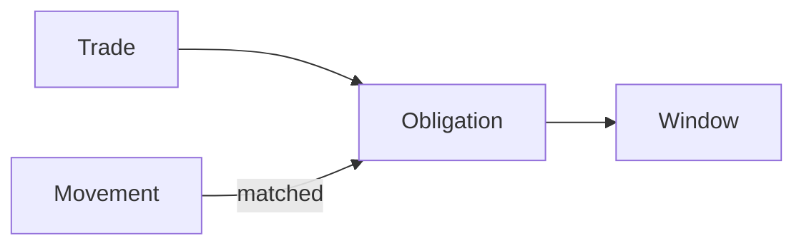

import CreditMonitor from '/snippets/samples/credit-monitor.mdx';
import CreditLedger from '/snippets/samples/credit-ledger.mdx';
import SettlementPlan from '/snippets/samples/settlement-plan.mdx';
import SettlementWindows from '/snippets/samples/settlement-windows.mdx';
import SettlementObligations from '/snippets/samples/settlement-obligations.mdx';
import SettlementMovements from '/snippets/samples/settlement-movements.mdx';
import TradeSettlement from '/snippets/samples/trade-settlement.mdx';
import CreditQuoteFunding from '/snippets/samples/credit-quote-funding.mdx';
import CreditQuoteRefusal from '/snippets/samples/credit-quote-refusal.mdx';
import CreditOrderWindow from '/snippets/samples/credit-order-window.mdx';
import CreditOrderRefusals from '/snippets/samples/credit-order-refusals.mdx';
import CreditTradeReadback from '/snippets/samples/credit-trade-readback.mdx';

Read the credit and settlement behind each venue account. On a credit account you trade first; what you and the liquidity provider (LP) owe is netted over a settlement window, then paid.

## At a glance

Paths are under `/api/v1/workspaces/{workspaceId}`.

| Read | Permission |
| --- | --- |
| Every trade: <span id="trade-history" /><span id="read-a-page" /><span id="read-one-trade" />[Trade history](/trade/trade-history) | Read trades |
| What is due, and how it settles: `GET …/settlement/plan`, `GET …/trades/{tradeId}/settlement`, `GET …/venue-accounts/{venueAccountId}/settlement/…` | Read settlements |
| Credit lines and positions: `GET …/venue-account-credit`, `…/venue-accounts/{venueAccountId}/credit`, `…/ledger` | Treasury read |
| Told instead of polling: `settlement.*`, `credit.updated` [webhooks](#webhooks) | Read settlements, Treasury read |



<AccordionGroup>
  <Accordion title="What each read needs">
    Your `workspaceId` comes from `GET /api/v1/me`; another answers `404 WORKSPACE_NOT_FOUND`. Take a `venueAccountId` from [`GET …/venue-enablements`](/trade/balances#list-your-exchange-accounts). Permissions are in [Permissions](/authentication#permissions) and [Before your first trade](/before-you-trade).

| Reads | Key permission; key owner's workspace permission |
| --- | --- |
| Settlement plan, trades, windows, obligations, movements, schedules | Read settlements (`settlements_read`); View settlements |
| `…/credit` | Treasury read; View wallets and View credit |
| `…/ledger` | Treasury read; View wallets |

  </Accordion>
</AccordionGroup>

## Settlement

No settlement read creates a transfer, reservation, approval or instruction to the LP.

<AccordionGroup>
  <Accordion title="Every settlement read">

| Read | You want to know |
| --- | --- |
| `GET …/workspaces/{workspaceId}/settlement/plan` | What is due across your venue accounts |
| `GET …/trades/{tradeId}/settlement` and `…/trades/{tradeId}/settlement/obligations` | How one trade settled |
| `GET …/venue-accounts/{venueAccountId}/settlement/windows`, `…/windows/{windowId}` and `…/windows/{windowId}/matches` | An account's settlement windows and statements |
| `GET …/venue-accounts/{venueAccountId}/settlement/obligations` and `…/obligations/{obligationId}` | What each side owes, and by when |
| `GET …/venue-accounts/{venueAccountId}/settlement/movements` and `…/movements/{movementId}` | The deposits and withdrawals that settled them |
| `GET …/venue-accounts/{venueAccountId}/settlement/schedules` (paged with `limit` and `cursor`) | The LP's published settlement schedules |
| `GET …/venue-accounts/{venueAccountId}/settlement/schedule-selection` | The schedule in effect, a pending change and the next window |
| `GET …/venue-account-credit` | Every venue account's credit, in one call |
| `GET …/venue-accounts/{venueAccountId}/credit` and `…/ledger` | The account's credit line and positions |

  </Accordion>
  <Accordion title="The settlement plan">
    `GET /api/v1/workspaces/{workspaceId}/settlement/plan` is a snapshot of what is due:

    - up to `horizonDays` ahead (1 to 90), as one snapshot that is never paged: a plan of more than 512 windows is refused whole with `422 SETTLEMENT_PLAN_TOO_LARGE`, so ask for a shorter horizon;
    - a summary per account, with its upcoming `windows`; `venueAccountId` narrows it to the accounts you name;
    - each window's `carries` (what was netted or carried forward into it, or out of it) and `minimumOutcome` (whether it is below the venue's minimum settlement, and so due or not);
    - an unknown deadline stays unknown, never a guess.

    `nextTransitionAt` is the earliest time the clock alone changes the plan, such as a deadline passing: read it again then instead of polling.

    A source that could not be read is listed in `failedReads`, with `complete: false`: the plan is partial, not "nothing due". An account whose settlement facts are not ready yet is its own entry, such as `SETTLEMENT_PROJECTION_PENDING` or `SETTLEMENT_PROJECTION_LAGGING` (the last good facts, a little behind); read again shortly.
  </Accordion>
  <Accordion title="One trade's settlement">
    - `GET …/trades/{tradeId}/settlement`: your side of the trade, with its lifecycle stages, transactions and the LP's response.
    - `…/settlement/obligations`: the obligations referencing it, each with venue account, window and state.

    Take `tradeId` from the [trade history](/trade/trade-history). The LP's view is a signed-in member read in the app.
  </Accordion>
  <Accordion title="Windows, obligations, movements and schedules">

| Object | What it is, and how to read it |
| --- | --- |
| Window | One settlement period. Once its snapshot is ready, it carries an indicative statement: positions, snapshot prices (an unavailable one names its stage and reason) and the minimum-settlement decision. An LP-issued window adds the LP's statement. Read newest first; filter by `status`, page with `cursor`. `…/windows/{windowId}/matches`: movements matched to its obligations, oldest first. |
| Obligation | What you and the LP owe each other, with status, deadline and origin. Filter by `windowId` or `tradeId`. The detail lists its matched movements. |
| Movement | A deposit or withdrawal that settles obligations, with its finality and how it matched, as recorded by TetraFi. `include=observation` says how current (`lastSuccessfulReadAt`, `observationState`), and an unread LP history is an `unreachable` entry. A key never starts a read from the LP. |
| Schedule | The LP's published schedules: the one in effect, with its minimum settlement, and the next window. |

  </Accordion>
</AccordionGroup>

### Follow what an account owes

A refused read answers with its code, never an empty page.

<Tabs>
  <Tab title="Plan">
    <SettlementPlan />
  </Tab>
  <Tab title="Windows">
    Filter by `status` and follow `nextCursor`; the SDK's `listSettlementWindowsAll` follows it for you.

    <SettlementWindows />
  </Tab>
  <Tab title="Obligations">
    <SettlementObligations />
  </Tab>
  <Tab title="Movements">
    <SettlementMovements />
  </Tab>
  <Tab title="One trade">
    <TradeSettlement />
  </Tab>
</Tabs>

<AccordionGroup>
  <Accordion title="Example output">

```json Example output
{"status":"incomplete","complete":false,"accounts":38,"windows":50,"failedReads":["SETTLEMENT_WALLET_NOT_LINKED"]}
{"windowId":"d3050000-…-f2","status":"ready","snapshotAt":"2026-10-31T00:00:00Z","paymentDeadlineAt":null,"dueState":"dueNow"}
{"windowId":"d3050000-…-f2","status":"ready","provenance":"indicative","prices":["available"],"minimum":"due"}
{"obligationId":"5b91bc49-…","payer":"workspace","asset":"USD","remainingAmount":"100000","dueAt":"2026-11-04T09:33:49.629345Z","status":"open","dueState":"dueNow"}
{"observation":{"observationState":"unavailable","reasonCode":"SETTLEMENT_MOVEMENTS_LP_UNAVAILABLE","lastSuccessfulReadAt":null},"unreachable":[{"source":"lpHistory","reason":"SETTLEMENT_MOVEMENTS_LP_UNAVAILABLE"}],"count":0}
{"tradeId":"d9200000-…-e1","obligations":[{"windowId":null,"obligationId":"d9200000-…-106","status":"lapsed"}]}
```

  </Accordion>
</AccordionGroup>

## Credit and the ledger

`…/credit` and `…/ledger` read the last recorded credit line and signed positions. An unreadable part is `unavailable` with its code, never zero.

<AccordionGroup>
  <Accordion title="What each read answers">

| Read | Answers, and how current |
| --- | --- |
| `GET …/venue-account-credit` | The same as the credit read, for every venue account (or those named in `venueAccountId`), with the ones that could not be read in `unreachable`. As current as the credit read. |
| `GET …/venue-accounts/{venueAccountId}/credit` | The provider's reported line (limit, used, available and overrun), the agreed facility, TetraFi's open credit commitments and the signed positions, each with its observation time. From the last recorded ledger observation; no provider call. |
| `GET …/venue-accounts/{venueAccountId}/ledger` | The signed positions and credit line. For a key, the last recorded observation (`source: "recorded"`), dated `observedAt`, `stale: true` past an hour. A key never starts a venue read. |

Readable positions still return when credit does not. A position with `prefundedOnly: true` is one the venue lets the account hold only long: selling more than its positive balance is refused whatever credit the account has, so deposit first. Without the field, the venue states no such rule.

  </Accordion>
</AccordionGroup>

### Monitor credit per account

`GET …/venue-account-credit` lists every venue account's credit; [`credit.updated`](#webhooks) tells you when it changes.

<CreditMonitor />

<Accordion title="Paging, unreadable accounts and observation.state">
  It lists newest account first; `venueAccountId` is comma-separated; page with `limit` and `cursor`. An account whose credit cannot be read is one `unreachable` entry (source `venueAccounts/<venueAccountId>`, reason its refusal code) while the others are listed.

  Each item is what `GET …/venue-accounts/{venueAccountId}/credit` answers for that account. `observation.state` says what the provider reported:

  - `reported`: `limit`, `used`, `available` and `overrun`, in `asset`, as of `observedAt`. `available` is negative when use exceeds the limit.
  - `notReported`: the provider does not report credit. An agreed facility in `facility` still applies.
  - `unavailable`: the report could not be read; `error` names why. There are no figures, never zeros.
</Accordion>

### Read the ledger

<CreditLedger />

<AccordionGroup>
  <Accordion title="Not observed yet, and example output">
    `409 LEDGER_NOT_OBSERVED`: no ledger read is recorded yet. A member opens the account in the app, which records one; then read again.

```json Example output
{"venueAccountId":"d3050000-…-a1","line":{"limit":"50000","used":"12000","available":"38000","overrun":"0","asset":"USD","observedAt":"2026-11-10T17:28:38.983588Z"},"facility":"observed","positions":[{"asset":"BTC","netPosition":"0.5"},{"asset":"USD","netPosition":"-12000"}],"readAt":"2026-11-12T12:32:19.066Z"}
{"venueAccountId":"d9200000-…-a1","line":{"status":"unavailable","code":"LEDGER_READ_UNAVAILABLE"},"facility":"observed","positions":{"state":"notStarted"},"readAt":"2026-11-12T12:32:32.758Z"}
{"source":"recorded","stale":true,"observedAt":"2026-11-10T17:28:38.983588Z","readAt":"2026-11-12T12:32:34.936Z","positions":[{"asset":"BTC","amount":"0.5"},{"asset":"USD","amount":"-12000"}]}
{"refused":{"status":409,"code":"LEDGER_NOT_OBSERVED","message":"Not observed yet: no ledger read is recorded for this account. A member opening it in Treasury records one."}}
```

  </Accordion>
</AccordionGroup>

## Trade on a credit account

Quote and order as on any venue account ([Orders](/trade/orders)); funding, the window and the refusals differ.

### Funding is derived, not chosen

The account's positions and credit decide, not you; each quote's `fundingModel` says which.

<CreditQuoteFunding />

<AccordionGroup>
  <Accordion title="Funding fields on the quote">

<ResponseField name="fundingModel" type="string">`prefunded`: paid from what the account holds. `credit`: the trade creates or increases a negative position. Treat a value you do not know as other ([Conventions](/reference/conventions#values)).</ResponseField>
<ResponseField name="creditPortion" type="object">On a `credit` trade, the part of the debit that goes negative, with its `amount` and `asset`. When it is less than the debit, the rest is spent from positive positions: the trade is mixed. Absent otherwise.</ResponseField>
<ResponseField name="creditCheck" type="object">The credit decision the funding came from: `decision`, `available`, `effectiveLimit`, `used`, and how fresh it is (`checkedAt`, `observationAgeMs` against `maxAgeMs`). Present exactly when `creditPortion` is. It is evidence, not a reservation.</ResponseField>
<ResponseField name="creditReservation" type="object">On a firm ask, the cash and credit held for this quote until `expiresAt` or until your order takes it.</ResponseField>
<ResponseField name="settlement.window" type="object">On a delayed trade, the window it settles in: `windowId`, `paymentDeadlineAt` and, on a clock window, `settlesBy`.</ResponseField>

  </Accordion>
  <Accordion title="A quote refused for credit: fix.kind">
    A card that cannot be ordered says why in `sourceRefusal`. On a credit account, `creditRefusal.fix` is the way forward:

| `fix.kind` | What to do |
| --- | --- |
| `reduceAmount` | Ask again for at most `maxAmount` of `asset`. |
| `reduceExposure` | The account is over its limit by `overBy` of `asset`. Only a trade that reduces what it owes passes. |
| `retryRead` | The credit figures could not be read fresh enough. Ask again. |

    Treat an unknown `kind` as "request a new quote".

    <CreditQuoteRefusal />
  </Accordion>
</AccordionGroup>

### Order with its settlement window

Your order consents to the quote's `settlement.window`: send its `windowId` as `settlementWindowId`, or leave it out to consent to the quote's own window.

<CreditOrderWindow />

<AccordionGroup>
  <Accordion title="The window changed first: 409 SETTLEMENT_WINDOW_CHANGED">
    If the window changes first, such as at a cut-off, the order is refused with `409 SETTLEMENT_WINDOW_CHANGED` and nothing is sent. Show `details.currentWindow` (the window now; `details.consentedWindow` is yours) to whoever decides, then send the same quote with `settlementWindowId` set to `details.currentWindow.windowId`.
  </Accordion>
  <Accordion title="Order refusals on a credit or prefunded account">
    Nothing was sent on any of these.

| Status and code | What to do |
| --- | --- |
| `409 CREDIT_LIMIT_BREACH` | The order needs more credit than is left. `details.creditRefusal.fix` says what passes (`reduceAmount` or `reduceExposure`). Request a new quote within it. |
| `503 CREDIT_READ_UNAVAILABLE` | Credit could not be read fresh enough to check the order. Retry shortly, with backoff. |
| `409 VENUE_PREFUNDED_BALANCE_INSUFFICIENT` | The account's free cash does not cover a prefunded trade. `details.maxAmount` is the largest debit that fits now, in `details.maxAmountAsset`. Request a new quote for at most that. |
| `422 LP_CREDIT_EXHAUSTED` | The liquidity provider has no credit left for this order. Lower the amount, or choose another quote. |
| `409 SETTLEMENT_WINDOW_CHANGED` | See above: consent to `details.currentWindow.windowId` and send again. |
| `422 SETTLEMENT_WINDOW_NOT_APPLICABLE` | You sent `settlementWindowId` on a quote that settles at once. Send the order without it. |
| `422 SETTLEMENT_WINDOW_NOT_CONSENTED` | The trade needed credit at the send, but its quote settled at once and carried no window to consent to. Request a new quote. |

The SDK reads the details for you: `creditRefusalOf(error)` returns `details.creditRefusal` on `CREDIT_LIMIT_BREACH` and `CREDIT_READ_UNAVAILABLE`, and `prefundedHeadroomOf(error)` returns `{ maxAmount, asset }` on `VENUE_PREFUNDED_BALANCE_INSUFFICIENT`. Both return `null` on any other code.

<CreditOrderRefusals />

  </Accordion>
</AccordionGroup>

### Read it back

After the fill, read the trade's settlement and the account's credit, which now includes it.

<CreditTradeReadback />

## Settlement actions are for members

A key never takes a settlement action. Signed-in members agree or dispute a statement, mark a bank payment sent and pay a window in the TetraFi app, with your workspace's approvals. A key or service-account token gets `403 JWT_REQUIRED`. The reads and webhooks here tell you when a member must act.

## Webhooks

Payloads carry ids, not statements: read the detail above. Delivery rules: [Webhooks](/trade/webhooks).

<Accordion title="Events, payloads and permissions">
  A key subscribing to a `settlement.*` event needs Read settlements, and to `credit.updated` needs Treasury read; otherwise it gets `403 INSUFFICIENT_SCOPE`.

| Event and `data.status` | Then read |
| --- | --- |
| [`settlement.window.ready`](/reference/webhook-events#settlement.window.ready): `ready` | The window, with its statement (`statementVersion`). |
| [`settlement.obligation.due`](/reference/webhook-events#settlement.obligation.due): `dueSoon` or `payableNow` | The obligation (`obligationId`). |
| [`settlement.obligation.overdue`](/reference/webhook-events#settlement.obligation.overdue): `overdue` | The obligation, then tell the member who pays. |
| [`settlement.payment.matched`](/reference/webhook-events#settlement.payment.matched): `paymentReceived`, `deliveryReceived` or `reversed` | The movement (`movementId`) and the window's matches. |
| [`credit.updated`](/reference/webhook-events#credit.updated): `agreedTermsChanged` or `lpReportedLimitChanged` | The account's credit (`termsVersion` is the new terms version). |

  Every settlement event's `data` carries `workspaceId`, `venueAccountId`, `windowId` and `status`, plus the ids above when they apply. `credit.updated` carries `workspaceId`, `venueAccountId`, `termsVersion` and `status`. New `status` values may appear: treat a value you do not know as other ([Conventions](/reference/conventions#values)).
</Accordion>

## Refusals

<AccordionGroup>
  <Accordion title="Settlement and credit">

| Status and code | What to do |
| --- | --- |
| `403 INSUFFICIENT_SCOPE` | The key lacks the scope the message names: `settlements_read` (Read settlements) or `treasury_read` (Treasury read). Use a key that holds it. |
| `403 JWT_REQUIRED` | A settlement action was called with a key. A [signed-in member](#settlement-actions-are-for-members) does it in the app. |
| `403 INSUFFICIENT_WORKSPACE_PERMISSION` | The key's owner lacks the [workspace permission](#at-a-glance). Ask a workspace admin. |
| `403 LEDGER_ACCOUNT_FORBIDDEN` | The same, on `…/ledger`. |
| `404 VENUE_ACCOUNT_NOT_FOUND` | No venue account with that id. |
| `404 WORKSPACE_NOT_FOUND` | The path's workspace is not your key's. |
| `409 LEDGER_NOT_OBSERVED` | No ledger observation yet. Read later, or open the account in the app, which reads the venue live. |
| `409 LEDGER_UNSUPPORTED` | The venue does not report a ledger. |
| `409 LEDGER_SETUP_MISSING` | No current key, or the connection needs setup. A member with Manage credentials adds or verifies the key; read again. |
| `409 VENUE_ACCOUNT_LEDGER_PENDING` | Setup unfinished. A member with Manage credentials finishes it (the `finishVenueAccountSetup` fix); read again. |
| `409 VENUE_ACCOUNT_FUNDS_IN_WALLETS` | A wallet-based venue keeps funds in linked wallets: read `GET …/balances`. |

  </Accordion>
</AccordionGroup>

Every other code is in [Error codes](/reference/error-codes).

Full script: [credit and settlement](https://github.com/TetraFi/docs/blob/main/samples/http/credit-settlement.sh).

## Next

<CardGroup cols={2}>
  <Card title="Balances and fees" icon="wallet" href="/trade/balances">What each account holds, and what you pay.</Card>
  <Card title="Order status" icon="signal" href="/trade/order-status">Follow one order.</Card>
</CardGroup>
