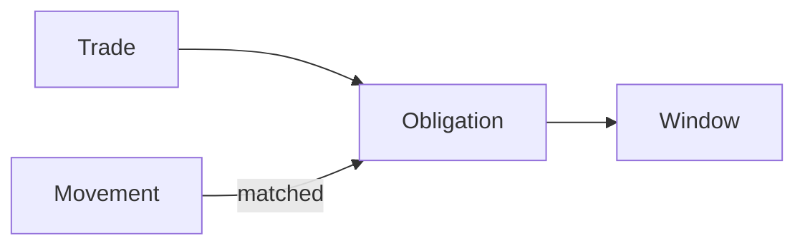

import TradesList from '/snippets/samples/trades-list.mdx';
import TradeDetail from '/snippets/samples/trade-detail.mdx';

Read every trade your workspace placed or made on an exchange account, how it settled, and the settlement cycle and credit behind each venue account.

## At a glance

Paths are under `/api/v1/workspaces/{workspaceId}`.

| Endpoint | Permission | Result |
| --- | --- | --- |
| `GET …/trades` | Read trades | Orders and exchange-account trades, newest first. |
| `GET …/trades/{tradeId}` | Read trades | One trade, with how it ended. |
| `GET …/trades/{tradeId}/settlement` and `…/settlement/obligations` | Read settlements | Your side of one trade's settlement. |
| `GET …/settlement/plan` | Read settlements | What is due across your venue accounts. |
| `GET …/venue-accounts/{venueAccountId}/settlement/…` | Read settlements | One account's movements, obligations, schedules, windows and matches. |
| `GET …/venue-accounts/{venueAccountId}/credit` and `…/ledger` | Treasury read | The account's credit line and positions. |



<AccordionGroup>
  <Accordion title="What each read needs">
    Your `workspaceId` comes from `GET /api/v1/me`; another answers `404 WORKSPACE_NOT_FOUND`. Take a `venueAccountId` from [`GET …/venue-enablements`](/trade/balances#list-your-exchange-accounts). Permissions are in [Permissions](/authentication#permissions) and [Before your first trade](/before-you-trade).

| Reads | Key permission | Key owner's workspace permission |
| --- | --- | --- |
| Trade history | Read trades | Not stated |
| Settlement plan, trades, windows, obligations, movements, schedules | Read settlements (`settlements_read`) | View settlements |
| `…/credit` | Treasury read | View wallets and View credit |
| `…/ledger` | Treasury read | View wallets |

  </Accordion>
</AccordionGroup>

<CardGroup cols={3}>
  <Card title="Trade history" icon="clock-rotate-left" href="#trade-history">Every trade, filtered and paged.</Card>
  <Card title="Settlement" icon="scale-balanced" href="#settlement">Windows, obligations and movements.</Card>
  <Card title="Credit" icon="credit-card" href="#credit-and-the-ledger">Credit line and positions.</Card>
</CardGroup>

## Trade history

`GET /api/v1/workspaces/{workspaceId}/trades` lists orders placed through the API or app and trades on your exchange accounts, newest first, for reconciliation and reporting. To follow one order, read its `statusUrl` ([Order status](/trade/order-status)).

### Read a page

Filter by `kind`, `status`, `from` and `to`; page with `cursor` until `nextCursor` is `null`.

<AccordionGroup>
  <Accordion title="Fields and parameters">

| Field | Meaning |
| --- | --- |
| `tradeId` | The trade's id. |
| `kind` | `order` (placed through TetraFi) or `venueTrade` (on your exchange account). Show an unknown kind generically. |
| `projection` | The view read through: `workspace` for an API key. |
| `createdAt` | When the trade was placed. |

The page also carries `total` (rows matching your filters), `limit` and `nextCursor`.

| Parameter | Use |
| --- | --- |
| `kind` | `all`, `order` or `venueTrade`. |
| `status` | Rows in this status. |
| `from`, `to` | RFC 3339 times: placed at or after, at or before. |
| `limit` | The page size, 25 by default. |
| `cursor` | The last `nextCursor`, same filters, until `null`. |
| `format=csv` | The same rows as CSV. |

  </Accordion>
  <Accordion title="Request and output">

<TradesList />

```json Output on test networks
{"total":628,"nextCursor":true,"coverage":null,"excludedKinds":null}
{"tradeId":"9410e38e-…","kind":"venueTrade","projection":"workspace","createdAt":"2026-11-02T01:36:46.856947Z"}
{"tradeId":"3ba8fe03…","kind":"order","projection":"workspace","createdAt":"2026-11-01T23:51:28Z"}
{"tradeId":"de0a1b4b-…","kind":"venueTrade","projection":"workspace","createdAt":"2026-11-01T22:55:48.448012Z"}
{"page":2,"rows":5}
```

  </Accordion>
  <Accordion title="The page is partial">
    - `coverage` lists each kind whose rows could not be read, with its `state`. The page is partial, not shorter: read again later; the missing rows are not absent.
    - `excludedKinds` lists each kind a filter or sort left out, with the `filter` it could not apply. Drop that filter to see it.
  </Accordion>
</AccordionGroup>

### Read one trade

`GET /api/v1/workspaces/{workspaceId}/trades/{tradeId}` reads one row with its detail; an order's `settlement.status` says how it ended.

<AccordionGroup>
  <Accordion title="Settlement fields, request and output">

| Field | Meaning |
| --- | --- |
| `settlement.status` | `pending`, `settled`, `failed`, `refunded` or `unknown`. Treat an unknown value as `unknown`. |
| `settlement.failureReason` | Why, when `status` is `failed` or `refunded`; else `null`. Show it to people; branch on `status`, never this text. |

<TradeDetail />

```json Output on test networks
{"tradeId":"673828c6…","kind":"order","settlement":{"status":"failed","failureReason":"…"}}
```

  </Accordion>
</AccordionGroup>

## Settlement

On some venue accounts, the liquidity provider (LP) and your workspace net what each owes over a settlement window, then settle the result. No read creates a transfer, reservation, approval or instruction to the LP.

<AccordionGroup>
  <Accordion title="Every settlement read">

| You want to know | Read |
| --- | --- |
| What is due across your venue accounts | `GET …/workspaces/{workspaceId}/settlement/plan` |
| How one trade settled | `GET …/trades/{tradeId}/settlement` and `…/trades/{tradeId}/settlement/obligations` |
| An account's settlement windows and statements | `GET …/venue-accounts/{venueAccountId}/settlement/windows`, `…/windows/{windowId}` and `…/windows/{windowId}/matches` |
| What each side owes, and by when | `GET …/venue-accounts/{venueAccountId}/settlement/obligations` and `…/obligations/{obligationId}` |
| The deposits and withdrawals that settled them | `GET …/venue-accounts/{venueAccountId}/settlement/movements` and `…/movements/{movementId}` |
| The LP's settlement schedule | `GET …/venue-accounts/{venueAccountId}/settlement/schedules` |
| The account's credit line and positions | `GET …/venue-accounts/{venueAccountId}/credit` and `…/ledger` |

  </Accordion>
  <Accordion title="The settlement plan">
    `GET /api/v1/workspaces/{workspaceId}/settlement/plan` is a snapshot of what is due:

    - up to `horizonDays` ahead, paged with `cursor` and `limit`;
    - a summary per account, with its upcoming `windows`;
    - an unknown deadline stays unknown, never a guess.

    A source that could not be read is listed in `failedReads`, with `complete: false`: the plan is partial, not "nothing due".
  </Accordion>
  <Accordion title="One trade's settlement">
    - `GET …/trades/{tradeId}/settlement`: your side of the trade, with its lifecycle stages, transactions and the LP's response.
    - `…/settlement/obligations`: the obligations referencing it, each with venue account, window and state.

    Take `tradeId` from the [trade history](#trade-history). The LP's view is a signed-in member read in the app.
  </Accordion>
  <Accordion title="Windows, obligations, movements and schedules">

| Object | What it is | How to read it |
| --- | --- | --- |
| Window | One settlement period. Once its snapshot is ready, it carries an indicative statement: positions, snapshot prices (an unavailable one names its stage and reason) and the minimum-settlement decision. An LP-issued window adds the LP's statement. | Newest first; filter by `state`, page with `cursor`. `…/windows/{windowId}/matches`: movements matched to its obligations, oldest first. |
| Obligation | What you and the LP owe each other, with status, deadline and origin. | Filter by `windowId` or `tradeId`. The detail lists its matched movements. |
| Movement | A deposit or withdrawal that settles obligations, with its finality and how it matched. | As recorded by TetraFi; `lastSuccessfulReadAt` and `observationState` say how current. A key never starts a read from the LP. |
| Schedule | The LP's published schedules. | The one in effect, with its minimum settlement, and the next window. |

  </Accordion>
</AccordionGroup>

## Credit and the ledger

`…/credit` and `…/ledger` read the account's credit line and signed positions from the last recorded observation. An unreadable component is `unavailable` with its code, never zero; readable positions still return when credit does not.

<AccordionGroup>
  <Accordion title="What each read answers">

| Read | Answers | How current |
| --- | --- | --- |
| `GET …/venue-accounts/{venueAccountId}/credit` | The provider's reported line (limit, used, available and overrun), the agreed facility, TetraFi's open credit commitments and the signed positions, each with its observation time. | The last recorded ledger observation; no provider call. |
| `GET …/venue-accounts/{venueAccountId}/ledger` | The signed positions and credit line. | For a key, the last recorded observation (`source: "recorded"`), dated `observedAt`, `stale: true` past an hour. A key never starts a venue read. |

  </Accordion>
</AccordionGroup>

## Refusals

<AccordionGroup>
  <Accordion title="Trade history">

| Code | Status | What to do |
| --- | --- | --- |
| `INVALID_REQUEST` | 400 | An unknown parameter or value, or an unappliable filter. The answer names the parameter. |
| `WORKSPACE_NOT_FOUND` | 404 | The path's workspace is not your key's. |
| `TRADE_PROJECTION_UNAVAILABLE` | 503 | Trade history is unreadable on this deployment right now. Retry later. |

A `404` on one trade means the `tradeId` is unknown, or belongs to another workspace.

  </Accordion>
  <Accordion title="Settlement and credit">

| Code | Status | What to do |
| --- | --- | --- |
| `INSUFFICIENT_WORKSPACE_PERMISSION` | 403 | The key's owner lacks the [workspace permission](#at-a-glance). Ask a workspace admin. |
| `LEDGER_ACCOUNT_FORBIDDEN` | 403 | The same, on `…/ledger`. |
| `VENUE_ACCOUNT_NOT_FOUND` | 404 | No venue account with that id. |
| `LEDGER_NOT_OBSERVED` | 409 | No ledger observation yet. Read later, or open the account in the app, which reads the venue live. |
| `LEDGER_UNSUPPORTED` | 409 | The venue does not report a ledger. |
| `LEDGER_SETUP_MISSING` | 409 | No current key, or the connection needs setup. A member with Manage credentials adds or verifies the key; read again. |
| `VENUE_ACCOUNT_LEDGER_PENDING` | 409 | Setup unfinished. A member with Manage credentials finishes it (the `finishVenueAccountSetup` fix); read again. |
| `VENUE_ACCOUNT_FUNDS_IN_WALLETS` | 409 | A wallet-based venue keeps funds in linked wallets: read `GET …/balances`. |
| `WORKSPACE_NOT_FOUND` | 404 | The path's workspace is not your key's. |

  
</Accordion>
</AccordionGroup>

Every other code is in [Error codes](/reference/error-codes).

<Card title="Run the full script" icon="terminal" href="https://github.com/TetraFi/docs/blob/main/samples/http/trades.sh">Pages your trade history and reads one trade.</Card>

## Next

<CardGroup cols={2}>
  <Card title="Balances and fees" icon="wallet" href="/trade/balances">What each account holds, and what you pay.</Card>
  <Card title="Order status" icon="signal" href="/trade/order-status">Follow one order.</Card>
</CardGroup>
