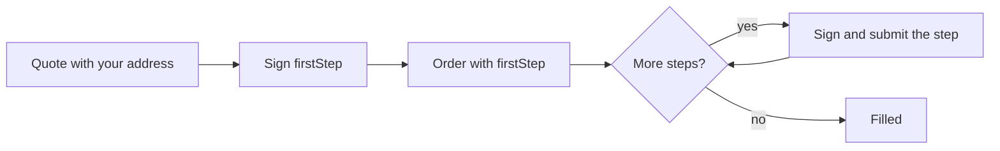

<Info>
**Rolling out.** This flow is not live yet. The shapes on this page are the contract we are building to; field names can still change before it opens. Today, a key trades on-chain from organisation wallets granted to it, which TetraFi signs for ([Choose wallets and accounts](/trade/wallets-and-accounts)).
</Info>

Name your wallet's address in the quote request, sign the step each on-chain quote carries, and send it with your order. You pay your own gas, and TetraFi never holds a key or a signing grant for the wallet.

## At a glance

| Step | Call | What you get |
| --- | --- | --- |
| Quote for your wallet | `POST /api/v1/quotes` with `source.tradingWallets` | On-chain quotes with `signing.firstStep` |
| Order with step 1 signed | `POST /api/v1/orders` with `firstStep` | The order; it opens and executes step 1 in one call |
| Sign a later step, if any | `POST /api/v1/orders/{orderId}/steps/{stepId}` | The order again |
| Follow | `GET /api/v1/orders/{orderId}` or [webhooks](/trade/webhooks) | `terminal: true` |



| Trade | Calls |
| --- | --- |
| The venue already has your token allowance | 2: quote, order |
| First trade on a token: an approval, then the trade | 3 |

You need a key with venue trading and request signing ([Authentication](/authentication#trade-on-your-venue-accounts)). The key needs no organisation-wallet grant, and the wallet does not have to be registered first.

## Trade from your wallet

<Steps>
  <Step title="Quote with your address">
    Send your wallet's address as the value for its network in `source.tradingWallets`. Exchange and OTC venues quote as usual; each on-chain quote is firm for that address and carries the first step to sign.

    ```json Request (shortened)
    {"kind":"pair","sell":{"asset":"USDC","network":"eip155:8453"},"buy":{"asset":"USDC","network":"eip155:1"},"sellAmount":"100",
     "source":{"tradingWallets":{"eip155:8453":"0xAbc…"}}}
    ```

    ```json Output shape on each on-chain quote (shortened) expandable
    "signing": {
      "mode": "you",
      "address": "0xAbc…",
      "firstStep": {
        "stepId": "3f2b9c1e-8d4a-4c7e-9b1f-…",
        "sequence": 1,
        "purpose": "approval",
        "type": "transaction",
        "network": "eip155:8453",
        "from": "0xAbc…",
        "signBy": "2026-11-18T12:00:45Z",
        "transaction": {"to": "0x…", "data": "0x…", "value": "0", "nonce": 17}
      }
    }
    ```
  </Step>
  <Step title="Sign the step">
    Sign `transaction` with your wallet on the chain of the step's `network` (`eip155:8453` is chain 8453), keeping its `nonce`. Gas and fees are yours to set. A step of `type` `typedData` carries an EIP-712 message to sign instead.
  </Step>
  <Step title="Order with it">
    `POST /api/v1/orders` with an `Idempotency-Key`. TetraFi checks the signed step against the one it issued, relays it and follows it on-chain.

    ```json Request
    {"quoteId":"q_01M5…","firstStep":{"stepId":"3f2b9c1e-8d4a-4c7e-9b1f-…","kind":"signedTransaction","raw":"0x02f8…"}}
    ```
  </Step>
  <Step title="Sign any later step">
    While the order's `next.kind` is `sign`, sign `next.step` and send it to `POST /api/v1/orders/{orderId}/steps/{stepId}` with the same body shape. Then follow the order until `terminal` is `true` ([Order status](/trade/order-status)).
  </Step>
</Steps>

<AccordionGroup>
  <Accordion title="Ways to submit a step">

| `kind` | Send | What TetraFi does |
| --- | --- | --- |
| `signedTransaction` | `raw` | Checks it against the step, then relays it. |
| `transactionHash` | `txHash` | You broadcast it yourself; TetraFi checks it on-chain. |
| `signature` | `signature` | For a `typedData` step: checks it, then passes it to the venue. |
| `declined` | nothing | On the step endpoint only: ends the order `unfilled`, nothing sent. |

  </Accordion>
  <Accordion title="What a step can be">
    `type` is `transaction` or `typedData`; `purpose` is `approval`, `trade`, `revoke`, `acceptance` or `funding`. Both lists can grow: do not sign a `type` you do not know, and keep following the order.
  </Accordion>
  <Accordion title="Who signs">
    `signing.mode` is `you` for an address TetraFi cannot sign for, and `tetrafi` for an organisation wallet granted to your key. Send `source.signer: "you"` to sign yourself for a wallet TetraFi could sign. The list of modes can grow.
  </Accordion>
  <Accordion title="Your wallet in TetraFi">
    The address is screened before anything is relayed. Your first checked signature proves the wallet is yours: it then appears in Treasury as an external wallet, and an Owner can remove it. The output goes to the signing wallet unless `deliverTo` names another wallet of your workspace.
  </Accordion>
  <Accordion title="When the chain moved">
    If your wallet's nonce, allowance or balance changed between the quote and the order, or the `minReceive` you send changes the trade's transaction, nothing is relayed: the order opens and `next` carries a fresh first step to sign.
  </Accordion>
  <Accordion title="How it ends">

| What happened | How the order reads |
| --- | --- |
| A later step was not signed by `signBy` | `unfilled`, `outcomeCode: not_sent`. A mined approval stays. |
| A step's transaction reverted | `unfilled` or `failed`, with the reason. |
| Another transaction used the step's nonce | `unfilled`, `outcomeCode: nonce_used_elsewhere`. |

  </Accordion>
  <Accordion title="Refusals">
    Nothing was relayed on any of these: `SIGNING_STEP_REQUIRED` (422, an order on a `you` quote without `firstStep`), `SIGNING_STEP_MISMATCH` (422, the signed step differs; `details.field` says where), `SIGNING_STEP_NOT_OPEN` (409), `SIGNING_STEP_EXPIRED` (410), `SIGNING_TRANSACTION_NOT_FOUND` (409, retry shortly) and `SIGNING_WALLET_REFUSED` (403).
  </Accordion>
  <Accordion title="Venues and networks at opening">
    Uniswap, Across, Relay, Circle CCTP and Multiliquid on EVM networks. More venues, Solana and Tron follow as new step types.
  </Accordion>
  <Accordion title="What comes next">
    Planned, and not available yet:

    - **People approve one trade.** `signing.mode` `owners` (your wallet's owners approve the trade) and `custodian` (your custodian's own approvers do). The order's `next.kind` is then `approve`, with an `approvalUrl` where they approve it: the same pattern [wallet creation](/trade/wallets-and-accounts#create-a-wallet) uses.
    - **Solana and Tron**, as new step `type` values.
    - **Bebop and StableFX** from your own wallet. StableFX takes two signed messages and its quote lasts about 4 seconds, so only an automated signer keeps up.
    - **Custody wallets that TetraFi signs for**, as `signing.mode` `tetrafi`.

    Build for them now: ignore a `signing.mode`, step `type`, `purpose`, submission `kind` or `next.kind` you do not know, never sign a step `type` you do not know, and keep following the order until `terminal` is `true`.
  </Accordion>
</AccordionGroup>

## Next

<CardGroup cols={2}>
  <Card title="Choose wallets and accounts" icon="wallet" href="/trade/wallets-and-accounts">Every source a quote can trade from.</Card>
  <Card title="Order status" icon="list-check" href="/trade/order-status">Follow the order to the end.</Card>
  <Card title="Recipe: move stablecoins from your own wallet" icon="terminal" href="/recipes/own-wallet-trade">An approval, then a bridge deposit, signed with a local key.</Card>
  <Card title="How a trade runs" icon="route" href="/trade/how-a-trade-runs">Every way a trade is funded, signed and settled.</Card>
</CardGroup>
