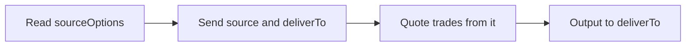

import TradingSourceOptions from '/snippets/samples/trading-source-options.mdx';
import TradingSourceRequest from '/snippets/samples/trading-source-request.mdx';
import TradingSourceRefusal from '/snippets/samples/trading-source-refusal.mdx';
import TradingSourceFunding from '/snippets/samples/trading-source-funding.mdx';
import WalletsDeliverTo from '/snippets/samples/wallets-deliver-to.mdx';

Every quote says where it trades from, how it is funded and settles, and where the output goes; to change your defaults, send `source` and `deliverTo` with `financialAccountId` values from `sourceOptions`.

## At a glance

| You want to | Send or read |
| --- | --- |
| See what a quote trades from | `tradingSource`, `fundingModel`, `deliverTo` on every quote |
| See what you may name | `sourceOptions` |
| Trade from a wallet or account | `source` on `POST /api/v1/quotes` |
| Send the output elsewhere | `deliverTo` on `POST /api/v1/quotes` |
| Change a held quote | A [requote](/search/firmness-and-lifetime#requote-a-quote) with only those parts |



You need:

- nothing, to get a quote: venues price with your defaults;
- organisation wallets granted to the key, to trade from them ([Give a key organisation wallets](/before-you-trade#give-a-key-organisation-wallets)).

A key can use your company's self-managed and custodian wallets and the organisation wallets granted to it, never a personal wallet.

## What a quote trades from

Read `tradingSource`, `fundingModel` and `deliverTo` on every quote: two quotes from one venue can trade from different sources. Each part you leave out comes from your defaults.

<AccordionGroup>
  <Accordion title="Quote fields: tradingSource, fundingModel, settlement and more">

| Field | What it says |
| --- | --- |
| `tradingSource` | Where it executes from: `{"kind": "wallet", "financialAccountId", "network", "venueEnablementId"}` for an on-chain venue, or `{"kind": "venueAccount", "financialAccountId", "venueEnablementId"}` for an exchange or OTC account. |
| `fundingModel` | `prefunded` (spends money in the trading source) or `payIn` (you pay in after ordering, on the `payIn` terms). |
| `fundingAccount` | The account backing execution; `kind` is `wallet`, `venueAccount` or `bankAccount`. `linkId` only when money moves through that link. |
| `settlement` | `method` (`venueLedger`, `dvp` or `fop`) and `timing` (`immediate`, `byDeadline` or `cycle`). |
| `deliverTo` | Where the output goes, resolved, with a `displayName`. |
| `walletSelection` | Per chain, why the wallet was chosen: `accountDefault`, `preference` or `explicit`. A record, never authority. |
| `sourceRefusal` | Present when no source you may use can execute the quote, and says why: `code` (why), `venueId` and `fix` (the next step). |

  </Accordion>
  <Accordion title="Your defaults">
    Each part you leave out comes from the first of:

    1. What the request names.
    2. The venue account's default organisation wallet, for on-chain venues trading through it.
    3. The key's own defaults.
    4. The workspace's defaults.

    The workspace's default organisation wallet is the first one created or linked in it. Saved defaults are always organisation wallets ([Wallets and signing](/core-concepts/wallets-and-signing)).
  </Accordion>
  <Accordion title="Example: read the source and funding of a quote">
    <TradingSourceFunding />

    ```json Output shape with a granted wallet (ids shortened)
    {"quoteId":"q_01M5…","venue":"across","location":"crossChain","tradingSource":{"kind":"wallet","financialAccountId":"4d46…","network":"eip155:84532"},"fundingModel":"prefunded","fundingAccount":{"kind":"wallet","financialAccountId":"4d46…"},"buy":"9.98","next":"order"}
    ```
  </Accordion>
</AccordionGroup>

## Read sourceOptions

`sourceOptions`, on every quote set and quote, lists what you may name. Each candidate has `financialAccountId`, `kind`, `displayName` and `isDefault`; an empty list means nothing else to choose.

<AccordionGroup>
  <Accordion title="Kinds and candidate fields">

| `kind` | Lists |
| --- | --- |
| `wallet` | Trading wallets of one `family` (`evm`, `solana` or `tron`) for `chain`. |
| `venueAccount` | The venue's account; a workspace has one per venue. |
| `fundingAccount` | Accounts that can fund it, such as a bank account for a pay-in. |
| `deliverTo` | Where the output can go. |

- a wallet also has `address` and `network`;
- `balance`, when present, is the sold asset held (`"kind": "known"`) or `"kind": "unavailable"`, never a made-up 0.

</Accordion>
  <Accordion title="Example: read sourceOptions">
    <TradingSourceOptions />

    ```json Output shape with a granted wallet (ids shortened)
    {"sourceOptions":[{"kind":"wallet","chain":"eip155:84532","candidates":[{"financialAccountId":"4d46…","kind":"wallet","displayName":"Treasury (Base Sepolia)","isDefault":true},{"financialAccountId":"61c3…","kind":"wallet","displayName":"Payments (Base Sepolia)","isDefault":false}]}]}
    ```
  </Accordion>
  <Accordion title="With no wallet granted">
    The list is empty and on-chain venues read `unavailable` with `apiKeyOrganisationWalletScopeRequired`, or `onchainWalletNotUsable` when the venue account's saved wallet is not visible to the key:

    ```json Output on test networks, no wallet granted (shortened) expandable
    {"sourceOptions":[]}
    [{"venue":"circle-cctp","status":"unavailable","reason":"onchainWalletNotUsable","detail":"Your saved wallet is not visible or usable for this API key on Base Sepolia, so it was not asked. …"}]
    {"tradingWallets":{},"quoted":false}
    ```
  </Accordion>
</AccordionGroup>

## Choose with source

Each part is optional; a part you leave out takes your default.

<Tabs>
  <Tab title="Organisation wallet">

| Field | What it names |
| --- | --- |
| `source.tradingWallets` | The trading wallet per CAIP-2 chain id: `eip155:<id>` (EVM), `solana:<genesis hash>` or `tron:<network>`, such as `tron:shasta`. |

<Accordion title="preferredWallets: a preference, not a choice">
  `preferredWallets` is keyed the same, but only a preference: used only when it is one of the venue account's linked wallets on that network, never a reason to refuse. `source.tradingWallets` wins on its chain.
</Accordion>

<TradingSourceRequest />

```json Request sent (shortened) expandable
{"kind":"pair","sell":{"asset":"USDC","chain":"eip155:84532"},"buy":{"asset":"USDC","chain":"eip155:11155111"},"sellAmount":"10","source":{"tradingWallets":{"eip155:84532":"4d46…","eip155:11155111":"9b07…"}}}
```

  </Tab>
  <Tab title="Venue account">

| Field | What it names |
| --- | --- |
| `source.venueAccountId` | The venue account the quote trades on. |
| `source.fundingAccountId` | The funding account, such as a pay-in's bank account. |

With an API key, a venue quote's output stays on the venue account ([Where the output goes](#where-the-output-goes)).

  </Tab>
</Tabs>

### When a source is refused

A wallet or account you may not use is refused before any venue is asked. A wallet a venue account has not linked is not a refusal: that venue reads `unavailable` with `tradingSourceNotLinked`.

<AccordionGroup>
  <Accordion title="Source refusal codes">

When one venue reads `tradingSourceNotLinked`, the others still quote.

| Status and code | Meaning | What to do |
| --- | --- | --- |
| `403 SOURCE_NOT_OWNED` | A wallet or account in `source` or `deliverTo` does not exist or is not yours to use (both read the same). | Choose from `sourceOptions`, or have the wallet granted to the key. |
| `400 WALLET_NOT_ON_CHAIN` | The wallet is registered on another chain. | Choose a candidate listed for that chain. |
| `409 PERSONAL_TARGET_NOT_ALLOWED` | An API key named a personal wallet. | Use an organisation wallet. |
| `403 ACCOUNT_NOT_AVAILABLE` | This quote cannot trade on that venue account. | Leave `venueAccountId` out. |
| `409 REQUOTE_NEEDS_WALLET` | The venue quotes only once a wallet is chosen; `details.reason` names the family. | Requote with a wallet of that family. |

  </Accordion>
  <Accordion title="Example: a refused source">
    <TradingSourceRefusal />

    ```json Output shape of a refusal (shortened)
    {"refused":"SOURCE_NOT_OWNED","message":"A source names a wallet or account this caller cannot use.","next":null}
    ```
  </Accordion>
</AccordionGroup>

## Where the output goes

`deliverTo` is a top-level request field:

| `kind` | Fields | Meaning |
| --- | --- | --- |
| `financialAccount` | `financialAccountId` | Your wallet, venue account or bank account. |
| `address` | `chain`, `address`, `destinationTag` (optional), `calldata` (optional) | This address on this chain. `destinationTag` is its tag or memo; none is sent without it. |

<AccordionGroup>
  <Accordion title="Limits with an API key">
    - An address outside the workspace's organisation wallets is refused with `403 API_KEY_ORGANISATION_WALLET_NOT_ALLOWLISTED`; a key cannot allowlist one, so manage destinations in the app.
    - A venue quote's output stays on the venue account: a requote naming another destination is refused with reason `deliverToNotPermitted`. Only a signed-in member who can view wallets delivers a venue trade to a wallet.
  </Accordion>
  <Accordion title="A venue trade delivered to a wallet">
    When a member does, TetraFi withdraws the output once the order fills. The wallet must be an approved withdrawal destination of that account for the bought asset, with the same tag, and the quote carries the venue's withdrawal fee as a network fee line.

    A venue that cannot deliver there reads `unavailable` with the reason; a requote is refused with `409 REQUOTE_REFUSED` and `details.reason`: `DESTINATION_NOT_APPROVED`, `DELIVER_TO_NOT_A_WORKSPACE_WALLET`, `WITHDRAWAL_CHAIN_UNSUPPORTED`, `DELIVER_TO_AMBIGUOUS`, `WITHDRAWAL_FEE_EXCEEDS_AMOUNT`, `deliverToCalldataUnsupported` or `deliverToNotPermitted`.
  </Accordion>
  <Accordion title="Example: requote an off-chain quote to a trading wallet">
    Requote an off-chain quote to a trading wallet you read:

    <WalletsDeliverTo />

    ```json Output when no off-chain quote came back
    {"deliverTo":"no off-chain quote to try"}
    ```
  </Accordion>
  <Accordion title="Change a held quote's source or destination">
    [Requote it](/search/firmness-and-lifetime#requote-a-quote) with only those parts:

    ```json Request
    { "kind": "requote", "requote": "q_01M5…", "source": { "tradingWallets": { "eip155:84532": "61c3…" } } }
    ```
  </Accordion>
</AccordionGroup>

## When a quote needs a wallet

<AccordionGroup>
  <Accordion title="next is requote with needs">
    `next` is `{"kind": "requote", "needs": [...]}`. Each entry is a slot to fill: `wallet:evm`, `wallet:solana`, `wallet:tron`, `account`, `bankAccount` or `deliverTo`. Requote with `source` or `deliverTo` filling them, from `sourceOptions`; an empty list means requote as it is.
  </Accordion>
  <Accordion title="A source reads needsWallet">
    No wallet of that `family` was available. Name one in `source.tradingWallets`, or set a default for the family.
  </Accordion>
  <Accordion title="A source reads walletRefused">
    The wallet in `wallet` cannot trade there, for example because it was revoked or matched a sanctions screen. When it is an organisation wallet not linked to the venue account, `recovery` carries a `linkHref` to link it and the account's `defaultWallets`, which you can send in `source.tradingWallets` instead.
  </Accordion>
</AccordionGroup>

<Card title="Run the full script" icon="terminal" href="https://github.com/TetraFi/docs/blob/main/samples/http/wallets.sh">Reads the wallets a key may name, quotes with one per chain and places no order.</Card>

## Next

<CardGroup cols={2}>
  <Card title="Requotes and expiry" icon="rotate" href="/search/firmness-and-lifetime#requote-a-quote">Change a held quote.</Card>
  <Card title="Place an order" icon="cart-shopping" href="/trade/orders">Order your quote.</Card>
</CardGroup>
