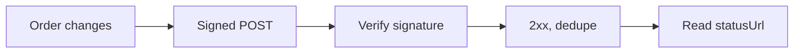

import WebhookVerify from '/snippets/samples/webhook-verify.mdx';

Register an HTTPS endpoint and TetraFi posts an `order.updated` event each time one of your orders changes status, signed to the [Standard Webhooks](https://www.standardwebhooks.com) spec.

## At a glance

Paths are under `/api/v1/workspaces/{workspaceId}`.

| Endpoint | Permission | Result |
| --- | --- | --- |
| `POST …/webhooks` | Manage webhooks (`webhooks_manage`) | `201` with `webhook`, `secret` and `secretShownOnce`. |
| `…/webhooks/{webhookId}` and its sub-paths | Manage webhooks | Test, rotate, redeliver, resume, read, change, remove. |
| `statusUrl` from an event | Read orders | The order's current state. |



<AccordionGroup>
  <Accordion title="What the key needs">
    - Manage webhooks (`webhooks_manage`) on the key, and the owner's workspace permission to manage webhooks ([Permissions](/authentication#permissions)).
    - For `order.updated`, an endpoint owner who can read the orders: events it cannot read are withheld.
    - Read orders, to follow an event's `statusUrl`.

    Calls send `X-API-Key`; a signing key [signs](/authentication#sign-requests) with `X-Timestamp`, `X-Signature` and, on writes, a fresh `X-Nonce`. `{workspaceId}` is your key's workspace. Other events are in the [event catalogue](/reference/webhook-events).
  </Accordion>
</AccordionGroup>

## Set up an endpoint

<Steps>
  <Step title="Create it">
    `POST /api/v1/workspaces/{workspaceId}/webhooks` with an `Idempotency-Key` and `{"url": "https://…", "events": ["order.updated"]}`. Store the `whsec_` secret at once: a replay within 24 hours returns `201` with `secret: null`.

    <Accordion title="Lost the secret?">
      [Rotate it](#manage-an-endpoint). It is not your request-signing secret.
    </Accordion>
  </Step>
  <Step title="Verify every delivery">
    Check the HMAC-SHA256 signature over the exact bytes received, before parsing, and refuse a `webhook-timestamp` over five minutes from your clock. A [Standard Webhooks library](https://github.com/standard-webhooks/standard-webhooks), such as `standardwebhooks` on npm or PyPI, does it for you.

    <Accordion title="How to verify by hand, with samples">
      The signature is HMAC-SHA256 over `<webhook-id>.<webhook-timestamp>.<raw body>`, keyed with the base64-decoded secret after `whsec_`.

      - Compute it over the exact bytes received, before parsing.
      - Compare in constant time; accept when any one `v1,` value matches.
      - Refuse a `webhook-timestamp` over five minutes from your clock.

      Each sample checks the Standard Webhooks example delivery:

      <WebhookVerify />

      ```json Output
      {"valid":"accepted","changedBody":"refused","staleTimestamp":"refused"}
      ```
    </Accordion>
  </Step>
  <Step title="Acknowledge, then handle each event once">
    Answer any `2xx` within 10 seconds, once verified and stored; work afterwards. Deduplicate on `webhook-id` and read `statusUrl` for the current status.

    <Accordion title="Ordering and duplicates">
      Deliveries arrive at least once, possibly out of order:

      - deduplicate on `webhook-id`; the body's `id` identifies the same event across deliveries;
      - read `statusUrl` for the current status, not the arrival order.

      Anything but a `2xx` is [retried](#retries-pauses-and-missed-events).
    </Accordion>
  </Step>
</Steps>

## What a delivery looks like

A `POST` with a JSON body and the `webhook-id`, `webhook-timestamp` and `webhook-signature` headers. The event only says an order changed: read `statusUrl` for the full state.

<AccordionGroup>
  <Accordion title="Headers and body">

| Header | What it carries |
| --- | --- |
| `webhook-id` | The delivery's id, the same on its retries. |
| `webhook-timestamp` | When it was signed, in Unix seconds. |
| `webhook-signature` | `v1,` and the base64 signature; two space-separated values during a secret rotation. |

```json Output shape
{
  "id": "…",
  "type": "order.updated",
  "apiVersion": "2026-10-29",
  "createdAt": "2026-10-30T09:12:44.000Z",
  "data": { "orderId": "…", "status": "…", "statusUrl": "/api/v1/orders/…" }
}
```

Answer unknown fields and event types with a `2xx` and ignore them; a breaking change ships under a different `apiVersion`.

  </Accordion>
</AccordionGroup>

## Manage an endpoint

Other paths are under `/api/v1/workspaces/{workspaceId}/webhooks/{webhookId}`. Every `POST` from an API key or OAuth client takes an `Idempotency-Key`: a new key for each action you intend, and the same key and body when you retry one whose answer you did not get, which returns the first answer instead of acting twice. A `PATCH` sends `If-Match` with the strong `ETag` from `GET` on the endpoint; without it the update is refused with `428 WEBHOOK_VERSION_REQUIRED`, and after a `412` read the endpoint again and review what changed before you update it. In the app: Integrations → Webhooks, for a member with Manage webhooks.

| Operation | Call |
| --- | --- |
| List | `GET /api/v1/workspaces/{workspaceId}/webhooks` |
| Get, update, delete | `GET`, `PATCH` (with `If-Match`), `DELETE` on the endpoint |
| Deliveries | `GET …/deliveries` |
| Test | `POST …/deliveries` with `{"kind":"test"}` |
| Retry | `POST …/deliveries/{deliveryId}/retry` |
| Resume | `POST …/resume` |
| Rotate the secret | `POST …/rotate` |

<AccordionGroup>
  <Accordion title="What each call answers">

| Operation | Answer |
| --- | --- |
| Test | `201` with a delivery record; your endpoint receives `webhook.test`. The `201` is not your receiver's acknowledgement: check `success`, `statusCode` and `errorMessage`. |
| Rotate the secret | `200` with the new `secret`; a replay of the same key returns `secret: null`. For 24 hours, deliveries carry both secrets' signatures, so either verifies while you deploy. |
| List deliveries | `items`, `totalCount`, `nextCursor` and `retention`. Each delivery has `success`, `errorMessage` and `redeliverAvailable`. |
| Redeliver | `200` with a delivery record: check its `success`. Resends the retained payload to the current URL, signed with the current secret. Your receiver gets the event again; it keeps its body `id`, so [deduplicate](#set-up-an-endpoint) as for any delivery. A retry with the same `Idempotency-Key` and body returns the first redelivery instead of sending another. |
| Resume | Reactivates a paused endpoint. Then redeliver what it missed. |

  </Accordion>
</AccordionGroup>

## Retries, pauses and missed events

An unacknowledged delivery is retried after 5 seconds, 30 seconds, 10 minutes, 1 hour, 6 hours and 24 hours. After five deliveries in a row fail every retry, the endpoint is paused: fix it, call `POST …/resume`, then redeliver the failures.

<AccordionGroup>
  <Accordion title="The delivery log and redelivery codes">
    The delivery log is bounded (see `retention`), never a complete history, and does not survive a TetraFi server restart; nothing replays every event since a time. When a delivery is gone, read the order's current state.

| Code | Meaning |
| --- | --- |
| `404 WEBHOOK_DELIVERY_NOT_FOUND` | The delivery id is not in this endpoint's log. |
| `409 WEBHOOK_REDELIVERY_REFUSED` | Not resendable now, such as while paused or an attempt is pending. |
| `409 WEBHOOK_REDELIVERY_NOT_AVAILABLE` | Withheld for lack of read access; never resent. Restore access for later events. |

  </Accordion>
</AccordionGroup>

<Card title="Run the full script" icon="terminal" href="https://github.com/TetraFi/docs/blob/main/samples/http/webhook-verify.sh">Verifies a delivery, and refuses a changed body and a stale timestamp.</Card>

## Next

<CardGroup cols={2}>
  <Card title="Order status" icon="signal" href="/trade/order-status">The state behind an event.</Card>
  <Card title="Webhook events" icon="list" href="/reference/webhook-events">Every event type.</Card>
</CardGroup>
